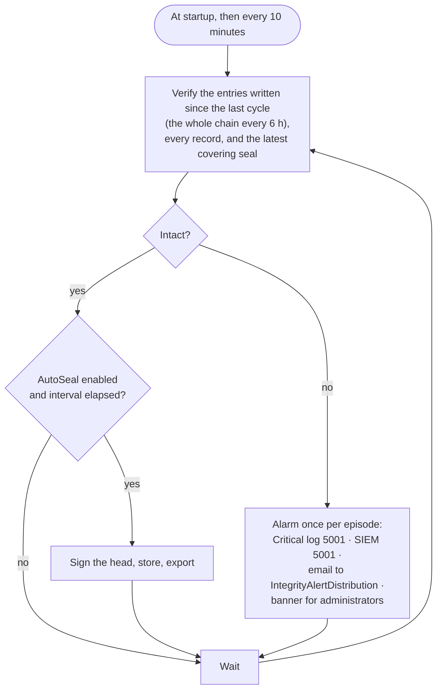

# Tamper evidence (the integrity spine)

CaseBook's record is meant to be evidence. This page explains how a change becomes provably part of the record,
how tampering is detected, and what is deliberately outside that protection. Why it's built this way:
[decision 0002](../decisions/0002-integrity-spine.md).

| Layer | Mechanism | Detects | Code |
|---|---|---|---|
| Row hash | SHA-256 of each record's canonical fields, stored in `RowHash` | A field edited without going through the app | `IHashableEntity.BuildCanonicalContent`, `HashChainService.ComputeRowHash` |

**Canonical format 2 (BUG-24).** A canonical joins fields with `|`. In the first format free text was joined as is, so
text could move between two adjacent fields of one record without changing the hash. Row hashes are now computed over
format 2, where `\` and `|` in free text are escaped (`Canonical.Text`), and are stored as `v2:` plus the hex digest.
A hash without the prefix was written in the first format and is checked in it, so existing rows verify unchanged
until they're next saved. The audit chain's own entry hash is unchanged.

**Canonical format 3 (BUG-316).** Format 2 plus fields the earlier formats left out: an indicator's TLP marking and pin,
and an evidence file's description. New hashes are stored as `v3:`; a `v2:` or unprefixed hash is checked in its own
format, so rows not saved since verify unchanged, and move to format 3 on their next save. Verify also flags a replaced
version of a note, entry or brief marked current (BUG-315), and a retracted timeline entry marked current (BUG-421),
which no row hash covers. A table hashed from its first row (account directory snapshots) has no row from before row
hashes, so a row there without a hash is flagged whether or not the trail records it (BUG-422).

**Canonical format 4 (C18).** Format 3 plus stored values that decide an outcome but were in no hash: a notice's kept
deadline (BUG-630), a reported case's kept jurisdictions (BUG-631) and its pending legal-hold release request
(BUG-632), a note's link to the version it replaced (BUG-622), an attack step's lineage and attack fields on an
investigation entry, a task's completion-recorded time. Each is folded in only when set (`Canonical.Since`), so a record
without them builds what format 3 built. Reports are hashed from this format (BUG-633). `Canonical.Covers(format)` says
whether a hash in an older format falls short of a record (it holds a value that format leaves out).
`CanonicalFormatTests` pins every record's canonical in every format on fixed fixtures, so an older format can never
change; `CanonicalCoverageTests` changes every stored value of every record and requires the hash to change, or the
value to be listed with the reason it's left out.

**The upgrade and the strict check (C18).** At the first start of this release, after the back-fills,
`RowHashUpgrade` looks at every record in every hashed table. One with no hash, or whose latest entry records none (last
updated before v1.5.1), gets its hash recorded as an audited change when it agrees with what its trail last recorded
(`TrailSnapshot`: everything its hash covers that the trail recorded is still as recorded; a case's data elements and a
step's tactics must be in the trail too) or, with no trail, when it still holds what a released migration wrote
(`MigrationSeededRows`: the close gate's requirements, the report templates the library migration made). One whose hash
doesn't cover what it holds is re-hashed in format 4 the same way. Anything else is left, logged at start-up, and
reported by the check. Then it writes the AppSetting `Integrity:RowHashFormat` = `4`, and from then on the record check is
strict: a record with no hash (in any table, planted or with its hash cleared, BUG-620/621), one whose latest entry
records no hash (rewritten with its hash recomputed, BUG-629), one holding a value its hash's format doesn't cover, and
a note or timeline entry marked not current that no later version replaced and that wasn't retracted (hidden,
BUG-634) are all flagged. If the upgrade fails part way nothing is marked, the check stays as it was, and the next start
carries on. The marker is audited and hashed like any setting, so removing it is flagged; the settings provider skips it.

**CaseBook's upkeep.** A change CaseBook makes to keep its own records (a derived value filled in at start-up, a hash
recorded by the upgrade) is an audited update with the reason "CaseBook upkeep: not a change to the record"
(`IntegrityUpkeep`), set through `IAppDbContext.PendingUpkeep`, never from user text (a reason that reads like it is
refused). Changes after closure, the activity feed, the Desk, team workload, the stale-case reminder and the "updated"
sort leave those entries out.
| Hash chain | Every change appends an `AuditLog` row whose hash covers the previous row's hash | Inserted, deleted, reordered or edited history | `AuditChainInterceptor`, `HashChainService` |
| Signed seals | Periodic RSA signature over the chain head, stored in the database and as files out of band | A competent rewrite that recomputes every hash | `IntegrityService`, `RsaSealSigner`, `FileSealStore` |
| Ledger (optional) | SQL Server append-only ledger tables plus external digests | Any UPDATE or DELETE, even by `sysadmin`; page-level tampering | `deploy/sql/02-Enable-Ledger.sql` |
| Evidence re-hash (optional) | Re-hashes stored evidence files against their recorded SHA-256 | Bit-rot, a swapped or deleted file | `EvidenceIntegrityVerifier` |
| Report hash | SHA-256 of each generated report, recorded in its audit entry and checked on every download and approval | A stored report altered or replaced after generation (even with its row changed to match) | `ReportService.FileMatchesAsync` |

## How a save becomes audited

`AuditChainInterceptor` is an EF Core `SaveChangesInterceptor` attached to every context.

```mermaid
sequenceDiagram
    participant Svc as Service
    participant Ctx as AppDbContext
    participant Int as AuditChainInterceptor
    participant Hash as HashChainService
    participant DB as Database

    Svc->>Ctx: SaveChangesAsync()
    Ctx->>Int: SavingChanges
    Int->>Ctx: DetectChanges; collect added / modified / deleted entities (except NotAudited)
    Int->>Int: take PendingChangeReason (if any) and clear it
    loop each hashable entity
        Int->>Hash: ComputeRowHash → RowHash
    end
    Int->>Int: acquire the process-wide chain gate
    Int->>DB: read the chain head (max Sequence)
    loop each change
        Int->>Hash: ChainAppend → Sequence, PrevHash, EntryHash
    end
    Int->>Ctx: add the AuditLog rows
    Ctx->>DB: COMMIT business rows + audit rows together
    Ctx->>Int: SavedChanges → release the gate; tell live viewers which cases changed
```

Each audit row records:

- the sequence number, time and actor (the signed-in user, or `system` for background work);
- the action: Create, Update, or Delete (stored as its number, so entries written when it was named `SoftDelete` verify unchanged);
- the entity type (the C# class name), id, case number and a readable label;
- for an update, only the changed fields' before and after values;
- a reason, when the service supplied one (re-dating, editing an entry, a legal hold, a restriction).

An update that changes only `ModifiedBy`/`ModifiedAtUtc` is skipped. Some acts that don't change a business row
are written explicitly through `IAuditWriter`: evidence transfer, compliance-bundle and configuration-bundle
export and import, API token create and revoke.

**Hash:** `EntryHash = SHA-256(canonical content | PrevHash)`. The first row has `PrevHash = ""`. Verification
walks the chain in order and stops at the first sequence gap, broken link, or mismatched hash, and reports that
sequence number. Entries are written in canonical format 2 (`Format = 2`, BUG-184): `v2|`, the fields with `\`
and `|` escaped, then `reason|…|label|…`. Entries from before it (no `Format`) keep the first format, where a reason
and a label were appended only when present; a first-format entry after a format-2 one is a break. An entry's time
is never earlier than the one before it (BUG-167), so a time range is a run of consecutive sequence numbers.

**Concurrency:** a process-wide semaphore serializes "read the head, append, commit", and the unique index on
`Sequence` is the backstop. This assumes one app instance.

## What is outside the chain, and why

| Not chained | Why |
|---|---|
| `AuditLog`, `IntegritySeals` | They are the integrity records. |
| `ChainOfCustodyEvents` | Has its own record; transfers are additionally chained. |
| `CaseAccessEvents` (the read log) | High volume and prunable; must not disturb the record. |
| `Users` (mirror), `EntityLayout` (graph positions), `SavedViews`, `PinnedCases`, display and notification preferences | Cosmetic or per-user state. |
| `PendingImports` | Staging; applying an import goes through normal audited writes. |

Some fields are also deliberately left out of row hashes: a case's custom-number flag, number parts and report
profile; evidence and report storage paths (the file there is checked against its SHA-256); a report profile's
template; a task's creator; an API token's last use; which version of a note, entry or brief is current (the lineage
rules check it). These are preferences, stamps or checked another way, not findings; `CanonicalCoverageTests` lists each
with its reason.

API tokens are chained and checked like other records (REV-05), since a token row decides who the API lets in: one
inserted in the database (an admin identity with a secret of the inserter's choosing) or given more roles there is
flagged. A token's hash covers everything that decides what it can do; its per-call `LastUsedAtUtc` is left out, and
an update that only moves it isn't audited. The trail records the token's row hash, not its `TokenHash` (the lookup
key for the secret). Tokens issued before this were recorded with their hash at the first start after upgrading,
those the trail's own Create entries name; a token row no entry names is flagged.

## Seals and continuous verification

A seal is `{ SealedAtUtc, UpToSequence, ChainHeadHash, SealedBy, Algorithm, KeyId, KeyedFromSequence, Signature }`.
`KeyedFromSequence` (BUG-142, signed when set) is where the chain key starts: the first keyed entry, or the entry
after the seal when the server keys entries but none is keyed yet. From there on a plain-hashed entry is a break,
which a restarted server can check before any seal covers a keyed entry. The seal is signed with
RSA-3072 (RSASSA-PSS, SHA-256; seals from before v1.4.0 used PKCS#1 v1.5 and still verify by the algorithm they
record). Each seal is checked with the key its `KeyId` names: the current key or a retired one kept for that. If the
sealed head hash still matches the live entry at `UpToSequence`, all history up to that point is unchanged since
sealing. Seals are written to the database, as JSON files to `Integrity:ExportPath`, and to the SIEM as event 5004
when a stream is configured. The SIEM copy is held apart from CaseBook's database and servers, so a seal added,
altered or deleted later shows up when the two are compared
([OPERATIONS.md §5](../OPERATIONS.md#seal-copies-in-the-siem-f-26)).



- Detection latency is about 10 minutes for new audit entries, any record changed in the database, a removed
  record, and the latest seal, regardless of the seal interval. Each cycle carries on from where the last one
  stopped (`IntegrityCheckState`: the chain verifier and each record's latest recorded hash), hashing only the
  entries written since, after confirming the last entry it checked is still there unchanged. **An edit to an older
  audit entry is found by the full re-hash**, which runs every 6 hours (`IntegrityCheckState.FullEvery`), after any
  failure, when the chain's key point changes, and on *Verify now* (BUG-257).
- **No seal is made over a broken chain.**
- The alarm fires once per broken episode (`IntegrityMonitor` is shared by the job and every session's banner)
  and goes out of band, so deleting rows can't also suppress it.
- *Verify now* on the Integrity page runs the full check (at most once a minute, shared between users).
- **The check covers the records too** (`RowIntegrityVerifier`, after the chain and seal pass). Each hashable record
  must still produce its stored `RowHash`, which catches a field edited in the database, and that hash must be the
  one the record's latest audit entry recorded, which catches an edit whose author also recomputed `RowHash`. Every
  update entry for a hashable record carries its `RowHash`. Records with no `RowHash` yet, and records whose latest
  entry was written before update entries carried it, get the first check only. The records are also reconciled
  with the chain: a record whose `RowHash` was cleared while the chain holds one, a record the chain last recorded
  as removed, a hashed record the chain never recorded (added in the database), and a record the chain recorded
  that is no longer there (deleted in the database) are all flagged. The app records every removal, so a missing
  record means a write outside it. One released migration cleared stage-gate requirement hashes, so a cleared hash
  on that table isn't flagged until the upgrade has run (see *The upgrade and the strict check* above). The
  transition, assignment and citation tables (status, classification, materiality, severity, assignment and verdict
  changes, case assignments, evidence citations) became hashable later (BUG-70): at startup `RowHashBackfill` gives
  their rows the trail records a hash, without an audit entry, and in those tables a row the trail never recorded is
  flagged whether or not it has a hash (so an assignment inserted to gain access to a restricted case shows). The upgrade
  test runs this check on a database upgraded from a release. A new `IHashableEntity`
  must be added to `RowIntegrityVerifier.Tables` (a test fails until it is).
- **Times are stored in UTC.** The interceptor converts any `DateTimeOffset` with another offset before hashing,
  since canonicals print the offset and SQLite reads times back as UTC.
- **The signing key is generated only in Development.** Elsewhere a missing key file stops startup; provision it
  first ([OPERATIONS.md §2](../OPERATIONS.md#2-integrity-signing-key-management-f-05b)).
- A failed copy to the export folder leaves the seal in place, logs a warning, emits SIEM event 5005 and shows in
  Diagnostics.

### Known limitation

By default the chain is unkeyed. Someone with database write access who recomputes every later hash produces a
chain that verifies on its own; the next seal catches that, because they can't re-sign without the private key, so
the entries since the last seal are protected by database access control alone. Turning on the **chain key**
(`Integrity:ChainKey`, [OPERATIONS.md §2](../OPERATIONS.md#the-audit-chain-key-f-25-off-by-default)) closes that:
new entries are hashed with HMAC-SHA256 under a key held in CyberArk or encrypted to a certificate, each entry
records the key's id in `HashKeyId`, and a plain entry after a keyed one is a break. That rule needs a keyed entry
that can't be rewritten, so the seal job seals at its next run (not its next interval) once keyed entries exist past
the latest seal and none is under one, and the running server flags the entry it last keyed if it comes back plain;
until that seal, a restart is the only gap in which every keyed entry could be downgraded to the plain hash. Seal copies in the SIEM
(event 5004) cover the other side: a seal deleted or re-signed later shows up there
([ADR 0016](../decisions/0016-key-custody-and-seal-copies.md)).

## Evidence at rest

When `Integrity:EvidenceVerify:Enabled` is on, a job re-hashes every stored evidence file on its interval (and
once at startup). A mismatched, missing or unreadable file raises event 5003: a Critical log entry and a SIEM
event (counts only), plus an email to the alert distribution listing the case, evidence id and file name. A
banner appears for administrators. The status is shown under Administration → Diagnostics. The job only reads.

## The compliance evidence bundle

`GET /export/compliance-bundle.zip?from=&to=` (administrators; also on the Integrity page) produces, for a date
range:

| File | Contents |
|---|---|
| `manifest.txt` | Coverage, entry span, whole-chain verdict, covering-seal verdict |
| `audit-chain.csv` | The audit rows in range, with their hashes |
| `seals.csv` | Covering and in-range seals, with signatures and verdicts |
| `signing-public-key.pem` | To verify the seals independently |
| `VERIFY.txt` | How to re-verify offline |

Generating it is itself recorded in the audit chain. It loads the whole chain into memory to verify it, so it
gets slower as the chain grows.

## Rules for developers

1. **Never write to the database outside EF tracking** for audited tables. Raw SQL, `ExecuteUpdate` and
   `ExecuteDelete` bypass the chain and look like tampering (`AuditedWriterBypassTests` fails on one). A start-up fill
   CaseBook makes for itself is a tracked save with `PendingUpkeep`. A data migration that writes an audited table must
   be listed in `MigrationSeededRows` with how its rows are told apart from planted ones.
2. **Changing a canonical** must not change what an earlier format builds (`CanonicalFormatTests` pins each). Add a
   field in a new format, with `Canonical.Since` (only when set) or `Canonical.From`, pin the new format, and have the
   upgrade move the records the older hash doesn't cover.
3. **Don't add a type to `NotAudited`** unless it is genuinely not part of the record.
4. **Background work is attributed to `system`.** If a job ever needs to write, decide how it should be
   attributed. None does today.
5. **When touching this area, add a test that would fail if tampering went undetected.** The integration tests
   include direct-database tampering and a "competent rewrite" that only the seal catches.
