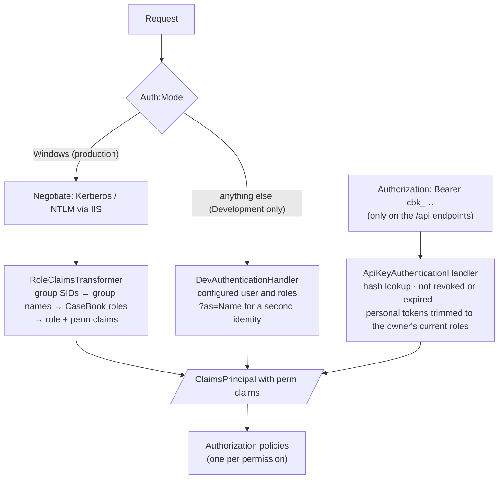

# Authentication, authorization and security

Who can sign in, what they can see and do, where each decision is enforced, and what is protected how. Tamper
evidence has its own page: [integrity.md](integrity.md).

> **UI visibility is not enforcement.** Pages hide what you can't do (`AuthorizeView`, disabled buttons).
> Enforcement happens at three places: the page or endpoint policy, the service-layer permission check, and the
> need-to-know query filter. A change that only hides a button protects nothing.

## Authentication



### Windows (production)

- IIS performs Windows Integrated Authentication; the installer enables Windows auth and disables anonymous for
  the whole site except `/api`.
- `Web/Security/RoleClaimsTransformer.cs` runs on each request. It takes the user's group claims (SIDs),
  resolves them to `DOMAIN\Group` and `Group` names (cached for the process lifetime), asks the role directory
  which CaseBook roles those groups map to, and adds role claims and `perm` claims. The bare `Group` name is offered
  only for a group of the server's own domain (or a local or built-in group): group names are unique only within a
  domain, so a same-named group made in a trusted domain matches only a mapping written as `OTHER\Group`.
- A user in no mapped group signs in successfully but has no permissions. Every page refuses them, and they land
  on `/access-denied`, which shows who they're signed in as and names the permission the page needed.
- A failed Negotiate handshake is SIEM event 5101.

### Development

`Web/Security/DevAuthenticationHandler.cs` signs every request in without a password:

- The identity comes from `DevAuth` settings (default `Dev Analyst`, id `S-1-5-21-DEV-1001`).
- Roles come from `DevAuth:Roles`; `appsettings.json` grants all five.
- `?as=<name>` on any URL switches to a second identity (`dev:<name>`), remembered in an HttpOnly cookie,
  for testing presence, assignment and need-to-know. **It keeps the same roles.** To test a lower-privilege
  user, change `DevAuth:Roles` (for example `DevAuth__Roles__0=Manager` as an environment variable).

**Fail-safe** (`Web/Security/AuthModeGuard.cs`): when `Auth:Mode` isn't `Windows`, startup throws unless the
environment is `Development`. A demo or QA server (any environment except `Production`) can opt in with
`Auth:AllowDevSignInOutsideDevelopment=true`; `Production` refuses dev sign-in even with the opt-in.

### API tokens

Used only by the endpoints under `/api` (bearer header): `POST /api/import/cases` and its status
(`GET /api/import/cases/{id}`), and the IOC feeds `GET /api/export/iocs.csv` and `GET /api/export/iocs.stix.json`. Each
names the scheme in its authorization policy, so the Windows (or development) sign-in never counts there, and a token
counts nowhere else. A refused API GET keeps its 401 or 403; it isn't redirected to a page.

| | Personal token | System token |
|---|---|---|
| Created by | Any signed-in user (account menu → API tokens) | `Administer` (Administration → API tokens) |
| Acts as | The owner; roles are a subset of theirs, trimmed to the roles they still hold at each call | A machine identity `apitoken:<slug>` with the roles granted to it |
| Maximum lifetime | 90 days | 365 days |

- Format `cbk_` + 32 random bytes (base64url). Only the SHA-256 is stored; the token is shown once.
- Expiry is mandatory. Revocation (by the creator or an administrator) is immediate and permanent.
- A rejected token is SIEM event 5101 (`ApiTokenRejected`), logged with its 12-character prefix and the source
  address, never the token.
- Create and revoke are written to the audit chain and SIEM (5404).
- **With Windows sign-in, a personal token's owner is checked in Active Directory** on use (`AdTokenOwnerCheck`): a
  missing or disabled account is refused, and the token keeps only the roles the owner's current groups map to. Each
  answer is reused for 15 minutes; if AD can't be reached (or takes longer than 10 seconds, BUG-469), the last answer
  stands for up to 24 hours, then the token is refused. An answer whose groups weren't all named in time counts as AD
  unreachable (BUG-575), except that a disabled account is refused at once and, with no whole answer yet, the token
  keeps only the roles its named groups map to (BUG-609). An open session's re-check on such an answer still applies
  removed mappings and permission changes, keeps a role while any mapping by name still grants it, and never adds a
  role (BUG-609). The calendar feed link follows the same check. Without Windows sign-in the user mirror is used (it updates
  at each sign-in).
- **Account entities are looked up only in domains the server already trusts** (BUG-419, `AdAccountDirectory`): an
  account indicator is attacker-supplied text, so `DOMAIN\sam` is asked about only when DOMAIN is in the server's
  forest or has a trust with its domain. Anything else, and a local account (`.\sam`, `COMPUTER\sam`), is answered
  "not looked up" without a DC-locator query or bind, so the server's identity never authenticates to a host an
  indicator names. See [integrations](../operations/integrations.md#active-directory).
- **Reminders go only to people still entitled to the case** (`ReminderAudience`): task (overdue, due soon), deadline,
  stale-case and digest emails, and the calendar feed, need an active account holding a role that grants `ViewCases`,
  and on a restricted case its IC, a teammate or someone cleared for restricted cases. The directory's current answer
  is used where it can say; when it can't be reached the mirror stands. A task owner left off falls back to the IC.

### Sessions

- There's no application session cookie. Negotiate authenticates the connection; the Blazor circuit carries
  the principal.
- **Permissions refresh while signed in.** Every 2 minutes each circuit re-derives roles and permissions from
  the current role directory, so editing a role or removing an AD mapping takes effect without the user
  reconnecting. AD group *membership* changes need a new Windows logon.
- **Idle lock** (`Security:IdleTimeoutMinutes`, default 15): after inactivity, a 60-second warning, then the
  circuit is torn down and the user lands on `/session-expired`. With Windows auth, *Resume* signs them straight
  back in; it's a screen lock, not a credential check. *Lock now* in the account menu does the same.
  If the connection to the server is down at the deadline (an app-pool restart, a dropped network), the browser
  leaves for `/session-expired` itself a few seconds later, so the case isn't left readable behind the reconnect
  overlay (REV-63).
- The data-protection keyring (antiforgery, circuit state) must persist (`DataProtection:KeyPath`), or every
  app-pool recycle disconnects everyone.

## Authorization

### Permissions

Eight permissions, defined in `Domain/Enums/Permission.cs`. Code checks them; administrators can't invent new
ones ([decision 0003](../decisions/0003-permissions-as-code-atoms.md)).

| Permission | Grants |
|---|---|
| `ViewCases` | Use the app and see cases within need-to-know |
| `ViewAllCases` | See every case, including restricted ones; dashboard and team workload |
| `EditCases` | Create cases and change their content |
| `ChangeClassification` | Promote, escalate or de-escalate; re-date a classification change; file a case already on the ladder (an Adverse Event or above) rather than as a Complex Event (REV-14) |
| `ApproveReports` | Approve a report as final |
| `ViewRestricted` | See every restricted case; lift a restriction |
| `ManageLegal` | Legal referral, legal hold and its release |
| `Administer` | Administration, access log, integrity sealing, exports of configuration and compliance bundles, archive, the retention review (CAP-10), the access review's CSV and recording a review (CAP-15) |

### System roles

From `Application/Security/RoleDefinitions.cs`. These five are seeded, locked, and re-synced to code on every
start.

| Role | View | View all | Edit | Classify | Approve reports | View restricted | Legal | Administer |
|---|:-:|:-:|:-:|:-:|:-:|:-:|:-:|:-:|
| **Analyst** | ✓ | | ✓ | ✓ | | | | |
| **IncidentCommander** | ✓ | | ✓ | ✓ | ✓ | ✓ | | |
| **Manager** | ✓ | ✓ | | | | | | |
| **LegalPrivacy** | ✓ | ✓ | | | | ✓ | ✓ | |
| **SysAdmin** | every permission, including any added later ||||||||

Consequences worth knowing:

- Analysts can reclassify, including escalating to Breach (subject to the stage gate).
- Incident commanders see **every** restricted case, not only the ones they lead (`ViewRestricted`).
- Managers and Legal/Privacy can't edit case content. They **can** add task comments (which need only
  `ViewCases`).
- Custom roles combine the same permissions; the last role holding `Administer` can't lose it or be deleted.

### Where each check happens

| Layer | Mechanism | Where |
|---|---|---|
| Every endpoint | Fallback policy: authenticated user | `Web/Program.cs` |
| Pages | `@attribute [Authorize(Policy = "<Permission>")]` | each `Components/Pages/*.razor` |
| HTTP endpoints | `.RequireAuthorization("<Permission>")` | `Web/Program.cs` |
| Case actions | `CaseService.Require()` looks up the calling method in `CaseActionPermissions`; **a method with no entry fails closed**; a unit test checks every mutating method is listed; a refusal emits SIEM 5202 | `Application/Cases/CaseService.cs`, `CaseActionPermissions.cs` |
| Admin actions | `AdminActionPermissions.Require<TService>()`, all `Administer`, fails closed; also the administrator-only reads (compliance bundle, access-log query and actors, every API token, the access review and its last recorded review, the retention review) | `Application/Security/AdminActionPermissions.cs` |
| Other services | Direct checks: evidence upload and transfer (`EditCases`), report generate (`EditCases`) and approve (`ApproveReports`), lessons, import decisions, API tokens | each service |
| Data visibility | `ForUser()` on every case query (below) | `Application/Cases/CaseQueryExtensions.cs` |
| UI | `AuthorizeView` and `CanEdit` flags hide controls | components (cosmetic) |

`ForbiddenException` produces the message "You don't have permission to …", shown as a toast.

### Need-to-know

```csharp
// Application/Cases/CaseQueryExtensions.cs (simplified)
if (!user.Has(ViewCases)) return query.Where(_ => false);                // no case at all (BUG-465)
if (user.Has(ViewAllCases) || user.Has(ViewRestricted)) return query;   // cleared roles see everything
return query.Where(c => !c.IsRestricted
                     || c.IncidentCommander == user.UserId
                     || c.Assignments.Any(a => a.UserId == user.UserId));
```

- Applied to lists, search, the workspace, every write (a case is loaded through it before changing), downloads,
  report hash verification, exports, dashboards, indicators, campaigns (a restricted case can't bridge two campaigns), pins and recents.
- Audit-trail reads (`IntegrityService.RecentAsync`, `QueryAsync`, `QueryPageAsync`, `ExportCsvAsync`, `AuditFacetsAsync`:
  `/integrity`, a case's Audit tab, both audit CSVs) show `ViewAllCases` and `Administer` the whole trail. Everyone else sees only entries
  for cases they can see; case-less entries (configuration, roles) are left out. Filtered to one case (the Audit
  tab, the audit CSV), the trail includes the entries made under every number the case has held, such as its
  Complex Event number before a promotion (REV-01); typing a former number on its own matches only that number,
  and only for oversight.
- The pending-import queue (`CaseImportService`, through `PendingImportQueue.Visible`) leaves out a submission into
  an existing case the reviewer can't see, for listing, counting, previewing, applying and rejecting, and for the
  Desk item, the sidebar count and the digest line (CAP-01). One with no target, or a target that no longer exists,
  is visible to every reviewer. The email about a new submission goes to reviewers through the same audience filter
  as other case emails, and the chat post leaves out a restricted target's summary.
- **API tokens are scoped as their owner** (`ForUser` for the token's identity and permissions). The IOC feeds under
  `/api/export` (CAP-09) carry a restricted case's indicators only to a token whose owner could open that case: one
  holding `ViewAllCases` or `ViewRestricted`, or the case's commander or a member of its team. A feed token for a
  firewall or a TIP shouldn't hold either permission. Exercises never appear.
- **An import aimed by detection case id** (`target.detectionCaseId`, CAP-14) is resolved when it's reviewed, among
  the cases the **reviewer** can see, never as the producer's token sees them (the BUG-279 lesson): the queued row has
  no target, so it's listed to every reviewer, and its queue summary names the detection case id, not a case. A
  reviewer who can't see the matching case is told no open case they can see carries it.
- **An import's status** (`GET /api/import/cases/{id}`, CAP-13) answers only the token that sent it, or a token holding
  `EditCases` for a submission it could review (`PendingImportQueue.Visible`); anything else is the same 404 as an
  unknown id. The case it went into is named only when the asking token can see that case.
- Without `ViewCases` it returns nothing, whatever else the user holds (as `CaseAudience.CanSee`). Windows auth
  signs in every domain user, so this is what keeps one with no CaseBook role out of the palette, Find and the
  case tabs; the layout also hides those (and the activity bell) behind the `ViewCases` policy (BUG-465).
- **No existence leak:** a hidden case and a missing case give the same "not found".
- Restricting is open to anyone with `EditCases` (they're kept on the case). Lifting needs the IC, or
  `ViewAllCases` or `ViewRestricted`.
- People who can't see a case can't be @mentioned on it, handed it, or emailed about it. Breach-escalation
  chat messages for restricted cases are redacted.

### Known gaps between the UI and enforcement

Listed in [reference/known-issues.md](../reference/known-issues.md#security). In short:

- A configuration bundle's signature is checked against the key inside the file, so it proves integrity, not
  origin. Origin is the key's: this server's own and those in `Config:TrustedBundleKeys` import without asking; any
  other imports only when an administrator types its key id (CAP-16, `ConfigBundleService.ImportAsync`, which also
  refuses a bundle whose signature doesn't verify, or that states a held or trusted key's id while carrying another).

## HTTP protections

- **Security headers** on every response (`Web/Security/SecurityHeadersMiddleware.cs`):
  `Content-Security-Policy: default-src 'self'; img-src 'self' data:; style-src 'self' 'unsafe-inline';
  script-src 'self'; object-src 'none'; connect-src 'self'; frame-ancestors 'none'; base-uri 'self';
  form-action 'self'`, plus `X-Content-Type-Options: nosniff`, `X-Frame-Options: DENY`,
  `Referrer-Policy: no-referrer`, `Cross-Origin-Opener-Policy: same-origin`, a restrictive
  `Permissions-Policy`, and no `Server` header. **No inline scripts are allowed**, so JavaScript lives in
  `wwwroot/js` files.
- **HSTS and HTTPS redirection** outside Development.
- **Antiforgery** on form posts.
- **Rate limiting**: a per-user token bucket (40 burst, 40 per minute by default) on downloads, exports, the
  import API (and an import's status) and the calendar feed. The API's IOC feeds have their own bucket per token
  (`api-feeds`: 20 burst, then one a minute, `RateLimiting:ApiFeeds`). Over budget returns 429 with `Retry-After` and
  SIEM 5306 (a spike suggests bulk scraping).
- **Static files** are served before authentication, so everything in `wwwroot` is public. Nothing sensitive
  belongs there.
- **Status pages**: a page GET that's refused redirects to `/access-denied` (SIEM 5201); an unknown page
  redirects to `/not-found`. Neither applies under `/api`, whose callers get the plain 403 or 404 (SIEM 5201 still).

## Protecting data

| Data | Protection |
|---|---|
| Case records | Need-to-know; row hashes and the audit chain; SQL Server TDE recommended at rest (not configured by CaseBook); optional ledger tables |
| Evidence files | Outside the web root, random names, per-case folders, path-traversal checks, SHA-256 recorded and re-verifiable; downloads logged to custody, the access log and SIEM. Downloads and exports refuse a browser's passive load (`Sec-Fetch-Dest` image, script, style and the like), so only a person's request is recorded. An evidence package (CAP-12) needs `EditCases`, is fetched by a single-use ticket so nothing typed goes in the URL, and records its custody before the first byte, then how far it got (sent in full or partial) |
| Inline images | Served only if the bytes really are PNG, JPEG, GIF or WebP; SVG and mislabeled files refused |
| Reports | SHA-256 recorded; downloads logged; TLP marking on every page; indicators defanged |
| Exports | CSV cells starting with `= + - @`, tab or CR are neutralized against formula injection; exports are scoped by need-to-know and logged |
| Markdown | Rendered to sanitized HTML by `Content/MarkdownService.cs`: no raw HTML, unsafe link schemes made inert, and images shown as links rather than loaded, so text can't make a viewer's browser fetch a URL as them |
| Secrets | Never in the database. Server-side config or CyberArk. Administration shows only whether a secret is present |
| Logs | Email logs recipient counts, not addresses; API tokens by prefix; access-log labels sanitized against log injection |
| PII at rest | Relies on SQL Server TDE. Column-level Always Encrypted isn't implemented |

## Auditing who did what

Three different records, for three different questions:

| Question | Record | Where to look |
|---|---|---|
| Who **changed** something? | The hash-chained audit trail: every insert, update and delete, with before and after values | Integrity & audit (filtered across cases; `GET /export/audit.csv`); a case's Audit tab; `GET /export/case-audit.csv` |
| Who **read** a case or **downloaded** something? | The access log (outside the chain, coalesced into view sessions) | Access log (administrators); "Viewed by" in a case's Audit tab |
| Who **handled an evidence file**? | Chain of custody | The file's *Custody* panel |

Plus the SIEM stream, for real-time detection over all of the above
([OPERATIONS.md §5](../OPERATIONS.md#5-siem-security-event-stream-f-18)).

## Security assumptions

- The app pool runs as a dedicated, least-privilege account (a gMSA where possible), with Modify only on the
  data root.
- The web root is read-only to the app.
- SQL Server is reached with Windows authentication. The app account is `db_owner` only if it applies its own
  migrations (otherwise datareader, datawriter and execute).
- The seal-signing key is provisioned out of band and its public key archived separately
  ([OPERATIONS.md §2](../OPERATIONS.md#2-integrity-signing-key-management-f-05b)). Outside Development the app
  refuses to start without it rather than generate one.
- One app instance (see [overview.md](overview.md#runtime-topology-production)).
- Database administrators are trusted not to edit data, and the chain, seals and optional ledger make it
  detectable if they do.
