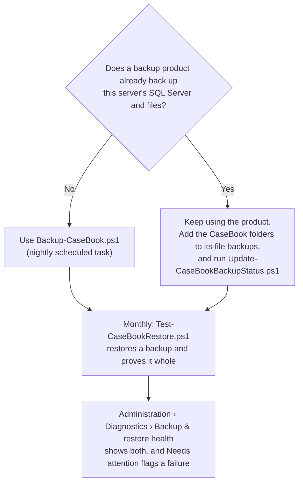
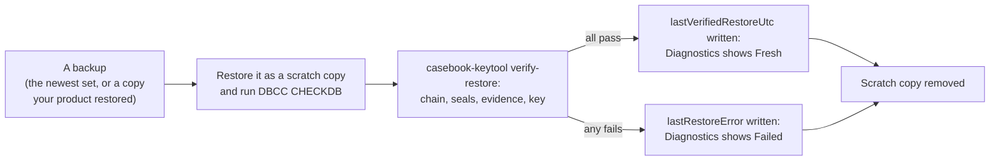
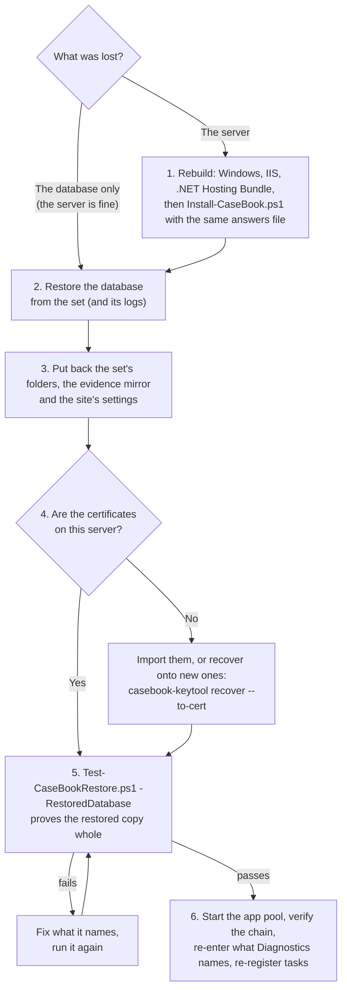

# Backup and disaster recovery

Section 1 of the [operations guide](../OPERATIONS.md), which keeps the deploy-time checklist and the host controls. Section numbers are kept, so "OPERATIONS.md section 1" in the app and the scripts means this page.

## 1. Backup & Disaster Recovery (H-03)

The system's integrity guarantees are only as good as the ability to restore a trustworthy copy.
Three data sets must be backed up **in lockstep** so they stay mutually consistent:

| Data set | Location | Backup method |
|----------|----------|---------------|
| Case database | SQL Server 2022 (`IncidentManager` DB) | Native SQL backups (below) |
| Evidence blobs | `EvidenceStore:RootPath` (outside webroot) | File backup of the whole tree |
| Integrity seals | `Integrity:ExportPath` (out-of-band seal exports) | File backup (append-only) |
| Generated reports | `ReportOutput:RootPath` | File backup |
| Keys folder | `<DataRoot>\keys` (the seal-signing key, `chain-key.json`, `evidence-key.json`) | File backup with tighter access; the evidence key's envelope is useless without a certificate or the shares, but keep it with the rest ([§2, Evidence key](keys-and-certificates.md#evidence-key-encryption-at-rest-backups-and-recovery-prod-57)) |
| Data Protection key ring | `DataProtection:KeyPath` (`DataRoot\dp-keys`) | File backup **with the database**, tight access. Besides keeping sessions across recycles, it decrypts the secrets saved under Administration: the SMTP password (CAP-05), and the team-chat webhook URL and the SIEM webhook token (CAP-40). A database restored without it can't open them: email that signs in is held, chat isn't posted, the SIEM webhook stops rather than sending without its token, and Diagnostics says which to re-enter ([troubleshooting](troubleshooting.md)). The keys are DPAPI-protected to the machine, so on a new server these are re-entered anyway. |
| Report branding logo | `ReportBranding:RootPath` (`DataRoot\branding`, H-07) | File backup (single small image; low churn) |
| Word report templates | `ReportTemplates:RootPath` (`DataRoot\report-templates`, PROD-47; when unset, a `report-templates` folder beside `ReportBranding:RootPath`, so upgraded servers need no config change) | File backup (one .docx per library template, named by its id; low churn) |

**What this server holds (CAP-19).** Administration → Diagnostics → **Backup set** lists the database's name and each
of these paths as this server resolves them (key files set outside the keys folder are listed on their own), with
whether it's there, whether CaseBook's account can write it, its size and its last write. The seal export folder is
judged writable by its last seal copy, never by a test file (it may be WORM), and the evidence store by its own probe.
Each folder's walk is limited to 5 seconds and 200,000 entries, so a share that's down says "didn't answer" and a very
large store says "at least". **`GET /export/backup-manifest.json`** (Administer; access-logged, SIEM 5304) gives the same
as JSON for a backup job to read its folder list from, or a restore drill to compare against: paths and metadata only,
never a key or the connection string. Pull it with the job's Windows account, for example
`Invoke-WebRequest https://casebook.contoso.com/export/backup-manifest.json -UseDefaultCredentials -OutFile manifest.json`.

### 1.1 Taking backups

A backup of CaseBook is the database **and** the folders in the table above, from the same point. There are two ways
to take one; which depends on whether your organization's backup product already backs up this server.



Both write the **status file** CaseBook reads (§1.3.1): set `BackupStatus:FilePath` in `appsettings.Production.json`
first, to a file the scripts' account can write and the app-pool account can read (for example
`E:\CaseBookData\ops\casebook-backup-status.json`).

**What counts as a successful backup:** the database was backed up with checksums and the backup read back
(`RESTORE VERIFYONLY`), and every folder was copied without an error. Only then is `lastBackupUtc` written. A failure
writes its reason instead, and Diagnostics shows **Failed** until a later backup succeeds.

#### Without a backup product: Backup-CaseBook.ps1

In an elevated PowerShell on the CaseBook server, from the deploy scripts kept beside the site (`<site>-deploy`, for
example `C:\inetpub\casebook-deploy`) or the `deploy` folder of the release:

```powershell
.\Backup-CaseBook.ps1 -Destination \\backup01\casebook                       # one backup now, to check it works
.\Backup-CaseBook.ps1 -Destination \\backup01\casebook -Register -TaskAccount 'CONTOSO\svc-casebook-bk$' -At 01:30
```

The second line creates two scheduled tasks: **CaseBook nightly backup**, and **CaseBook log backup** every 15 minutes
(`-LogEveryMinutes`; `0` for none). The tasks run the copy of the script kept beside the site (`<site>-deploy`, which
every upgrade refreshes), so they keep working after the release folder is gone. Each nightly run makes
`<Destination>\CaseBook-<yyyyMMdd-HHmm>` holding the database backup (`db\`), a copy of each folder (`files\keys`,
`files\dp-keys`, `files\seals`, `files\report-output`, `files\branding`, `files\report-templates`) and `backup-set.json`
(what's in it). Evidence only ever grows, so it's copied into one mirror, `<Destination>\evidence`, that every set
shares; the one exception, a file an administrator purged (Diagnostics › *Withdrawn evidence*), is removed from the
mirror by the next run, by the paths the database records as purged. The newest 14 sets are kept (`-Keep`). A backup
product keeps its own copies of a purged file until its retention ages them out.

**Log backups.** The installer creates the database in the FULL recovery model, so SQL Server keeps every change in the
transaction log until a log backup takes it out; with no log backups, the log grows until its disk is full. Each
`-Log` run backs the log up to `<Destination>\log\<database>-<yyyyMMdd-HHmmss>.trn` (or `-DatabaseBackupFolder`) and
removes logs older than the oldest set kept. They let you restore to any point since the oldest set, to within 15
minutes. A database you've put in the SIMPLE model has nothing to back up, and the run says so; a log backup waits for
the first full one (and for a new one after a switch back to FULL).

The account it runs as needs:

- **SQL Server:** `db_backupoperator` on the CaseBook database (or sysadmin). SQL Server writes the `.bak` itself, as
  its service account, so that account needs write to the destination too.
- **Files:** read on the data folders, and write on `-Destination`. The backup holds the keys folder: lock the
  destination down as tightly as the data root.

A group managed service account (`DOMAIN\name$`) needs no password; any other account is asked for one when the task
is registered. Without `-TaskAccount` the task runs as SYSTEM, which works only if SYSTEM has those rights.

#### With a backup product: Update-CaseBookBackupStatus.ps1

Don't run `Backup-CaseBook.ps1` beside a backup product without `-CopyOnly`: an ordinary full backup resets the
product's differential base, and a log backup takes records out of its log chain. (`-CopyOnly` takes no log backups, and
`-Register -CopyOnly` creates no log task: the product's log backups keep the log in check.) Instead:

1. **The database:** the product backs it up as it does any database. SQL Server records each of those backups in its
   own history (`msdb`), whatever takes them.
2. **The folders:** add every folder in the table above to the product's file backups, on the same schedule as the
   database. **Administration › Diagnostics › Backup set** lists them as this server resolves them, and
   `/export/backup-manifest.json` gives the same list to a job.
3. **The status:** run `Update-CaseBookBackupStatus.ps1` after each backup (as the product's post-backup step), or
   every hour:

   ```powershell
   .\Update-CaseBookBackupStatus.ps1 -Register -TaskAccount 'CONTOSO\svc-casebook-bk$'
   ```

   It reads the newest full or differential backup of the CaseBook database from SQL Server's history and records when
   it finished, its size, its kind and what took it (a backup product shows as *a backup product*). It takes no backup
   itself. Its account needs read on `msdb` and write on the status file.

It sees the database only, so the monthly restore drill (§1.3) is what proves the product's folder backups restore with
it.

#### Doing it by hand

If you'd rather write your own SQL Agent jobs, this is the baseline the scripts follow: a nightly full backup, a
differential every 4 to 6 hours and a log backup every 15 minutes (the database in the FULL recovery model), each
`WITH CHECKSUM`, written to a secured, encrypted share with an immutable or offsite copy. Then stamp the status file
yourself (§1.3.1), or run `Update-CaseBookBackupStatus.ps1` after the job.

```sql
-- Nightly full
BACKUP DATABASE [IncidentManager]
  TO DISK = N'\\backup-share\IncidentManager\full\IncidentManager.bak'
  WITH CHECKSUM, COMPRESSION, INIT;

-- Log backup (every 15 min via SQL Agent)
BACKUP LOG [IncidentManager]
  TO DISK = N'\\backup-share\IncidentManager\log\IncidentManager.trn'
  WITH CHECKSUM;
```

### 1.2 Evidence, seals & reports

- Back up the evidence store **with** each DB backup window so blob references never dangle.
- The evidence store is immutable by design (files are content-hashed and never rewritten), so an
  incremental/file-level backup is sufficient and cheap. The one exception: when evidence encryption is turned on,
  each file stored before is rewritten once, encrypted (§2, Evidence key). Expect one full backup's worth of change.
- Seal exports (`Integrity:ExportPath`) are append-only; include them in every backup — they are the
  out-of-band tamper-evidence anchor and must survive a DB compromise.

### 1.2.1 Evidence storage: limits, large uploads and network shares

**Limits (PROD-55).** Administration › Evidence storage sets the largest file
(`Evidence:MaxUploadMB`, default 500 MB, up to 64 GB), the most all evidence may take (`Evidence:StorageQuotaGB`, no
limit by default) and the free space an upload must leave on the store (`Evidence:MinFreeSpaceGB`, default 10 GB).
Every way evidence arrives (picked, dropped, sent in parts, a pasted screenshot) is checked before a byte is stored
and again once its real size is known. Uploaders are warned at 90 % of the limit. Administration › Diagnostics ›
Evidence storage shows where the store is, whether CaseBook can write and read there, what it holds and what's free.

**Large files (PROD-56).** A file over 100 MB, such as a memory dump, uploads in 8 MB parts with a progress bar, so no
request comes near IIS's 30 MB limit and nothing in IIS needs changing. A part lost on the network is sent again. The
file is read back and its SHA-256 checked before it's recorded (`Evidence:ReadBackCheck`). **An upload that stops
part-way is kept** (PROD-59): a network failure, the page closed, or the app restarting. Its state is saved beside its
parts in `<store>\.incoming`, and the Evidence tab lists it under **Unfinished uploads** for the person who started
it; they pick the same file again to carry on (it's checked by name, size and the SHA-256 of its first megabyte), or
discard it. One resumed after a restart is read back in full when it completes, every part checked against the hash
it arrived with, whatever `ReadBackCheck` says. Only **Cancel** deletes an upload at once; one with nothing sent for a
day is deleted from `<store>\.incoming`.

**The same file twice.** A file already evidence in the same case (by SHA-256) isn't stored again: the upload is
refused, naming the first copy, whose chain of custody stands. In another case it's stored, and the uploader is told
which other cases (among those they can see) hold it.

**A store on a network share.** `EvidenceStore:RootPath` (installer `-EvidencePath`) may be a UNC path such as
`\\files01\casebook$\evidence`.
- The app-pool account needs **Modify** on the folder (NTFS) and **Change** on the share. With a gMSA that's the gMSA;
  with the built-in ApplicationPoolIdentity, the share sees the web server's computer account (`DOMAIN\WEB01$`).
  Remove inherited access for everyone else; keep SYSTEM and Administrators. The installer sets the folder's rights
  when it can and prints what to grant when it can't.
- CaseBook probes the store (writes, reads back and deletes a small file) at every start and hourly, with a time limit
  so a share that's down can't hang it. A failure is logged with the account and the reason and shown on Diagnostics.
- While the share is down, uploads are refused, downloads answer that the store can't be read, and the evidence
  re-check reports **one** finding, "evidence store unreachable", instead of every file missing. Earlier findings
  stand until their files are checked again. `/health` reports Unhealthy. When the share is back, all of it clears
  without a restart.
- **A store that held evidence is never recreated empty.** If the share answers but the store's folder isn't there
  (the share was remapped, a DFS target or drive changed, the folder was moved), CaseBook treats it as the outage
  above rather than making a new, empty folder: otherwise new uploads would land in the stand-in and every recorded
  file would read as missing. Only a fresh install (no evidence recorded) has its folder created at start-up. To move
  a store, follow *Moving an existing store* below.
- Put the share on storage that is backed up with the database (section 1.2), and keep the data root's `keys` folder
  off the share.

**Moving an existing store** to another folder or a share: stop the app pool; copy with
`robocopy <old> <new> /E /COPY:DAT /DCOPY:DAT`; grant the rights above; set `EvidenceStore:RootPath` to the new path in
`appsettings.Production.json`; start the app pool; then run **Verify now** on the Integrity page and check the
evidence re-check on Diagnostics. Stored paths are relative to the store, so the database doesn't change. Keep the
old copy until the re-check is clean.

**Safe download (PROD-58).** A file that can run (a program, script, shortcut, disk image, Office file with
macros or web page, by its name and type) shows **Can run** on the Evidence tab and downloads first as **Download
safely**: a zip holding the file, with the password `infected`, the security field's convention. A double-click can't
run it, and the analyst's antivirus doesn't delete it on arrival; the zip opens in Windows Explorer and every zip tool.
Its encryption is classic zip encryption, there to stop accidents, not to keep the file secret. The plain file is
behind a confirmation; any file can be downloaded as a zip. `Evidence:SafeDownload` makes the zip the first choice for
every file (`Always`) or none (`Off`). A program renamed to look harmless and uploaded with a harmless type isn't caught
by its name; choose `Always` to wrap every file. The chain of custody records which kind of download it was. Every
evidence download is sent as plain bytes (never the type its uploader's browser claimed) with a sandboxing
`Content-Security-Policy`.

**Evidence packages (CAP-12).** *Package evidence…* on the Evidence tab hands many files over at once: one zip with the
password `infected` (the same encryption as the safe download), streamed from the store and decrypted as it's read, so
no plain copy is written on the server, holding the files and a `MANIFEST.txt` (the case, the recipient, method and
purpose, and each file's SHA-256, size, collection, upload and chain of custody so far). It's limited to 500 files and,
in all, the largest single file the store takes (`Evidence:MaxUploadMB`); a larger hand-over is several packages.
Each counts against the `downloads` rate limit.

**How a package is recorded: begun, then sent in full or partial.** The zip streams with a data descriptor after each
file, and such a zip can be read file by file from its local headers even without its closing directory (7-Zip, or any
streaming unzip, recovers every file that arrived), so a package that stops part-way is still a hand-over of what went
out. So it's recorded in steps, each step's custody and its audit entry in one transaction (both or neither):

- **Begun**, before the first byte: a "Transfer begun" custody event on every file, naming the package (its id) and
  the hand-over, and an audit entry with the package id, the hand-over, and each file's name and SHA-256 (for a large package the list is cut to the entry's 2,000 characters; each file's own
  custody event names the package, and its SHA-256 is on its record); with it the
  access-log row and SIEM 5308. If this can't be written, nothing is sent (the download answers 503).
- **Sent in full**: each file gets "Transferred", and the audit trail an entry with the SHA-256 of the zip as sent and
  of its manifest (the recipient can check the zip they received against it), written before the zip's directory goes
  out. (A download cut off in those last bytes keeps this record, since every file and the manifest left; the log says so.)
- **Stopped part-way** (cut off, past its time limit, a store or key outage, a file that doesn't match): each file gets
  how far it got, "Transferred" (sent in full), "Partly transferred" or "Not transferred", and the audit trail an entry
  "stopped after N of M files" naming which went out in full, in part and not at all, and why.

A begun record with nothing after it means the server stopped before it could record the end: treat it as partial
(every file in it may have gone). The log says which happened, and says so when the end couldn't be recorded. "Sent"
means written to the connection: what reached the recipient may be less, never more. Each file is checked against its
SHA-256 before any of it is sent, so a file that no longer matches is never sent ("Not transferred", and the package
stops; the evidence check reports it); this reads each file twice (see integrity.md for the cost). A package that
stopped is prepared again. A download that's sent slower than about 1 MB/s on average (after 15 minutes) is stopped.
The log names the package id and the case.

**Withdrawn evidence (CAP-21).** A file filed on the wrong case is withdrawn from its panel with a reason, not
deleted: its bytes stay in the store (and in backups), its custody gets a "Withdrawn" event, the audit trail an
update, and the SIEM 5516. It drops out of the case's report, gates and packages but can still be downloaded, each
download logged. A withdrawn copy isn't named as "also evidence in" its case elsewhere; Find still finds it, marked
*Withdrawn*. No task is added about it and no transfer of it is recorded. There's no undo; the right file is uploaded again.

**Disk encryption.** Turn on BitLocker (or the storage's own encryption) for the data root's volume and the evidence
store's. With CaseBook's own evidence encryption on (§2, Evidence key) a copied disk or backup no longer exposes
evidence or reports, but the database and the logs are still on those volumes.

### 1.3 Restore verification (do not skip)

A backup that has never been restored is a hypothesis, not a control. `Test-CaseBookRestore.ps1` is the drill: it
restores a backup into a scratch copy, proves the copy whole, and records the result. Run it monthly.



**What "verified" means.** Every one of these passes on the restored copy, read as the app would read it:

| Check | Proves |
|---|---|
| DBCC CHECKDB | The database's pages and structures are sound |
| Database | It opens, with its cases, audit entries, evidence and seals |
| Audit chain | Every audit entry's hash follows from the one before, first to last: the history wasn't altered |
| Seals | Every seal's signature is authentic and the chain head it sealed is unchanged |
| Evidence files | Every file the database lists is in the store at its recorded size |
| Evidence hashes | 200 random files (or every one, `-HashAll`) hash to their recorded SHA-256 |
| Evidence key | With encryption on, the key opens, so the files can be read |

The findings are kept as `restore-check-<time>.json` in the backup set (or beside the status file), and the summary
shows on Diagnostics.

**With Backup-CaseBook.ps1's sets**, on the CaseBook server:

```powershell
.\Test-CaseBookRestore.ps1 -Destination \\backup01\casebook                    # the newest set, now
.\Test-CaseBookRestore.ps1 -Destination \\backup01\casebook -Register -At 03:00 # every fourth Sunday
```

It restores the database as `CaseBook_RestoreDrill` on the same SQL Server (or `-SqlInstance` a recovery server's),
uses the set's folders and the evidence mirror where they are, and removes the scratch database afterwards
(`-KeepRestored` keeps it to look at). It needs disk space for one copy of the database while it runs, and an account
that can restore databases (`dbcreator`).

**With your backup product**, restore (or mount) the database and the folders from the same point with the product,
then point the drill at them; it checks them and leaves them as they are:

```powershell
.\Test-CaseBookRestore.ps1 -RestoredDatabase CaseBook_Restored -SqlInstance SQLREC01 -EvidencePath R:\evidence-store -KeysPath R:\keys
```

**On a recovery server** without the signing certificate, give `-PublicKeys`, a folder of the signing keys' public
halves (`casebook-keytool signing-public-key`). With evidence encryption on and the server certificate not there, give a
recovery certificate (`-PfxPath`, or `-CertThumbprint` for one in the store); the drill then also proves that backup of
the key works.

**When it fails**, the reason says which check and what it found, for example *Evidence hashes: signin-export.csv:
SHA-256 differs*. Restore that file from an older backup (the recorded hash says what its bytes must hash to), or find
out why the backup didn't capture it, and run the drill again. A failed drill doesn't replace the last good one: both
show until a drill passes.

A **full disaster recovery** restores everything as a set, from the same point, and runs the drill against the result
before it serves anyone: §1.5 has the steps.

### 1.3.1 Backup-health status file (H-04)

CaseBook shows backup and restore health on **Administration › Diagnostics › Backup & restore health** (and in *Needs
attention* when something's wrong), from a small JSON file the scripts write. The app only ever reads it, so it works
while the database itself is being restored, and it stays out of the audit chain (it's operations telemetry).

```jsonc
"BackupStatus": {
  "FilePath": "E:\\CaseBookData\\ops\\casebook-backup-status.json", // the scripts write it; the app-pool account reads it
  "BackupMaxAgeHours": 24,   // warn when the last backup is older than this
  "LogBackupMaxAgeMinutes": 60, // warn when the last log backup is older than this (once there's been one)
  "RestoreMaxAgeDays": 35    // warn when the last verified restore is older than this
}
```

| Field | Written by | Shown as |
|---|---|---|
| `lastBackupUtc`, `lastBackupSizeBytes`, `lastBackupSet`, `lastBackupBy` | `Backup-CaseBook.ps1` or `Update-CaseBookBackupStatus.ps1`, after a successful backup | *Last successful backup*: Fresh, or Stale past `BackupMaxAgeHours`, or Missing |
| `lastBackupError`, `lastBackupFailedUtc` | `Backup-CaseBook.ps1`, when a run fails | *Latest backup attempt*: **Failed**, while it's newer than the last success |
| `lastLogBackupUtc` | `Backup-CaseBook.ps1 -Log`, after a successful log backup | *Last log backup*: Fresh, or Stale past `LogBackupMaxAgeMinutes`; not shown until there's been one |
| `lastLogBackupError`, `lastLogBackupFailedUtc` | `Backup-CaseBook.ps1 -Log`, when a log backup fails | *Latest log backup attempt*: **Failed**, while it's newer than the last log backup |
| `lastVerifiedRestoreUtc`, `lastVerifiedRestoreSet`, `lastRestoreSummary` | `Test-CaseBookRestore.ps1`, when every check passes | *Last verified restore*: Fresh, or Stale past `RestoreMaxAgeDays`, or Missing |
| `lastRestoreError`, `lastRestoreFailedUtc` | `Test-CaseBookRestore.ps1`, when a check fails | *Latest restore drill*: **Failed**, while it's newer than the last pass |
| `note` | you, if you like | shown under the table |

Times are UTC, ISO 8601. A future time reads as Stale (clock skew). Your own jobs can write the same fields: merge
them into the file rather than replacing it, so one job doesn't erase another's.

### 1.3.2 Evidence-at-rest re-verification (F-17)

The audit hash-chain protects each evidence row's recorded **SHA-256** (it is part of the row's
canonical, chain-hashed content). It does **not** re-check that the *stored bytes* still match that
hash — so bit-rot, a silently substituted file, or a deletion under the evidence store would go
undetected until someone tried to open the file. F-17 closes that gap: a background job periodically
**re-hashes the stored evidence files** and compares each with its recorded hash.

- **Enable and schedule it** under **Administration → Integrity**
  (`Integrity:EvidenceVerify:Enabled`, default **off**; `Integrity:EvidenceVerify:IntervalHours`,
  default **24**; `Integrity:EvidenceVerify:PassDays`, default **7**). Each run re-hashes one share of the
  files, so every file is checked at least once in `PassDays` days and a large store is read a seventh at a
  time rather than end to end daily (PROD-53). A run also happens at startup, and a run after an outage or a
  settings change may leave a file for up to twice `PassDays`. A drift found stays reported until that file
  is checked again. Set `PassDays` to 1 to re-hash every file every run. It is off by default because
  re-hashing is I/O-heavy; turn it on where the evidence store's at-rest integrity matters.
- **On drift** (hash mismatch, missing, or unreadable file) it raises the same out-of-band alarm as the
  F-16 chain-break: a `LogLevel.Critical` event **`EventId 5003`** (the SIEM signal, counts only — no
  filenames), the same event on the F-18 stream, and **email** to `Email:IntegrityAlertDistribution`
  (the offender list — case number, evidence id, filename). The alarm fires **once per drift** (an item and
  what's wrong with it): a drift that persists doesn't repeat it, a new one does even while an older one persists,
  and one that clears and comes back alerts again (REV-09).
- **Status** is surfaced on **Administration → Integrity → Evidence-at-rest results** (last checked,
  count verified, and any offenders) and, on drift, a persistent app-wide banner for Administer users.
- Like the backup-health signal, the job **only reads** — it records nothing to the database and is not
  part of the audit chain (ops telemetry, not a case mutation), so a tamper that targets the store or
  the DB cannot also suppress the signal. Recover drifted files from the out-of-band evidence backups
  (§1.2); the recorded hash tells you what the original bytes must hash to.

### 1.4 RTO / RPO

Document target RTO/RPO with the business. With `Backup-CaseBook.ps1`'s log backups every 15 minutes (or your
product's at the same cadence) the database's RPO is 15 minutes; with nightly sets alone it's a day. The folders are
copied nightly, so a file stored since the last set can be lost even when the database isn't: the drill's *Evidence
files* check names any. RTO depends on restore automation and hardware.

To restore to a point between sets, restore the set's `.bak` `WITH NORECOVERY`, then each `.trn` after it in order
(`RESTORE LOG ... WITH NORECOVERY`, the last one `WITH STOPAT = '<time>', RECOVERY`). The restore drill restores the
set alone. Adjust to the insurer's records policy
and any NYDFS Part 500 expectations (Legal owns the regulatory interpretation).

### 1.5 Disaster recovery

The order to bring CaseBook back from a backup, on the same server or a rebuilt one. Everything comes from **one
point**: the database, the folders and the evidence store from the same set, so the seals, the audit chain and the
files agree. Nobody signs in until step 6 passes.



1. **A rebuilt server:** install the prerequisites (INSTALL.md §1) and run `Install-CaseBook.ps1` with the same answers
   file, so the site, the data root and the app-pool account are where they were. Then stop the app pool. With the
   database server intact, skip INSTALL.md §2.
2. **The database**, as an administrator on SQL Server, from the set's `db\<database>.bak`:

   ```sql
   RESTORE DATABASE [CaseBook] FROM DISK = N'\\backup01\casebook\CaseBook-20261020-0130\db\CaseBook.bak'
     WITH CHECKSUM, REPLACE, NORECOVERY;
   -- then each log backup taken after it, oldest first (<Destination>\log), the last one:
   RESTORE LOG [CaseBook] FROM DISK = N'\\backup01\casebook\log\CaseBook-20261020-091500.trn' WITH RECOVERY;
   ```

   With no logs to apply, restore the `.bak` `WITH CHECKSUM, REPLACE, RECOVERY`. With your backup product, restore the
   database to the same point with the product. Give the app-pool account its login and database role again if the
   SQL Server is new (INSTALL.md §2).
3. **The folders.** `backup-set.json` lists each folder the set copied and where it came from: copy `files\<name>` back
   to that place (`keys`, `dp-keys`, `seals`, `report-output`, `branding`, `report-templates`), and the evidence mirror
   (`<Destination>\evidence`) to `EvidenceStore:RootPath`. `files\site\appsettings.Production.json` is the site's
   settings as they were: compare it with the one the installer just wrote and put it back, so changes made since
   install (CyberArk, seal copies, retired keys, alert lists) come back too.
4. **The keys.** On the same server, nothing to do. On a new one:
   - **Seal signing key** in the certificate store: import the signing certificate with its private key if you kept
     it. If it was non-exportable, make a new key and keep the old one's public half in the retired keys folder, so
     the old seals still verify (§2, *Rotating the signing key*: a lost key).
   - **Evidence key** (encryption on) and a **chain key** on a certificate: install a new certificate, then
     `casebook-keytool recover --site <site folder> --pfx <recovery .pfx> --to-cert <new thumbprint>`, adding
     `--chain-key` to rebuild `chain-key.json` onto it too; set the thumbprints (§2, *Recovering the key onto a new
     certificate*).
   - **`@protected:` values** open only with the certificate they were made for: import it, or make the values again
     (`casebook-keytool protect-secret`).
   - **The Data Protection key ring** is locked to the old server (machine DPAPI), so the secrets saved under
     Administration (the SMTP password, the chat webhook URL, the SIEM token) are entered again in step 6.
5. **Prove it**, before anyone signs in, from the `deploy` folder:

   ```powershell
   .\Test-CaseBookRestore.ps1 -RestoredDatabase CaseBook -EvidencePath E:\CaseBookData\evidence-store -KeysPath E:\CaseBookData\keys
   ```

   It runs DBCC CHECKDB and `casebook-keytool verify-restore` against the restored database and folders, and changes
   neither (§1.3 lists the checks). A file stored after the set was taken is reported missing: restore it from a later
   backup if there is one, or record it as lost.
6. **Start the app pool.** Then: `Verify-Install.ps1 -Url https://<host>` (the IIS carve-outs and health);
   **Integrity › Verify now** reports the chain valid; enter again any secret **Diagnostics** says it can't open; and,
   on a new server, run each script's `-Register` again (§1.6), since scheduled tasks don't come back with a restore.
   Diagnostics › Backup & restore health shows the drill from step 5.

### 1.6 What runs when

Everything CaseBook needs done on a schedule outside the app, and what tells you it didn't happen. The app's own
background jobs (seals, the evidence re-check, retention counts) are on **Administration › Diagnostics › Scheduled
jobs**.

| What | How often | How it's scheduled | What tells you it's late or failed |
|---|---|---|---|
| Backup set (§1.1) | Nightly, 01:30 | `Backup-CaseBook.ps1 -Register` | Diagnostics: *Last successful backup* Stale after 24 hours, or **Failed** |
| Log backup (§1.1) | Every 15 minutes | The same `-Register` | Diagnostics: *Last log backup* Stale after 60 minutes, or **Failed** |
| Backup status, with a backup product (§1.1) | Hourly | `Update-CaseBookBackupStatus.ps1 -Register` | Diagnostics, as for the backup set |
| Restore drill (§1.3) | Every fourth Sunday, 03:00 | `Test-CaseBookRestore.ps1 -Register` | Diagnostics: *Last verified restore* Stale after 35 days, or **Failed** |
| Ledger digest (§7.2) | Daily, 02:00 | `Export-LedgerDigest.ps1 -Register` | The task's last run result (1 = not saved); nothing in the app |
| Ledger verification (§7.3) | Every fourth Sunday, 04:00 | `Verify-LedgerDigests.ps1 -Register` | The task's last run result: 1 = the ledger doesn't match, 2 = it couldn't run |
| Evidence key drill (§2, Step 5) | Yearly | By hand: `casebook-keytool verify` | Diagnostics, after 12 months |
| Access review (§8) | Every 90 days | By hand, in Administration | Diagnostics, after `Governance:AccessReview:ReminderDays` |
| Retention review (§8) | When cases come due | By hand, in Administration | Diagnostics, and a monthly email to Legal / Privacy if on |
| Signing key rotation (§2) | Yearly, or your policy | By hand | Diagnostics, after `Integrity:RotationReminderDays` (365) |
| Certificate renewals (§2, *Renewing certificates*) | Before each expires | By hand | Diagnostics, 60 days ahead, for every certificate the configuration names, and the TLS one by its host name |
| Upgrades (UPGRADE.md) | Each release | By hand: `Upgrade-CaseBook.ps1` | Administration › Updates |

The tasks run as `-TaskAccount` (SYSTEM by default) the copy of each script kept beside the site, `<site>-deploy`,
which every install and upgrade refreshes, and an upgrade points this site's `CaseBook *` tasks at it. See them in
Task Scheduler, or with `Get-ScheduledTask -TaskName 'CaseBook *' | Get-ScheduledTaskInfo`.
