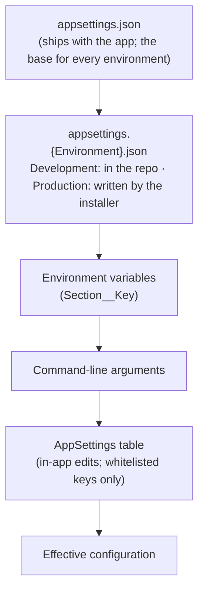

# Configuration reference

Every setting CaseBook reads, where it comes from, what it defaults to, and who can change it. For how to set
up a production host see [INSTALL.md](../INSTALL.md); for the reasoning behind the split between in-app and
server-side settings see [decision 0007](../decisions/0007-settings-split.md).

Source paths are relative to `src/` unless they start with `deploy/`.

## 1. Where settings come from

Later sources win. The database provider (`Infrastructure/Configuration/DbSettingsConfiguration.cs`) is added
**last** in `Web/Program.cs`, so an in-app value beats files, environment variables and the command line, but
only for keys in the in-app whitelist (`Application/Admin/SettingsCatalog.cs`).

Things to know:

- **Production inherits `appsettings.json`.** The production file the installer writes is an overlay, not a
  complete file. Every section it omits (rate limits, SLA targets, notification scans, SIEM, chat, access log)
  takes its value from `appsettings.json`.
- **Environment variables** use the standard mapping: `Siem__Webhook__Url` sets `Siem:Webhook:Url`, and
  `Email__LegalDistribution__0` sets the first element of a list. There is no prefix.
- **The environment** comes from `ASPNETCORE_ENVIRONMENT`. Only `launchSettings.json` sets it (to
  `Development`). Nothing in `deploy/` sets it, so an IIS install runs as **Production**, which loads
  `appsettings.Production.json` and enforces Windows authentication.
- **Lists merge by index** across sources. A later source can replace items 0..n but can't make a list
  shorter, except the in-app editor, which blanks the file's items past the end of its own (BUG-98), so a shorter
  or cleared list saved in Administration wins.
- **A list written as one string** (`RelatedIndicators__ExcludedRanges="10.0.0.0/8, fd00::/8"`, read by the
  related-indicator exclusions) is used only while no source gives the list as items. An in-app list, blank
  included, always wins over it (CAP-28 review). An empty JSON array (`"ExcludedDomains": []`) is an empty list,
  not an unset one.
- **Administration → Settings → Configuration source map** shows the true effective value of each key and
  which source it came from. Use it when a value isn't what you expect.

### 1.1 In-app (operational) settings

Administration → Settings edits the keys in `SettingsCatalog`. A save:

1. requires the `Administer` permission;
2. rejects any key not in the catalog;
3. normalizes the value (booleans must parse; numbers must be within the catalog's range; a blank number is
   stored as *null*; a choice must match one of the options);
4. writes an `AppSetting` row, which is audited and hash-chained like any other change;
5. reloads configuration and emits SIEM event 5403.

Two other key spaces share the table: `Taxonomy:*` (display labels, Administration → Taxonomy) and
`EmailTemplate:*` (Administration → Email templates).

When loading, the database provider applies the same whitelist. A row whose key isn't in the catalog (and
isn't `Taxonomy:*` or `EmailTemplate:*`) could only have got there outside the app. It is ignored, and **at
startup** it is logged as Critical and sent as SIEM event 5002. The check runs once per start, so a row
inserted while the app is running is ignored silently until the next restart.

> **Known quirks** (see [known issues](../reference/known-issues.md)):
> - **Clearing a number field doesn't mean "off".** A blank number is stored as null and skipped on load, so
>   the file value comes back. To disable an SLA target, enter `0`.

### 1.2 Live reload

| Takes effect | Settings |
|---|---|
| Immediately | Anything read per request: SLA targets, deadline settings, labels, access-log scope, time zone, base URL, branding colors, external links, the related-indicator exclusions (`RelatedIndicators:*`, from the next check), email, chat, SIEM transports, reporting options, legal-hold option |
| Within about 5–10 minutes | Background-job options (jobs re-read them every 5 minutes; the integrity monitor every 10; the executive report hourly) |
| New sessions only | `Security:IdleTimeoutMinutes` |
| **Restart required** | `Auth:Mode`, `Auth:AllowDevSignInOutsideDevelopment`, `Database:*`, `ConnectionStrings:*`, `DataProtection:KeyPath`, `RateLimiting:*`, `Siem:QueueCapacity`, every `Secrets:CyberArk:*` key, all storage paths, `Integrity:SigningKeyPath`/`ExportPath`, `DevAuth:*`, `RoleMapping:*` (first run only, see §3.16) |

## 2. Startup checks

The app refuses to start in exactly these cases:

| Condition | Message |
|---|---|
| Environment is Production and `Auth:Mode` isn't `Windows` (missing means `Dev`) | `Auth:Mode is '…' in Production. Production requires Auth:Mode=Windows…` |
| Environment is neither Development nor Production, `Auth:Mode` isn't `Windows`, and `Auth:AllowDevSignInOutsideDevelopment` isn't `true` | `Auth:Mode is '…' in the '<environment>' environment. Set Auth:Mode=Windows, or…` |
| `DataProtection:KeyPath` is set but not an absolute path | `DataProtection:KeyPath must be an absolute path…` |
| `Database:Provider` is `SqlServer` and there's no `ConnectionStrings:Default` | `A SqlServer connection string is required.` |
| A `*.pem` in `Config:TrustedBundleKeys` isn't a readable RSA key (CAP-16) | `'…' in the trusted configuration-bundle keys folder (Config:TrustedBundleKeys) isn't a readable RSA key in PEM form…` |
| Environment isn't Development and the seal-signing key file (`Integrity:SigningKeyPath`) doesn't exist | `The seal-signing key '…' (Integrity:SigningKeyPath) doesn't exist. Outside Development the app won't generate one…` |

Everything else is checked lazily or not at all:

- A `Database:Provider` other than `SqlServer` (including a typo) means **SQLite**.
- A file store whose folder can't be created fails when it's first used, typically on the first request
  that touches evidence or reports.
- **The seal-signing key is generated only in Development.** If the key file is missing there, the app creates a
  new RSA-3072 key at startup. In any other environment it refuses to start until the key is provisioned out
  of band ([OPERATIONS.md §2](../OPERATIONS.md#2-integrity-signing-key-management-f-05b)), because a generated
  key on the server can't vouch for anything. No setting turns generation on outside Development.
- Full-text search (CAP-22) is checked, never required: the search mode is logged at startup ("Search: full-text
  (SQL Server)" or "Search: substring (…)"), and a check that fails means substring search until the next one.
- Email relay sign-in settings that can't be used together (CAP-05) are logged as an error at startup and shown on
  Diagnostics, but don't stop the app: email stops (held) until they're fixed. A plain-text `Email:SmtpPassword` is
  logged as a warning.
- Not validated at all: whether storage paths are outside the web root, `AllowedHosts`, the other email settings,
  the format of `App:BaseUrl`. SIEM URLs are validated each time an event is sent.

## 3. Key reference

Columns:

- **Edit**: **App** (Administration → Settings) or **Server** (files or environment).
- **Sens**: 🔒 secret · ⚠ sensitive (infrastructure detail, personal data) · blank for benign.
- A default shown as `json: …` is a value set in `appsettings.json` rather than in code.

### 3.1 Hosting and authentication

| Key | Purpose | Default | Edit | Sens |
|---|---|---|---|---|
| `Auth:Mode` | `Windows` = Negotiate (Kerberos/NTLM) with AD group → role mapping. Any other value = the passwordless development handler, which starts only in the Development environment. **Must be `Windows` in Production.** | `Dev` (json: `Dev`; prod template: `Windows`) | Server | ⚠ |
| `Auth:AllowDevSignInOutsideDevelopment` | `true` lets a non-Production environment other than Development (a demo or QA server) use the development handler. Ignored in Production. | `false` | Server | ⚠ |
| `DevAuth:UserId`, `DisplayName`, `Upn`, `Email` | Identity of the development user | `S-1-5-21-DEV-1001`, `Dev Analyst`, … | Server | |
| `DevAuth:Roles` | Roles granted to the development user | none in code; json: all five | Server | |
| `AllowedHosts` | Host header allow-list | `*`; prod template: the site hostname | Server | ⚠ |
| `Logging:LogLevel:*` | Standard ASP.NET Core log levels | json: `Information`; prod template: `Warning` | Server | |
| `Security:IdleTimeoutMinutes` | Lock an idle session after N minutes, up to 1,440 (a day; a larger value is held to it); `0` disables. The warning appears 60 seconds before (or at half the timeout if that's shorter). | `15` | App | |
| `RateLimiting:Uploads:TokenLimit` / `TokensPerPeriod` / `PeriodSeconds` | Per-user token bucket on the 8 MB parts of large evidence uploads (PROD-56). The default allows about 32 MB/s per person. | `240` / `240` / `60` | Server | |
| `RateLimiting:Downloads:TokenLimit` / `TokensPerPeriod` / `PeriodSeconds` | Per-user token bucket on downloads, exports, the import API (and an import's status) and the agenda feed. Over budget gets **429** with `Retry-After` and SIEM event 5306. | `40` / `40` / `60` | Server | |
| `RateLimiting:ApiFeeds:TokenLimit` / `TokensPerPeriod` / `PeriodSeconds` | Per-token bucket on the API's IOC feeds, `/api/export/iocs.csv` and `/api/export/iocs.stix.json` together (CAP-09). The default is a burst of 20 pulls, then one a minute. Over budget gets **429** with `Retry-After` and SIEM event 5306. | `20` / `1` / `60` | Server | |
| `RateLimiting:Health:TokenLimit` / `TokensPerPeriod` / `PeriodSeconds` | Per-address token bucket on `/health/alarms` (CAP-18 review, C10). The readiness probes (`/health`, `/health/ready`, `/health/live`) are never limited, so a flood can't take a node out of rotation. Far above a monitor polling every few seconds. Over budget gets **429** and SIEM event 5306. | `120` / `120` / `60` | Server | |
| `RateLimiting:Thumbnails:TokenLimit` / `TokensPerPeriod` / `PeriodSeconds` | Per-user token bucket on evidence thumbnails (the timeline's inline images), which aren't logged as downloads but are still evidence (REV-62). Over budget gets **429**. | `300` / `300` / `60` | Server | |

### 3.2 Database

| Key | Purpose | Default | Edit | Sens |
|---|---|---|---|---|
| `Database:Provider` | `SqlServer`, or SQLite for any other value | `Sqlite` | Server | ⚠ |
| `ConnectionStrings:Default` | Connection string. Production uses integrated security (no password). | `Data Source=App_Data/incidentmanager.db`; prod template: `Server=…;Database=…;Trusted_Connection=True;Encrypt=True;TrustServerCertificate=True;Application Name=CaseBook;` | Server | ⚠ (🔒 if it ever holds credentials) |

The template ships `TrustServerCertificate=True`. Set it to `False` once SQL Server presents a CA-signed
certificate.

**Full-text search (CAP-22) has no setting.** On SQL Server the app checks at startup, and again every 5 minutes (30
seconds while the indexes are filling) and whenever Diagnostics opens, whether the instance has Full-Text Search and
CaseBook's indexes are there and filled, and searches by word where they are, by substring where not. SQLite always
searches by substring. See [OPERATIONS.md](../OPERATIONS.md#9-full-text-search-on-sql-server-cap-22).

### 3.3 Storage paths

All production paths sit under the installer's **data root** (`-DataRoot`). Relative paths resolve against the
process's working directory, which under IIS is the site folder.

| Key | Holds | Code default | Edit | Sens |
|---|---|---|---|---|
| `EvidenceStore:RootPath` | Evidence files (per-case folders, random names). May be a UNC share path (PROD-56; installer `-EvidencePath`; [OPERATIONS.md §1.2.1](../OPERATIONS.md#121-evidence-storage-limits-large-uploads-and-network-shares)). | `App_Data/evidence-store` | Server | ⚠ |
| `ReportOutput:RootPath` | Generated reports | `App_Data/report-output` | Server | ⚠ |
| `ReportBranding:RootPath` | The report and email logo | `App_Data/branding` (not in `appsettings.json`) | Server | ⚠ |
| `ReportTemplates:RootPath` | Uploaded Word templates (`{id}.docx`) | unset: a `report-templates` folder beside the branding folder | Server | ⚠ |
| `Integrity:SigningKeyPath` | PEM RSA private key that signs seals. **Generated if missing.** | `App_Data/keys/seal-signing.pem` | Server | 🔒 (the file) |
| `Integrity:ExportPath` | Out-of-band copies of seals | `seals` (relative to the working directory, **not** `App_Data`) | Server | ⚠ |
| `DataProtection:KeyPath` | Keyring for antiforgery and circuit protection, encrypted with machine DPAPI. Must be absolute. Blank uses the framework default, which under an app pool without a profile is lost on every recycle. | blank | Server | ⚠ |
| `BackupStatus:FilePath` | JSON file written by your backup jobs ([OPERATIONS.md §1.3.1](../OPERATIONS.md#131-backup-health-status-file-h-04)). Relative paths resolve against the content root. | blank (not configured) | Server | ⚠ |
| `BackupStatus:BackupMaxAgeHours` / `RestoreMaxAgeDays` | When Diagnostics calls a backup or restore stale | `24` / `35` | Server | |

> **A store with no path falls back under `App_Data` in the web root.** On a production server the web root
> is read-only, so that store fails with *"Access to the path … is denied"* the first time it's used.
> `Upgrade-CaseBook.ps1` adds any data-folder setting the release template has and your config lacks. If
> `Integrity:SigningKeyPath` is missing, it stops instead of guessing.

### 3.4 Integrity

| Key | Purpose | Default | Edit |
|---|---|---|---|
| `Integrity:AutoSeal:Enabled` | Sign a seal on a schedule. Chain verification runs every 10 minutes either way. | code `false`; json, template and catalog `true` | App |
| `Integrity:AutoSeal:IntervalHours` | Hours between seals (`≤0` means 6) | `6`; prod template `24` | App |
| `Integrity:EvidenceVerify:Enabled` | Periodically re-hash stored evidence files (a run also at startup); alarm 5003 on drift | `false` | App |
| `Integrity:EvidenceVerify:IntervalHours` | Hours between runs, counted from midnight UTC (`≤0` means 24) | `24` | App |
| `Integrity:EvidenceVerify:PassDays` | Every file is re-hashed at least once in this many days: each run checks its share of the files. `1` checks every file every run. | `7` | App |
| `Storage:Encryption:Enabled` | Encrypt evidence and reports at rest (PROD-57; [OPERATIONS.md §2, Evidence key](../OPERATIONS.md#evidence-key-encryption-at-rest-backups-and-recovery-prod-57)). Starts only once a recovery certificate is listed or shares have been issued; files stored before are converted in the background, one-way. | `false` | Server |
| `Storage:Encryption:RecoveryCertificates` | Paths to recovery certificates (`.cer`, public part only); the key is also encrypted to each. | empty | Server |
| `Storage:Encryption:CertificateThumbprint` / `StoreLocation` | Optional certificate of its own to protect the key; blank uses the chain key's certificate, else the seal-signing certificate, else the CyberArk chain key. | blank / `LocalMachine` | Server |
| `Storage:Encryption:EnvelopePath` | The key's envelope file; blank is `evidence-key.json` beside the seal-signing key. | blank | Server |
| `Config:TrustedBundleKeys` | CAP-16: a folder of public keys (`*.pem`, SubjectPublicKeyInfo; a private key's public half is used) whose configuration bundles import without asking, as this server's own do. Any other key's bundle imports only when the administrator types its key id. Read at startup like `Integrity:RetiredPublicKeysPath`: a file that isn't an RSA key stops the app; a folder that isn't there holds none. Restart to change. The Configuration bundle page lists the keys held. | blank (none) | Server |

### 3.5 Reporting

| Key | Purpose | Default | Edit |
|---|---|---|---|
| `Reporting:OrganizationName` | Report header line 1; app name in the sidebar and emails; STIX identity | unset: `[Company Name]` in reports, `CaseBook` elsewhere | App |
| `Reporting:TeamName` | Report header line 2 | unset: `[Team Name]` | App |
| `Reporting:RequireSeparateApprover` | Maker-checker: the approver of a final can't be the person who generated it | `false` | App |
| `Reporting:LessonsLegend` | Confidentiality legend on every page of the lessons-learned report | blank | App |
| `Reporting:SectionLayout` | Section order and visibility (`Summary,!Outcome,…`; `!` hides). Edited with the layout designer. | all sections (notes and brief off) | App |
| `Reporting:DefangIndicators` | Defang IOCs in reports (`hxxp`, `[.]`) | `true` | App |
| `Reporting:IncludeMilestones` | Include derived milestones in the report timeline | `true` | App |
| `Reporting:MarkLateEntries` | Note "recorded …" on entries made more than an hour after they happened | `true` | App |
| `Reporting:DefaultTlp` | Default TLP marking: CLEAR, GREEN, AMBER, AMBER+STRICT, RED (invalid means AMBER) | `AMBER` | App |

### 3.6 Organization, branding and links

| Key | Purpose | Default | Edit |
|---|---|---|---|
| `Organization:TimeZone` | Where days, months and quarters begin for trends, the program report and digests. A fixed list of 14 IANA zones. | `America/New_York` | App |
| `Organization:DefaultJurisdictions` | Pre-fills a case's affected jurisdictions (`NY, NJ`) | blank | App |
| `Branding:AccentColor` / `Branding:InkColor` | Brand colors (hex) for the UI and emails | gold `#ffcf31` / charcoal `#232a33` | App |
| `ExternalLinks:DetectionSourceLabel` | Name of the detection system shown in the UI. CAP-36: a case whose team sets its own label (Administration › Teams) shows the team's | json: `SIEM` | App |
| `ExternalLinks:DetectionCaseUrlTemplate` | Deep link to the detection platform; `{0}` = the case's detection id. CAP-36: a case whose team sets its own template uses the team's | blank | App |
| `ExternalLinks:VirusTotalUrlTemplate` | IOC lookup link; `{0}` = indicator | json: VirusTotal search URL | App |
| `App:BaseUrl` | Absolute site URL used in email links, the email logo and calendar links. Blank still sends, without links. **The installer doesn't set it.** | blank | App |
| `RelatedIndicators:ExcludedDomains` | CAP-28: your organization's domains, one per line (a pasted `contoso.com, corp.contoso.local` is split). Each covers every name under it (`mail.contoso.com`, `a@corp.contoso.com`; never `notcontoso.com`), checked against the whole host. A domain, URL, email address or account on one is never used to suggest *Possibly related* indicators, and nothing is suggested because of it. Stored lowercased without a trailing dot (`*.contoso.com` is `contoso.com`). Refused on save: an email address, an IP, a single label, a public suffix (`co.uk`), or non-ASCII (enter an international name in its `xn--` form). Under Administration › Integrations › Related indicators. **Default (CAP-28 discovery):** while it isn't set anywhere (never saved in Administration, not in a settings file), the domains found on the server's network are used: the AD domain the server is joined to, its forest root and the forest's other domains (NetBIOS names and public suffixes dropped). Domains the domain and the forest trust are found too but only offered under *Use these*: a partner's domain isn't necessarily noise. They're looked up once in the background after start-up (5 s limit), kept until restart or *Look again*, never stored, and never in a config bundle. Not domain-joined, not Windows, or a failure finds none. Once saved, blank included, the saved value is used; Reset brings discovery back. Setting sources shows *Discovered*. | blank, or the domains found on the server's network | App |
| `RelatedIndicators:ExcludedRanges` | CAP-28: address ranges in CIDR, IPv4 or IPv6, one per line. An address inside one (an IPv4-mapped `::ffff:10.1.2.3` as its IPv4 address), or a URL on one, is never related by its /24 or /48. A bare address is stored as /32 or /128; a range with bits set past its prefix (`10.0.0.1/8`) is refused with the range it probably meant. Each IPv4 part is decimal: a zero-padded `010.0.0.0/8` is `10.0.0.0/8` (never octal 8.0.0.0/8), and a hex part (`0x0A`) is refused; an indicator `010.0.0.1`, or a URL on `http://010.0.0.1/`, is likewise 10.0.0.1, and a URL on a hex host (`http://0x0a.0.0.1/`) has no address to relate by. An IPv4-mapped range (`::ffff:10.0.0.0/104`) is stored as its IPv4 range (`10.0.0.0/8`). Blank relates every range; Reset brings back the default. | `10.0.0.0/8`, `172.16.0.0/12`, `192.168.0.0/16`, `127.0.0.0/8`, `169.254.0.0/16`, `::1/128`, `fe80::/10`, `fc00::/7` (private, loopback, link-local and unique local) | App |
| `RelatedIndicators:ExcludeFreeMail` | CAP-28: addresses at the big free mail providers (Gmail, Outlook.com, Yahoo, iCloud, Proton and the like; a fixed list in `RelatedObservables`) aren't related by their email domain | `true` | App |

### 3.7 Governance and retention

| Key | Purpose | Default | Edit |
|---|---|---|---|
| `Governance:LegalHoldRelease:RequireSecondApprover` | Two-person control for releasing a legal hold | `false` | App |
| `Retention:CaseYears` | Years after closing before a case is listed under Administration › Retention review for an administrator to archive (CAP-10). Nothing is archived or deleted automatically. `0` turns the review (and its background count, at start-up and then every `Notifications:RetentionReview:IntervalHours`) off; at most 100 (a larger value in the file counts as 100). | `7` | App |
| `Notifications:RetentionReview:Email` | Once a calendar month (organization time zone), when cases are past `Retention:CaseYears`, email the Legal / Privacy distribution how many are waiting and how many are under a hold: counts only, no case named (CAP-10). Needs `Email:LegalDistribution`; a month whose email fails goes again on the next count | `false` | App |
| `Notifications:RetentionReview:IntervalHours` | Hours between the retention review's counts (`0` also means 24; at most 744) | `24` | Server |
| `Governance:AccessReview:ReminderDays` | Diagnostics flags the access review as due when none has been recorded under Roles & access in this many days, or none ever has (CAP-15). `0` turns the reminder off; at most 730 | `90` | App |
| `Evidence:MaxUploadMB` | The largest single evidence file, in MB (1 to 65,536). Files over 100 MB upload in 8 MB parts with a progress bar (PROD-56). | `500` | App |
| `Evidence:StorageQuotaGB` | The most all stored evidence may take, in GB; an upload that would pass it is refused and uploaders are warned at 90 %. `0` is no limit. Two uploads at once may together go slightly over. | `0` | App |
| `Evidence:MinFreeSpaceGB` | An upload is refused if it would leave less than this free on the evidence store's volume or share. | `10` | App |
| `Evidence:SafeDownload` | Which evidence files the Evidence tab downloads first inside a zip with the password "infected" (PROD-58): `RiskyTypes` (programs, scripts, shortcuts, disk images, Office files with macros, web pages), `Always` or `Off`. The zip and the plain file are always both available. | `RiskyTypes` | App |
| `Evidence:ReadBackCheck` | A file uploaded in parts is read back and its SHA-256 checked before it's recorded (catches a write damaged on its way to a share; doubles the reads for large files). | `true` | App |
| `Retention:AccessLogYears` | Years the access log is kept. Older entries are deleted nightly (and after a restart), except a legal-hold case's; each prune is an audit-trail entry. `0` keeps it forever. | `3` | App |
| `Retention:DecidedImportDays` | Days an applied or rejected API import keeps the document it was sent with (CAP-31). After that it's cleared nightly (and after a restart); the decision row (sender, decider, times, reason, the case) stays, and each run is an audit-trail entry. Imports waiting for review or being applied keep theirs. `0` keeps every document; at most 3650. | `90` | App |

### 3.8 Response SLAs

Targets are hours from detection. **There's no code default.** A target exists only if configuration holds a
whole number from 1 to 8760; anything else means "no SLA" for that severity. Informational cases never have one.

| Key pattern | Default (json) | Notes |
|---|---|---|
| `Sla:Containment:{Critical,High,Medium,Low}` | 4 / 12 / 24 / 72 | Detected → contained |
| `Sla:Resolution:{…}` | 24 / 72 / 168 / 336 | Detected → resolved |
| `Sla:Detection:{…}` | none | Occurred → detected; only when the occurred time is recorded |
| `Sla:Breach:Containment:{…}`, `Sla:Breach:Resolution:{…}` | none | Override for Breach-classified cases; blank uses the general target |
| `Sla:AtRiskThresholdPercent` | 80 | When a running clock shows "at risk" (1–100) |

All are editable in-app (App). Remember that a blank field restores the json value; enter `0` to switch a
target off.

### 3.9 Regulatory notification deadlines

| Key | Purpose | Default | Edit |
|---|---|---|---|
| `Compliance:NotificationDeadlines:Enabled` | Master switch for the deadline clock, its dashboard block and the case panel | `false` | App |
| `…:StartBasis` | When the clock starts: `Determination` (the materiality determination) or `Detection` | `Determination` | App |
| `…:DefaultWindowHours` | Window for jurisdictions with no rule, 1 to 8,760 hours (a value outside that falls back to 72) | `72` | App |
| `…:AtRiskThresholdPercent` | When a deadline shows "at risk" | `80` | App |

Per-jurisdiction windows are reference data (Administration → Regulatory deadlines), not settings.

### 3.10 Labels

`Severity:Label:{Critical,High,Medium,Low,Informational}`: display names for the five severities (App).
Classification, phase and other labels are under Administration → Taxonomy (`Taxonomy:*` rows).

### 3.11 Access log

| Key | Purpose | Default | Edit |
|---|---|---|---|
| `Access:LogScope` | Which case opens are logged: `Off`, `RestrictedOnly` or `All`. Artifact downloads and exports are logged whenever logging is on. | `All` | App |
| `Access:CoalesceWindowMinutes` | Repeated access by the same person within this window is folded into one row with a count (`≤0` means 30). Exports are never folded: each is its own row. | `30` | App |

### 3.12 Email

CaseBook signs in to the relay one of three ways (CAP-05): **none** (an anonymous or IP-allow-listed relay, the
default), a **username and password**, or **Windows**: integrated authentication as the app-pool account (a gMSA), with
no password anywhere, for on-premises Exchange. The usual place to set it is **Administration → Settings →
Notifications → Email sign-in**: the password is encrypted with ASP.NET Core Data Protection and kept in the
database (`SmtpSignIns`), never shown again ([integrations.md](integrations.md#email-smtp)). The server's
configuration can set it instead, with the keys below; when it sets any of them it wins, and the form shows the
sign-in read-only. Username and password, and Windows, can't be used together: a mix, or a username without a
password (or the reverse), stops every email until it's fixed, and startup and Diagnostics say so.

| Key | Purpose | Default | Edit | Sens |
|---|---|---|---|---|
| `Email:Enabled` | Off: messages are logged (recipient count only) instead of sent. Scheduled reminders, the executive report and critical alerts aren't marked sent while it's off, so those still due go out once it's on | `false` | App | |
| `Email:SmtpHost` | Relay host | blank; installer `-SmtpHost` | Server | ⚠ |
| `Email:SmtpPort` | Relay port | `25` | Server | |
| `Email:EnableSsl` | STARTTLS | `true` | Server | |
| `Email:SmtpUsername` | Account to sign in to the relay as. Blank: the form's sign-in applies (or none). | blank | Server | ⚠ |
| `Email:SmtpPassword` | Its password: a `@protected:` value (`casebook-keytool protect-secret`, [ADR 0018](../decisions/0018-protected-secrets.md)), an `@cyberark:` reference, or a literal (plain text in the file: Diagnostics warns). Resolved at each send; one that won't resolve stops the send, and the mail is held. Never logged or shown. | blank | Server | 🔒 |
| `Email:SmtpUseDefaultCredentials` | Sign in as the app-pool account (integrated Windows authentication). Not with `SmtpUsername`/`SmtpPassword`. | `false` | Server | |
| `Email:SmtpTimeoutSeconds` | How long a send may take before it counts as not reached (held to 5 to 300) | `30` | Server | |
| `Email:From` | Sender address: one address, optionally with a name (`CaseBook <casebook@contoso.com>`). The settings page and a config-bundle import refuse a blank value, a name alone or a list; a bad value in the file (a blank installer mail domain produces `casebook@`, which fails every send once email is on) is flagged by the "Settings within limits" health check in Administration. | `incident-manager@localhost`; template `casebook@<domain>` | App | |
| `Email:LegalDistribution` | Who is emailed when a case escalates to Breach | empty | App | ⚠ |
| `Email:IntegrityAlertDistribution` | Who receives audit-chain and evidence-drift alarms | empty | App | ⚠ |
| `Email:AssignmentNotifications` | Email people when they're assigned | `false` | App | |

Message wording is edited under Administration → Email templates (`EmailTemplate:*`). The branded shell is
fixed.

### 3.13 Notifications and background scans

Each scan re-reads its options every 5 minutes and runs when it's enabled and its interval has passed. All
scans read case data only. All deliver only when `Email:Enabled` is on (or to chat, where routed).

| Key | Purpose | Default | Edit |
|---|---|---|---|
| `Notifications:OverdueScan:Enabled` / `IntervalHours` | Remind task owners once when a task passes its due date | `false` / `24` | App |
| `Notifications:OverdueScan:Escalation:Enabled` | Escalate overdue tasks further | `false` | App |
| `…:Escalation:IncidentCommanderAfterHours` / `ManagersAfterHours` | When to tell the incident commander, then managers (`0` skips the step) | `48` / `120` | App |
| `Notifications:DueSoonScan:Enabled` / `LeadHours` / `IntervalHours` | Remind once as a task enters its lead window. Keep the interval at or below the lead time. | `false` / `24` / `6` | App |
| `Notifications:DeadlineScan:Enabled` / `IntervalHours` | Remind the incident commander and assignees as a regulatory deadline approaches or passes. Also needs the deadline clock on. | `false` / `1` | App |
| `Notifications:StaleScan:Enabled` / `IntervalHours` | Nudge about open cases with no activity | `false` / `12` | App |
| `Notifications:StaleScan:Days:{Critical,High,Medium,Low}` | Quiet days before a nudge (`0` = never) | `2` / `5` / `10` / `21` | App |
| `Notifications:StaleScan:Days:Informational` | As above | `0` | Server |
| `Notifications:DigestScan:Enabled` / `IntervalHours` | Master switch for the per-user work digest (users opt in from the account menu) | `false` / `1` | App |
| `Notifications:DigestScan:ImportWaitingHours` | A digest for someone who can confirm imports (`EditCases`) says how many API imports they could review have waited longer than this (CAP-01). `0` leaves the line out; at most 8,784 (a year) | `24` | App |
| `Notifications:ImportSubmitted:Email` | Email everyone who can confirm imports when a document arrives through the import API; one into a restricted case goes only to those who can see it (CAP-01). Nothing is applied until someone confirms it | `false` | App |
| `Notifications:ExecutiveReport:Enabled` | Quarterly program-report email to managers, sent in the first 7 days of a quarter | `false` | App |
| `Notifications:Mandatory:{Assignment,Overdue,DueSoon}` | Users can't opt out of that type | `false` | App |
| `Notifications:Chat:{BreachEscalations,Assignments,Mentions,OverdueReminders,DueSoonReminders,DeadlineReminders,StaleReminders,ImportSubmissions}` | Also post that type to the team chat channel. `ImportSubmissions` (CAP-01) says an API import is waiting; for a restricted case it leaves out the summary and origin | `false` | App |

Administration → Settings → Notifications has a **Delivery readiness** panel. It shows whether email is on,
whether a sender is set and which triggers are enabled, and a *Send a test email* card.

### 3.14 Calendar feed

| Key | Purpose | Default | Edit | Sens |
|---|---|---|---|---|
| `Agenda:FeedKey` | HMAC key that signs each user's ICS feed URL (`/agenda/feed.ics?token=…`). Blank disables the feed (404). Rotating it invalidates every issued URL. Tokens also expire after 365 days. | blank | Server | 🔒 |

### 3.15 SIEM, chat and secrets

The full SIEM reference, including the event catalog, is in [OPERATIONS.md §5](../OPERATIONS.md#5-siem-security-event-stream-f-18); CyberArk is in
[§6](../OPERATIONS.md#6-secret-management-f-19). The keys:

| Key | Default | Sens |
|---|---|---|
| `Siem:QueueCapacity` (restart) | `2048` (minimum 16) | |
| `Siem:Webhook:Enabled`, `Url` (https; http only to loopback), `Token`, `AuthHeader`, `AuthScheme`, `TimeoutSeconds`, `MaxAttempts` | off, blank, blank, `Authorization`, `Bearer`, `5`, `3` | `Token` 🔒, `Url` ⚠ |
| `Siem:Syslog:Enabled`, `Host`, `Port`, `Protocol` (`Udp`/`Tcp`/`Tls`, by name only), `Facility`, `AppName`, `TimeoutSeconds`, `ServerCertificateThumbprint` (CAP-33, TLS: optional SHA-1 or SHA-256 pin), `ClientCertificateThumbprint` (CAP-33, TLS: optional, `LocalMachine\My`) | off, blank, `514`, `Udp`, `16`, `CaseBook`, `5`, blank, blank | `Host` ⚠ |
| `Siem:EventLog:Enabled`, `Source`, `LogName` | off, `CaseBook`, `Application` | |
| `Chat:Webhook:Enabled`, `WebhookUrl` (https), `Format` (`Slack`/`Teams`), `TimeoutSeconds`, `MaxAttempts` | off, blank, `Slack`, `5`, `3` | `WebhookUrl` 🔒 |
| `Secrets:CyberArk:Enabled`, `BaseUrl`, `AppId`, `ClientCertificateThumbprint`, `CacheTtlSeconds`, `TimeoutSeconds`, `FailClosed` (all restart) | off, blank, blank (template `CaseBook`), blank, `300`, `5`, `true` | `BaseUrl`, `AppId` ⚠ |

**Three values can be `@cyberark:` references or `@protected:` values** (CAP-05, ADR 0018): `Siem:Webhook:Token`,
`Chat:Webhook:WebhookUrl` and `Email:SmtpPassword`. A `@protected:` value works with CyberArk on or off. The
integrity keys take `@cyberark:` references of their own (§3.4). Connection strings, `Agenda:FeedKey` and the other
SMTP settings must be literals or come from environment variables.

**Two of them can be entered in Administration instead** (CAP-40), as the SMTP password can: leave
`Chat:Webhook:WebhookUrl` blank and enter the URL under **Settings → Notifications → Team chat webhook**, or leave
`Siem:Webhook:Token` blank and enter the token under **Server configuration → SIEM webhook token**. Each is encrypted
with ASP.NET Core Data Protection under a purpose of its own and kept in the `StoredSecrets` table, never shown again,
and outside the configuration bundle and the settings list ([integrations.md](integrations.md#team-chat-slack-or-teams)).
Set in the server's configuration (a literal, `@cyberark:` or `@protected:`), the server's value wins and the card shows
it read-only. `Chat:Webhook:Enabled`, `Siem:Webhook:Enabled` and `Siem:Webhook:Url` stay server-side: a saved URL or
token is used only while its switch is on there. A token set either way that won't resolve or decrypt stops the
webhook's sends instead of sending without it (CAP-40; before, the event went without an auth header).

**A team's own chat webhook URL** (CAP-36) has no configuration key: it's entered on Administration › Teams and kept
the same way (Data Protection, a `StoredSecrets` row per team), outside the configuration bundle. It's used only while
`Chat:Webhook:Enabled` is on, and with it set, chat posts even when no shared `Chat:Webhook:WebhookUrl` is set (posts
for cases with no team, or whose team has none, then have nowhere to go). Teams themselves are reference data, not
settings, and travel in the configuration bundle (schema v5) without their members or webhook URL.

### 3.16 Role mapping (first run only)

`RoleMapping:Groups:{Analyst,IncidentCommander,Manager,LegalPrivacy,SysAdmin}`: the AD groups (names or SIDs)
for each system role. They're copied into the database **only when the role-mapping table is empty**, on first
start. After that, mappings are managed in Administration → Roles & access, and these keys are ignored.
`appsettings.json` carries sample group names (`SOC-Analysts`, …), and the template replaces them with the
installer's values. Sensitivity: ⚠ (names AD groups).

### 3.17 Search

| Key | Purpose | Default | Edit |
|---|---|---|---|
| `Search:Mode` | CAP-22 review: how Find and the case-list search match words on SQL Server with Full-Text Search. `Auto` by word from the full-text indexes, fast, but a word joined by `_` or `-` is one word (`backup` doesn't find `svc_backup`); `Substring` anywhere in the text, reading every row ([OPERATIONS.md §9](../OPERATIONS.md#9-full-text-search-on-sql-server-cap-22)). Read by name at each search; anything else is `Auto`. No effect without Full-Text Search. | `Auto` | App |

### 3.18 Design-time only

`IM_MIGRATIONS_PROVIDER=SqlServer` (environment variable) points the `dotnet ef` tooling at the SQL Server
migrations assembly. The running app never reads it. See [development/recipes.md](../development/recipes.md#add-or-change-a-database-column).

## 4. The production template and the installer

`deploy/appsettings.Production.template.json` is rendered by `Install-CaseBook.ps1`, which replaces these
tokens and refuses to write the file if any remain:

| Token | Becomes | Lands in |
|---|---|---|
| `__PUBLIC_HOSTNAME__` | `-Hostname` | `AllowedHosts` |
| `__SQL_INSTANCE__`, `__DB_NAME__` | `-SqlInstance`, `-DbName` | `ConnectionStrings:Default` |
| `__DATA_ROOT__` | `-DataRoot` | every storage path, the key paths, `DataProtection:KeyPath`, `BackupStatus:FilePath` |
| `__SMTP_HOST__`, `__MAIL_DOMAIN__` | `-SmtpHost`, `-MailDomain` | `Email:SmtpHost`, `Email:From` |
| `__SMTP_USERNAME__`, `__SMTP_PASSWORD__`, `__SMTP_INTEGRATED__` | `-SmtpSignIn`: `Windows` sets the third; `Password` sets the first two, with `-SmtpUsername` and `-SmtpPasswordSource` (`Protected`, `CyberArk` or `Literal`) | `Email:SmtpUsername`, `Email:SmtpPassword` (for `Protected`, the `@protected:` value only), `Email:SmtpUseDefaultCredentials` |
| `__AD_GROUP_ANALYSTS__` … `__AD_GROUP_APPADMINS__` | the five AD groups | `RoleMapping:Groups:*` |

The template also fixes `Auth:Mode=Windows`, `Database:Provider=SqlServer`, auto-seal on every 24 hours,
logging at `Warning`, and CyberArk off.

The installer does **not** set `App:BaseUrl`, `Agenda:FeedKey`, any SIEM or chat endpoint, or
`ASPNETCORE_ENVIRONMENT`. Set them by editing `appsettings.Production.json` (server-side keys) or in
Administration (in-app keys).

**Upgrades never rewrite this file** (it is excluded from the binary copy and backed up first). The only
change an upgrade makes is adding missing data-folder settings. Any other new setting in a later release takes
its `appsettings.json` default until you add it.

## 5. Hard-coded values

These are constants in code today. Changing them needs a release. The ones most likely to need tuning come
first.

| Value | Where |
|---|---|
| Evidence uploads over **100 MB** go in **8 MB** parts; **3** in progress per person; abandoned after **24 hours** | `Application/Evidence/EvidenceUploadSessions.cs` |
| Timeline screenshot **15 MB**; report logo 2 MB; Word template 5 MB; config bundle 64 MB | `CaseTimelineTab.razor`, `Admin.razor`, `Application/Admin/ReportTemplateService.cs`, `AdminConfigBundle.razor` |
| Case-import file **4 MB in the UI, 5 MB through the API**; IOC import 2,000 indicators | `CaseImport.razor`, `Web/Program.cs`, `Application/Import/IocImportConverter.cs` |
| Audit-chain verification every **10 minutes** (new entries and every record), the whole chain re-hashed every **6 hours** | `Web/BackgroundJobs/IntegritySealHostedService.cs`, `Application/Integrity/IntegrityCheckState.cs` |
| Job option re-read every 5 minutes | each `*HostedService.cs` |
| Signed-in users' permissions re-derived every **2 minutes** | `Web/Security/PermissionRevalidatingAuthStateProvider.cs` |
| User directory refresh 30 minutes | `Infrastructure/Security/UserDirectory.cs` |
| API token maximum lifetime 90 days (personal) / 365 days (system) | `Application/ApiTokens/ApiTokenService.cs` |
| "Recorded later" threshold 1 hour | `Application/Cases/CaseService.cs` (`BackdateReasonThreshold`) |
| Audit and access-log CSV exports streamed, up to **1,000,000 rows**, newest kept; a cut file says so on its second line and its last; stopped after 15 minutes plus a second per 1,000 rows, the last line then saying the file is incomplete | `Application/Common/CsvStream.cs` (`MaxRows`, `TimeLimit`); `Web/Program.cs` (`ExportRowLimit`) |
| Indicator list 300 rows a page (Previous and Next page through the rest); its CSV up to **50,000** indicators, a cut file saying so at the top and the end | `Application/Intel/IndicatorService.cs` (`PageSize`, `ExportLimit`) |
| Full-text search: status re-checked every **5 minutes** (**30 s** while indexes fill, 1 minute after a failed check), the check limited to **5 s**; English word breaker, no stoplist; a search term over **200** characters matched by substring | `Infrastructure/Persistence/SqlFullTextSearch.cs`, `FullTextSchema.cs`; `Application/Search/FullTextCondition.cs` |
| Access review "dormant" after 90 days | `Application/Admin/AccessReviewService.cs` |
| Webhook and chat retry back-off 250 ms × attempt | `Web/Siem/WebhookTransport.cs`, `Web/Notifications/ChatWebhookNotifier.cs` |
| Seal key RSA-3072, PKCS#1 v1.5 with SHA-256 | `Infrastructure/Security/RsaSealSigner.cs` |
| Blazor circuit options, HSTS and Kestrel limits | framework defaults (`Web/Program.cs`) |
| Outbound HTTP proxy | none configured; the `siem` and `chat` clients use the system proxy |
