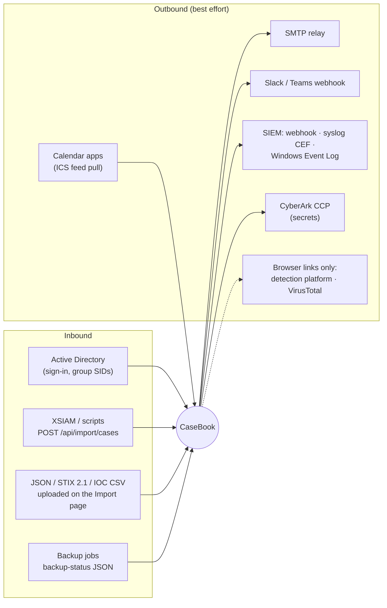

# Integrations

Every connection CaseBook makes to something outside itself, and every way data comes in. All outbound calls go
to endpoints an operator configured; **nothing calls an AI service** ([decision 0005](../decisions/0005-no-outbound-ai.md)).

| Integration | Direction | Default | Config | Code |
|---|---|---|---|---|
| Active Directory | in | on (Windows mode) | `Auth:Mode`, role mappings in-app | `Web/Security/RoleClaimsTransformer.cs`, `WindowsNames.cs` |
| Case-import API | in | available | API tokens in-app | `Web/Program.cs`, `Application/Import/` |
| File imports (JSON, STIX, CSV) | in | available | — | `Application/Import/` |
| Email (SMTP) | out | off | `Email:*` | `Infrastructure/Notifications/` |
| Team chat | out | off | `Chat:Webhook:*`, `Notifications:Chat:*` | `Web/Notifications/ChatWebhookNotifier.cs` |
| SIEM | out | off | `Siem:*` | `Infrastructure/Siem/`, `Web/Siem/` |
| CyberArk CCP | out | off | `Secrets:CyberArk:*` | `Infrastructure/Secrets/` |
| Calendar feed | pulled | off | `Agenda:FeedKey` | `Application/Work/AgendaFeedService.cs`, `Infrastructure/Agenda/` |
| Backup status | read from file | off | `BackupStatus:*` | `Web/Ops/BackupHealthReader.cs` |
| Detection platform, VirusTotal | links in the UI only | — | `ExternalLinks:*` | Briefing (case record) and Things › IOCs & entities |
| MITRE ATT&CK | embedded data | — | — | `Application/Mitre/` |
| STIX export | file download | — | — | `Application/Export/StixExportService.cs` |

## Active Directory

- **What:** Windows Integrated Authentication through IIS; AD group SIDs resolved to group names and mapped to
  CaseBook roles; display names looked up for the user directory.
- **Auth:** Kerberos/NTLM; the app pool's identity reads group names.
- **Failure:** a SID that can't be resolved is cached as unknown for five minutes, then tried again (BUG-223); if the
  role directory can't load at startup it's empty, and **nobody gets permissions** until it loads.
- **Request-path lookups (BUG-565):** a signed-in user's display name and the names of their group SIDs are looked up
  on their own threads, one lookup per name at a time, waited on for 2 seconds (display name) or 5 seconds (a
  sign-in's unnamed groups, translated together). Past that the bare username is shown, or the group matches only
  mappings by SID, for that request; nothing is kept as unresolved, and an answer that lands later is kept. A domain
  with two lookups still blocked isn't asked again until one returns, so a hung domain controller holds a few
  threads rather than one per request.
- **Local testing:** not possible on the development handler; use a domain-joined test server.
- **Account entities (BUG-416):** an Account entity (or an email address the directory knows) is looked up when it's
  added to a case, and its details (display name, title, department, manager, email, enabled, locked, expiry, last
  logon, password last set, created, DN) are kept with the case as a hashed snapshot. The entity panel's *Look up now*
  shows the account as it is now, with what changed, and *Keep with the case* adds that as a new snapshot. Lookups are
  read-only, as the app pool's identity, 10-second timeout. A bare name or a UPN is looked up in the server's own
  domain, and `DOMAIN\sam` only when DOMAIN is in the server's forest or has a trust with its domain (BUG-419: the
  list is read from our own domain controller and kept for an hour). Any other domain, and a local account (`.\sam`,
  `COMPUTER\sam`), is shown as *Not looked up*: nothing is sent anywhere, so an indicator naming an attacker's domain
  can't make the server contact it. A domain that failed or timed out isn't asked again for a minute (BUG-420); one
  whose lookups timed out and are still blocked isn't asked again until they return, and other domains are still
  asked (BUG-471). A domain listing in which either of its two searches runs into its 10-second limit may be
  incomplete, so it's treated as a failure and retried after a minute, not kept (BUG-470); a slow listing whose
  searches each finished in time is kept, even when it comes back after the lookup stopped waiting (BUG-498). An
  add looks up at most 50 accounts within 15 seconds in all (an import shares one allowance), stops at the first
  unavailable answer, and keeps what it took so far; an unreachable directory keeps nothing and the add is saved
  either way. A snapshot is shown as the account's details only when it was taken for the value the entity has now;
  one taken before the value was edited is listed as "taken for" the old value (BUG-432). A bare name the directory
  knows is typed as an Account when it's added.
  In development (not Windows sign-in) a made-up CONTOSO directory answers for `jdoe`, `asmith` and `svc_backup`.

## Case-import API (and XSIAM elevation)

- **What:** lets a producer (an XSIAM playbook, a script) hand a case or additions to an existing case to a human
  reviewer.
- **Auth:** bearer API token with `EditCases` ([API.md](../API.md)). IIS must allow anonymous access to `/api` so
  the token scheme applies (the installer does this).
- **Data:** a `casebook-case-import` JSON document: target (new case or an existing case id), origin, summary,
  timeline entries, entities, tasks. Up to 5 MB.
- **Result:** a pending import, nothing written to a case. A reviewer confirms or rejects it in *Import →
  Pending imports*. Reviewers find it on the Desk ("Waiting for review") and by the count beside *Import* in the
  sidebar, and, when turned on, by email (`Notifications:ImportSubmitted:Email`), a chat post
  (`Notifications:Chat:ImportSubmissions`) and a line in their digest once it has waited a day (CAP-01). A failure to
  tell them never fails the submission; the response is unchanged.
- **Failure:** 400 with an `error` message for invalid documents; 401/403/413/429 as documented; a server error is a
  JSON 500 (`{ "error", "ref" }`, the ref matching the server log), as in [API.md](../API.md).
- **Retry:** none on the server; the caller decides.
- **XSIAM:** `integrations/xsiam/CaseBookElevate.py` is a template automation (Python 3, `requests`) that builds
  a new-case document from an XSIAM incident (name, severity, times, details, incident id, indicators with DBot
  verdicts) and posts it. It hasn't been run against a live tenant; adapt the mappings and test it first. See
  [integrations/xsiam/README.md](../../integrations/xsiam/README.md).
- **Local testing:** create a system token in Administration → API tokens on a development instance, then
  `curl -X POST http://localhost:5103/api/import/cases -H "Authorization: Bearer <token>" -H "Content-Type:
  application/json" --data @integrations/xsiam/sample-elevation.json`.

## File imports

On the Import page: a case-import JSON document, a **STIX 2.1 bundle**, or an **indicator CSV**. STIX and CSV
are converted into an entities-only document (up to 2,000 indicators). Everything goes through the same editable
preview and the normal audited writes. The *Generate a prompt for your AI* step builds a prompt embedding the
schema, for use in the organization's own approved AI tool.

## Email (SMTP)

- **What:** breach escalation to Legal, assignment, mentions, handoff, reminders (overdue, due soon, deadlines,
  stale cases), digests, API imports waiting for review (CAP-01), the quarterly executive report, integrity alarms
  ([who gets what](../architecture/backend.md#who-gets-notified-about-what)).
- **Auth:** none. `SmtpClient` with host, port and STARTTLS (`Email:EnableSsl`). The relay must accept the server
  anonymously or by IP.
- **Data:** branded HTML plus a text part; subject and body from editable templates; links and logo only when
  `App:BaseUrl` is set. Restricted-case details only go to people who can see the case.
- **Failure:** a scheduled reminder that wasn't delivered isn't marked sent, so the next scan tries it again (BUG-08); a
  breach escalation or integrity alarm is kept in the alert outbox and retried, then shown to administrators as
  undelivered (BUG-101). With email off nothing is marked sent and critical alerts wait in the outbox, so they go out
  once email is on again (WF-21); the log records recipient counts only. A relay that times out or can't be reached
  three times in a row within two minutes is backed off (1 minute, doubling to 10) so user actions don't each wait out
  its timeout; meanwhile reminders and outbox alerts wait for their next try (an outbox retry isn't used up), and an
  assignment, mention or handoff email is held (up to 500, in order) and sent when the relay answers. It's held too
  when its own send didn't reach the relay or was turned away for now (a 4xx such as "mailbox full"); a permanent
  refusal of its addresses (5xx) isn't. Refused addresses are an answer, so they never back the relay off (BUG-650).
  A refusal that isn't about the addresses (530 "authentication required", a refused sender) or an email setting
  that stops every send (a From that isn't an address) keeps the held mail and logs an error until it's fixed
  (BUG-652). While email is turned off, held mail waits and goes once it's on again (BUG-651). One recipient's
  "not now" puts only that email back for its own retry; the others go on (BUG-653). So does a refusal of one
  message at the end of its send (550 5.7.1 from a DLP or transport rule, 554 content rejected): it's retried on its
  own back-off and given up after 24 hours, and only when the next email is refused too is it read as the session's;
  a 552 "message too large" is refused for good (BUG-659). Before an email about a case
  goes, its recipients are checked against the case again: someone who lost access while it was held isn't sent
  it, and it's dropped if the case is gone (BUG-654). Held mail is kept in the `HeldEmails` table, so it survives a restart. It's removed once
  it's sent, refused for good, or given up after 12 temporary refusals or after 24 hours with the relay unreachable
  or refusing every email (a relay outage doesn't use up the tries; each give-up is logged as an error); past 500
  the newest is dropped and logged (BUG-576, BUG-608, BUG-617, BUG-626, BUG-640). The log names SMTP failures by
  their type and status code, never the relay's reply, which can echo an address (BUG-657).
- **Testing:** Administration → Notifications → *Send a test email*. Locally, run an SMTP sink such as smtp4dev
  on localhost:25 with `Email:EnableSsl=false`.

## Team chat (Slack or Teams)

- **What:** a shared channel broadcast for selected events (breach escalations, assignments, mentions, reminder
  summaries, API imports waiting for review), chosen per type under Notifications.
- **Auth:** the incoming-webhook URL is the credential (`Chat:Webhook:WebhookUrl`, literal or a CyberArk
  reference). Must be https (http only to loopback).
- **Data:** Slack mrkdwn or a Teams MessageCard; restricted cases are redacted ("Breach escalation (restricted
  case)"; an import into one says only that it's waiting, without its summary or origin).
- **Failure and retry:** up to `MaxAttempts` (3) with a 250 ms × attempt back-off. A scheduled reminder's post that still
  fails is tried again at the next scan (WF-20); an event post (an escalation, an assignment) is then dropped and logged.
  A webhook that fails to answer (or answers 5xx/429) three posts in a row within two minutes is backed off like the
  mail relay; event posts made meanwhile are dropped and logged.
- **Limits:** a broadcast channel, not per-user messaging.
- **Testing:** point the URL at `http://localhost:<port>/` with any request-capture tool.

## SIEM security-event stream

- **What:** a structured stream of security-relevant actions for detection rules: reads, downloads and exports,
  refusals, role, mapping, setting and token changes, reference-data changes (5405), legal holds, restrictions, and the
  case lifecycle from filing to archive, including an applied import (5506-5515, CAP-06). Full reference, payload and
  event-id catalog: [OPERATIONS.md §5](../OPERATIONS.md#5-siem-security-event-stream-f-18).
- **XSIAM:** the lifecycle events end their `detail` with `detection=<id>` when the case records the detection
  platform's incident id (an elevation from `CaseBookElevate.py` sets it), so a correlation rule can join a CaseBook
  close, reopen or downgrade to the XSIAM incident it came from.
- **Transports:** webhook (JSON over https, optional bearer or API-key header; token may be a CyberArk
  reference), syslog (RFC 5424 with a CEF payload, UDP or TCP), Windows Event Log (event id = catalog id).
- **Delivery:** events go into a bounded in-memory queue (`Siem:QueueCapacity`, 2048) and a background dispatcher
  sends each to every enabled transport. Never blocks a user action. Webhook retries up to 3 times; syslog and
  Event Log don't retry. Overflow and anything queued at shutdown is lost; the audit chain remains the record.
- **Testing:** Administration → Diagnostics → *Send test event* (id 5901) reports per-transport success.
  Locally, a webhook to `http://localhost:<port>` or syslog to a local UDP listener.

## CyberArk Central Credential Provider

- **What:** fetches secrets at runtime instead of keeping them in configuration. **Only `Siem:Webhook:Token` and
  `Chat:Webhook:WebhookUrl` are resolved this way today.**
- **Auth:** the CCP Application ID, plus whatever the CyberArk administrator requires: a client certificate
  (`ClientCertificateThumbprint`, in `LocalMachine\My`), allowed machines (source IP), and/or the OS user (the
  app pool identity).
- **Data:** `GET {BaseUrl}/api/Accounts?AppID=…&Safe=…&Object=…` for a reference written as
  `@cyberark:Safe=<safe>;Object=<object>`.
- **Failure:** cached for `CacheTtlSeconds`; on error, `FailClosed=true` resolves to nothing (the dependent
  feature degrades, for example the webhook sends without auth), `false` serves the last good value. Health in
  Diagnostics → Secret resolution.
- **Config needs a recycle.** Full guide: [OPERATIONS.md §6](../OPERATIONS.md#6-secret-management-f-19).

## Calendar feed

- **What:** each user's open, dated tasks as an ICS file (`/agenda/agenda.ics`, signed in) or a subscription URL
  for calendar apps (`/agenda/feed.ics?token=…`).
- **Auth:** the subscription token is an HMAC (`Agenda:FeedKey`) over the user id and issue time. Users can reset
  their link; it stops working after 365 days or if the user loses all roles. Blank `FeedKey` disables the feed.
- **IIS:** the feed must be reachable anonymously for calendar apps, which needs a carve-out
  ([troubleshooting](troubleshooting.md#health-probe-returns-401)).

## Backup status file

Your backup and restore-verification jobs write a small JSON file; CaseBook reads it to show backup freshness in
Diagnostics. Format and job snippets: [OPERATIONS.md §1.3.1](../OPERATIONS.md#131-backup-health-status-file-h-04).

## Links out

`ExternalLinks:DetectionCaseUrlTemplate` turns a case's detection id into a link to the SIEM or detection
platform (`{0}` = the id); `ExternalLinks:VirusTotalUrlTemplate` adds a lookup link to network and hash
indicators. These are plain links in the browser; CaseBook makes no request to either service.

## MITRE ATT&CK

The Enterprise matrix (v19.1) is embedded as JSON and loaded once. No network access. To update it, see
[src/IncidentManager.Application/Mitre/README.md](../../src/IncidentManager.Application/Mitre/README.md).

## Exports for other systems

| Export | For |
|---|---|
| `/export/iocs.csv` | A blocklist feed of malicious indicators |
| `/cases/{id}/graph.stix.json` | A case's entities and relationships as STIX 2.1, for a TIP or a partner |
| `/campaigns/{id}/rollup.json` | A campaign rollup |
| `/export/config-bundle.json` | Moving configuration between CaseBook instances |

See [workflows/reporting.md](../workflows/reporting.md#cross-case-reporting) for the rest.
