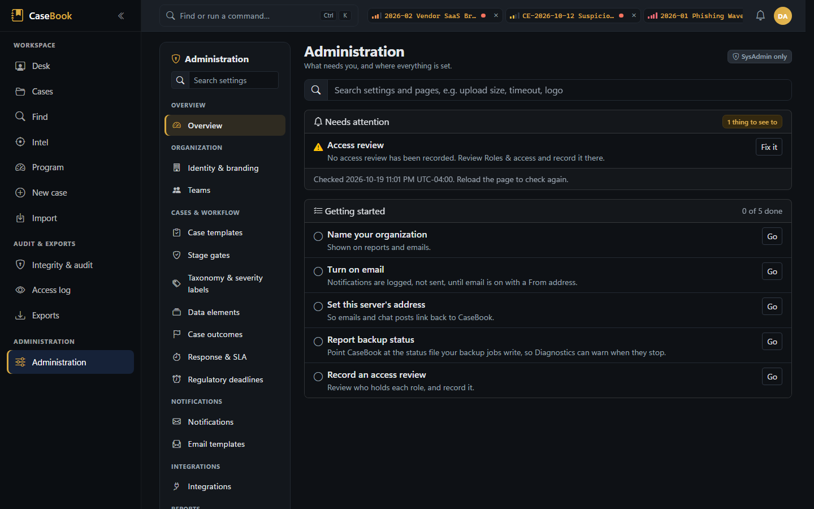
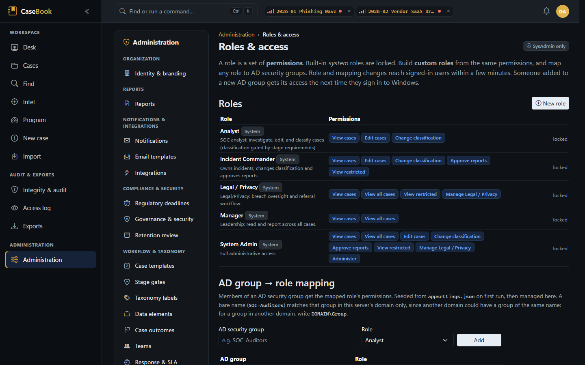
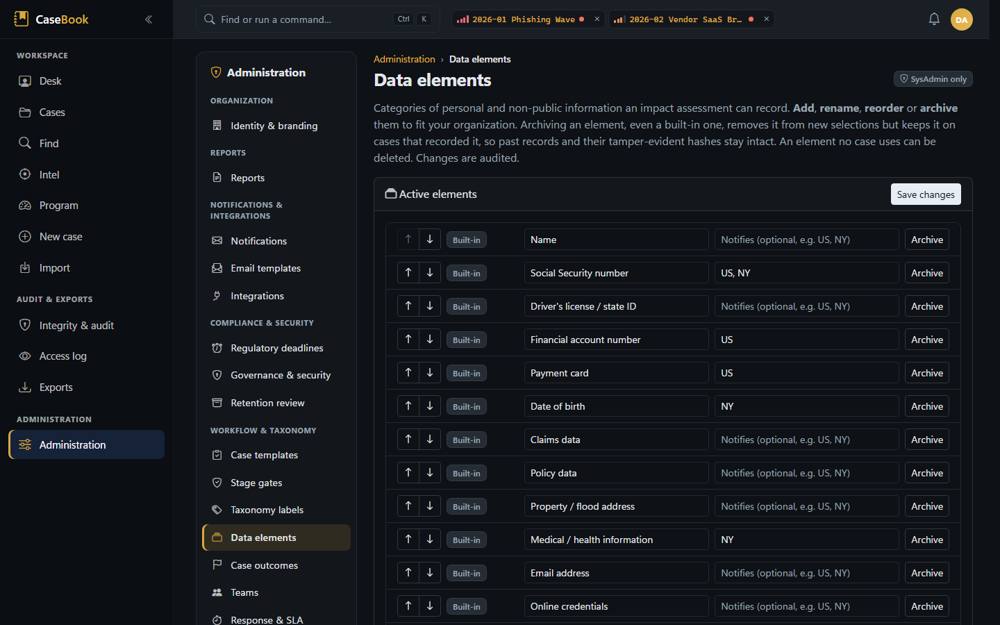

# Administration workflows

Everything under **Administration** needs the `Administer` permission (SysAdmin by default). Every change is
audited and hash-chained, and most take effect without a restart. Server-side settings (connection strings,
authentication, key paths, SIEM, CyberArk) aren't editable here; they're shown read-only. See
[operations/configuration.md](../operations/configuration.md).

## The admin areas

| Area | Route | What you can do |
|---|---|---|
| Identity & branding | `/admin` | Organization and team name, time zone, default jurisdictions, accent and ink colors, report logo |
| Reports | `/admin/settings/reporting` | Report defaults (TLP, defanging, milestones, late-entry notes, separate approver, lessons legend), the section-layout designer, report profiles, the Word template library |
| Notifications | `/admin/settings/notifications` | Email on/off, sender, distributions, reminder scans and their timing, mandatory types, chat routing, base URL; the delivery-readiness panel; the **Email sign-in** card (CAP-05: none, username and password, or Windows; the password write-only, encrypted with Data Protection, read-only when the server's configuration sets it) with a test email beside it; the **Team chat webhook** card (CAP-40: the URL write-only, https checked before it's saved, "set on … by …" with Replace and Clear, read-only when the server's configuration sets it) with *Send test* beside it; and a test email and chat message |
| Email templates | `/admin/email-templates` | Subject and body of every notification email, with preview (the branded shell is fixed) |
| Integrations | `/admin/settings/integrations` | Detection-source label and link template, VirusTotal link template |
| Regulatory deadlines | `/admin/settings/regulatory-deadlines` | Deadline clock on/off, start basis, default window, per-jurisdiction rules |
| Governance & security | `/admin/settings/governance` | Retention (case retention for the retention review, the monthly retention email to Legal, access-log retention), integrity (auto-seal, evidence re-hash), access logging scope and coalescing, idle timeout, the access-review reminder, two-person legal-hold release |
| Offboarding | `/admin/users/{reference}` (from Known users) | CAP-30: one person who leaves: their roles at last sign-in (AD stays the source; remove their groups there), the open cases they command or are on (restricted ones counted unless you're cleared for them), their open tasks, their working API tokens and whether their calendar link works. **Revoke** their tokens and **Void the calendar link** (each confirmed and audited; the link is never shown); reassign their cases with **Reassign…** in Program › Team workload |
| Retention review | `/admin/retention` | CAP-10: closed cases past case retention, with each one's legal hold, open improvement actions and regulatory notices not recorded; archive up to 25 at a time after seeing them listed. Nothing is purged |
| Case templates | `/admin/templates` | Playbooks: defaults for the new-case form and steps that become tasks |
| Stage gates | `/admin/gates` | One gate per trigger: requirements, blocking or advisory, minimum reason length |
| Taxonomy labels | `/admin/taxonomy` | Rename, hide or reorder display labels for six lists: classifications, phases, entity types, dispositions, timeline entry types and relationship types (display only; stored values don't change). Severity labels are under Response & SLA |
| Data elements | `/admin/data-elements` | Personal-data categories and their notification jurisdictions; archive or (if unused) delete |
| Case outcomes | `/admin/outcomes` | What a case can conclude when it closes; add, relabel, describe, reorder, archive or (if unused) delete |
| Response & SLA | `/admin/settings/sla` | SLA targets per severity, breach overrides, at-risk threshold, severity labels |
| Roles & access | `/admin/roles` | Custom roles (from the eight permissions) and AD group mappings; the access review (broad access, restricted cases, known users, each opening their offboarding page (CAP-30), active API tokens) with its CSV, and **Record this review** (CAP-15) |
| API tokens | `/admin/api-tokens` | System tokens for machine producers |
| Server configuration | `/admin/settings/server` | Read-only view of server-side settings (secrets as present or absent, and where from: the server's configuration or Administration); and the **SIEM webhook token** card (CAP-40: write-only, as the chat URL's, with *Send test event* beside it) |
| Setting sources | `/admin/settings/source` | Each setting's effective value and where it comes from |
| Configuration bundle | `/admin/config-bundle` | Export, diff and import editable configuration |
| Updates | `/admin/settings/updates` | The running version and the last upgrade; the update check (off by default: one anonymous call a day to the GitHub Releases API) with each newer release's notes; the exact elevated command to upgrade this site |
| Diagnostics | `/admin/settings/diagnostics` | Backup and restore freshness, evidence-integrity status, CyberArk resolution health, delivery health (CAP-04: email, chat and each SIEM transport; in memory since restart), the scheduled jobs (CAP-29: each background job's last run, next due and last error by type, in memory since restart; **Run now** for the read-only scans), the email relay sign-in check, a "re-enter" check for a saved chat URL or SIEM token that can't be decrypted here (CAP-40), SIEM test event, writable-path checks, the retention review's latest count (CAP-10) and the access-review reminder (CAP-15) |
| Style guide | `/admin/style` | Live design-system reference for developers |
| Access log | `/access-log` (main navigation) | Who read which case or downloaded what |

## Editing settings

1. Open a section. Each card shows its settings; changed values are marked "Unsaved changes".
2. **Save changes** in the bar at the bottom of the section (or *Discard*). Leaving with unsaved changes asks
   first.
3. The service checks each value against the catalog (type, range, options), writes an audited `AppSetting`
   row, reloads configuration and emits SIEM 5403.

Two things to know: where no override exists, the form shows the value from your server files (or the catalog
default when they set none), so what you see is what's in effect; and **clearing a number restores the file
value**, so enter `0` to turn something off (an SLA target is the exception: blank turns it off). Numbers have
limits (for example, scan intervals at most 744 hours), and a link template must be a full `https://` address
with `{0}` where the value goes.

## Roles and AD groups

- **System roles** (Analyst, IncidentCommander, Manager, LegalPrivacy, SysAdmin) are locked; their permissions
  are reset to code on every start.
- **Custom roles**: name, description and any combination of the eight permissions.
- **Mappings**: an AD group name (or SID) to a role; a group can map to several roles.
- Safeguards: the last role holding `Administer` can't lose it or be deleted; removing a mapping says what it
  will do. Deleting a role removes its mappings.
- Changes reach signed-in users within about two minutes. New AD group *membership* needs a new Windows logon.
- SIEM 5401 (roles) and 5402 (mappings).
- The installer seeds mappings from `RoleMapping:Groups` only on first start; afterwards they're managed here.

## Access review (CAP-15)

Below the roles and mappings, **Access review** shows who can see across cases (roles granting all cases or restricted
cases, and the AD groups that confer them), each restricted case's incident commander and assignees, everyone who has
signed in with their roles at that sign-in (idle more than 90 days is flagged dormant), and the **API tokens** that work
now (not revoked, not expired) with the roles each was granted, when it was last used and when it expires. A personal
token acts only within its owner's current roles.

- **Download (CSV)** (`/export/access-review.csv`): the same review, one row per role, case, user and token with a
  `section` column, and the last recorded review on the second line. It's recorded in the access log and sent as SIEM
  5304, like every export.
- **Record this review**: say what you reviewed and what came of it (up to 1,000 characters), then *Record review*. It's
  recorded as you, now, as an entry in the audit trail (entity type `AccessReview`), not as case data, so it's chained,
  sealed and can't be edited. The card shows **Last reviewed … by …** and when the next is due.
- **Reminder**: Diagnostics flags *Access review* when none has been recorded in `Governance:AccessReview:ReminderDays`
  (default 90; 0 turns it off), or when none has ever been recorded. It's worked out when the page opens, from the audit
  trail, as the evidence-key drill's reminder is from the key's record.

To find past reviews, filter the audit trail (Integrity & audit) by the entity type *AccessReview*.

## Retention review (CAP-10)

`Retention:CaseYears` (Governance & security, default 7) decides when a closed case is listed under **Retention review**:
closed more than that many years ago and not archived. 0 turns the review off. Exercises aren't listed. The list is your
own need-to-know view: an administrator without the clearance for a restricted case doesn't see it.

Each row shows the case, when it closed, its **legal hold** (and a release requested), its **open improvement actions**
(they don't stop archiving; they're tracked under Program whatever their case's state) and each **regulatory notice not
recorded** with its due date (a jurisdiction already notified isn't listed). A case under a legal hold, or with a notice
not recorded while the deadline clock is on, can't be archived, and says so instead of offering *Archive*.

The list shows at most **500 cases**, the oldest closings first. With more due, the header says so ("the first 500
(oldest closed) of 1,234 are listed") and counts them all; archive those listed and the list moves on to the next.

1. Tick the cases to archive (at most 25; the header box ticks the first 25 that can be archived), or use a row's
   *Archive*.
2. *Archive selected* lists the cases by number and asks you to confirm.
3. Each is archived through the case's own archive action, as you, one save each: the case still refuses a hold or a
   running deadline, and a case reopened or archived since the list loaded is left alone, even one reopened while the
   batch runs (it's checked again on the save). A case that fails some other way (the save refused) is reported and the
   rest go ahead. The page says what happened to each.

Archiving takes a case off the lists, dashboards and reminders; it stays in the record and the audit trail and can be
restored from its page. **Nothing is deleted.** Purging stays out of CaseBook until it can have two-person control.

A job counts the cases past retention at start-up and then once a day by default (and within a few minutes after the
setting changes) for
Diagnostics, across every case but exercises, so it can count cases your list doesn't show. With
**Monthly retention-review email to Legal** on (off by default), the Legal / Privacy distribution is told once a calendar
month how many cases are waiting and how many are under a hold: counts only, no case named, no link. The email's wording
is the *Retention review (Legal / Privacy)* email template. The job only counts and tells (ADR 0004): it never archives.

**Reference data in the SIEM (CAP-06).** Every save on the pages below (case templates, stage gates, taxonomy labels,
data elements and their regulatory deadline rules, case outcomes, report profiles, Word and email templates), and a configuration
bundle import, also sends SIEM event 5405 naming what changed by its kind and name (never a template's text). A
change to a stage gate or a regulatory deadline rule, and any delete, is a Warning. See
[OPERATIONS.md §5](../OPERATIONS.md#event-id-catalog).

## Case templates (playbooks)

A template has a name, description, active flag, sort order, optional default classification and severity,
data-type defaults, summary prompts, and ordered steps (title, description, owner hint, due offset in hours,
task kind). On the new-case form it pre-fills values and turns its summary text into prompts. After creation, or
later through *Apply playbook*, its steps become tasks. Editing a template replaces its steps; tasks already
created aren't changed. Five starter templates are seeded: Phishing wave, Ransomware, BEC / wire fraud, Lost /
stolen device, Third-party / vendor breach.

## Stage gates

See [governance.md](governance.md#stage-gates) for how gates work. Here you add requirements (a machine check
from the registry, with a number where it takes one, or an attestation's wording), mark each blocking or
advisory, order them, set a minimum reason length, and activate the gate. Only one gate per trigger can be
active. Gate edits don't change past passages, which recorded their own outcome.

## Data elements and notification rules

- **Data elements** are the personal-data categories an impact assessment records (13 system ones, such as SSN,
  payment card and medical information). Each has a stable key (stored on cases, never renamed), a label you can
  change, a sort order, and **notification jurisdictions** (`US, NY`) that drive the deadline clock. System
  elements can be archived but not deleted; custom ones can be deleted only if no case uses them. A deleted
  element's key isn't reused: an element added later with the same label gets a numbered key (`PassportNumber2`).
- **Notification rules** set the window per jurisdiction code (NY and US, 72 hours, are seeded). System rules
  can't be deleted.

## Case outcomes

What a case can conclude, chosen in the close-out view ([closing](case-lifecycle.md#closing-outcome-and-closing-brief))
and printed in the report. Six are seeded: Confirmed, Policy violation, Benign or expected, False positive,
Inconclusive and Duplicate. Each has a stable key (stored on cases, never renamed), a label and a one-line
description you can change, and a sort order. Added outcomes get a key made from the label ("Insider misuse" →
`InsiderMisuse`), never one a deleted outcome had or a case records (then it's numbered, `InsiderMisuse2`).
Built-in outcomes can be archived but not deleted; an added one can be deleted only if no close recorded it. At least one outcome must stay active. Keep the wording neutral: it's part of the case record.

## API tokens

System tokens: a name (unique among active tokens), the roles they act with, and a required expiry (up to 365
days). The token is shown once. Revoke at any time. Personal tokens are created by each user from the account
menu. See [API.md](../API.md).

## Configuration bundle

Moves editable configuration between instances (test to production, a new instance from a baseline), or
snapshots it for comparison with a revised incident response plan.

- **Export** (`/export/config-bundle.json`): editable settings and taxonomy labels, roles, AD mappings, case
  templates, stage gates, report profiles with their Word templates, data elements, case outcomes and notification rules,
  signed with the instance's seal key. Email-template wording isn't included. Recorded in the audit chain.
- **Import** (up to 64 MB): the signature is checked against the public key **inside the file**, and the page
  says whether that key is this instance's. A valid signature is required: the page won't offer Apply without
  one, and `ConfigBundleService.ImportAsync` itself refuses a bundle whose signature doesn't verify. A diff
  shows what would change. Import adds and updates; it never deletes, and never changes system roles'
  permissions. Every change is audited (SIEM 5401–5403).
- Never included: cases, evidence, the audit trail, server-side configuration.

A valid signature proves the file wasn't altered after signing, not who made it, so whose key it is decides
(CAP-16):

- **This server's key** (a re-import here) or a **trusted key**, one in the server-side folder
  `Config:TrustedBundleKeys` ([configuration](../operations/configuration.md#34-integrity)): the bundle imports as
  before. The page's *Trusted signing keys* card lists the keys held, by id and file.
- **Any other key**: Apply stays off until you type the key's id, which the page shows. Check it first on the source
  server's Integrity page (*Signing key*). To trust a source for good (test to production, say), put its public key
  (the public half of its seal-signing key, in PEM form) in the folder and restart.

The audit entry and the SIEM 5405 name the key and how it was trusted. A bundle stating a trusted key's id (or this
server's) while carrying another key is refused.

## Integrity operations

On the **Integrity & audit** page (any `ViewCases` user can verify; sealing needs `Administer`):

- **Verify now**: checks the whole chain and the latest seal (shared, at most once a minute).
- **Seal chain head**: verifies the whole chain and its records, then signs the current head. It refuses while the chain
  doesn't verify, since a seal would make a rewritten history read as authentic (REV-04).
- **Audit trail**: the whole trail, newest first, 100 entries a page (*Newer* / *Older*). Pages follow on by sequence
  number, so entries written while you page neither repeat on *Older* nor go missing on *Newer*; the summary shows the
  page's range by sequence (`#1,000 to #901`, the **#** column) and says when it's the latest. Filter by case number, actor,
  action, entity type (configuration such as Setting, Role, AD group mapping and Stage gate is grouped apart in the
  list) and UTC dates; *Export CSV* downloads what the filter shows (`/export/audit.csv`, up to 100,000 rows; a cut file
  says so at the top and on its last line). Need-to-know applies as on a case's Audit tab: someone who can't see a
  restricted case doesn't see its entries, and only oversight and administrators see configuration entries. The
  filters come from the address too (`?case=`, `?action=`, `?entity=`, `?key=`, `?from=`, `?to=`; the page's address never
  carries the actor, though the *Export CSV* link does, as a case's Audit tab export does), so a link can open it
  filtered, and following another link to the page (the menu's *Integrity*, Back, Forward) applies that link's filters: **History** beside each setting in Administration opens that setting's changes
  (`?entity=AppSetting&key=Email:From`), across a reset and the next change.
- **Compliance bundle**: for a date range.
- SQL Server ledger status, when enabled.

If the red integrity banner appears, follow [troubleshooting](../operations/troubleshooting.md#integrity-alarm-5001).

## Access log

`/access-log`: who opened which case and who downloaded which artifact or export, grouped into view sessions
(`Access:CoalesceWindowMinutes`), filterable by actor, case, type, restricted-only and date, with a CSV export.
`Access:LogScope` controls what's recorded (Off, RestrictedOnly, All). It's outside the audit chain and can be
pruned. Leadership also sees a "Viewed by" panel on each case's Audit tab.
