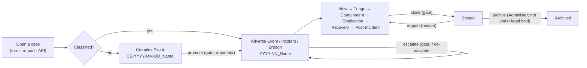
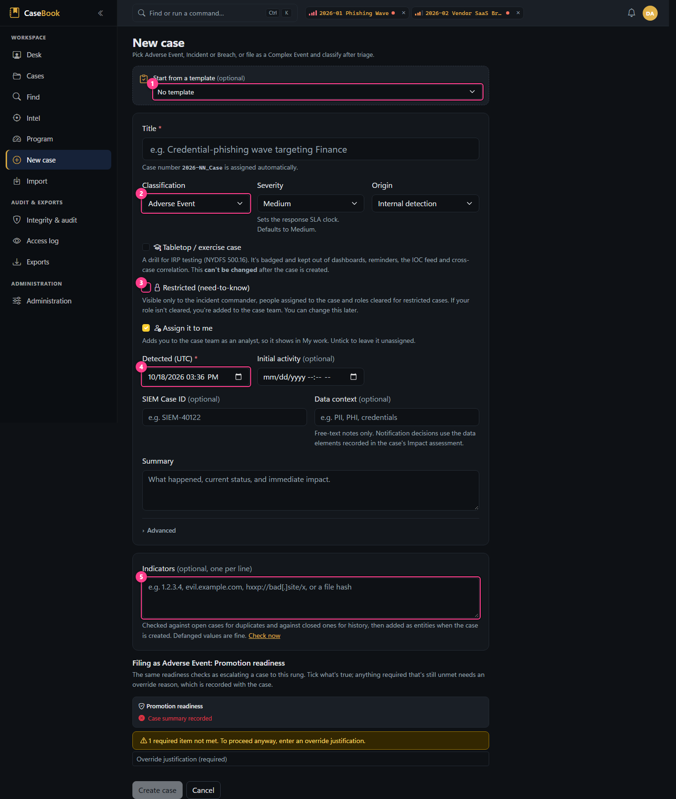
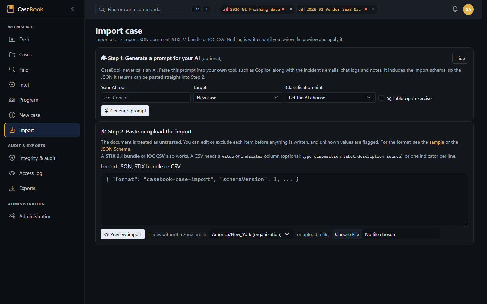
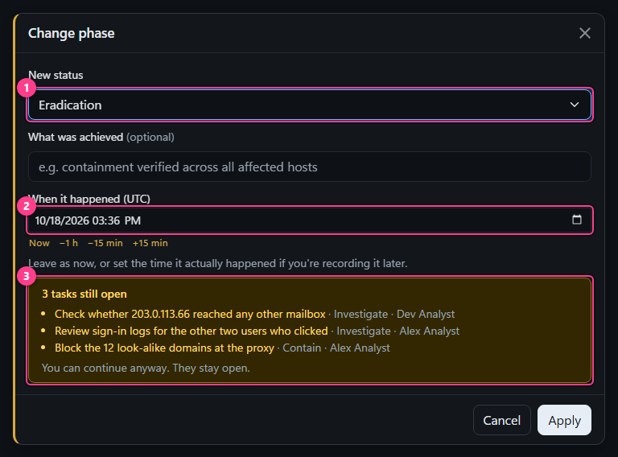

# Case lifecycle workflows

Opening, classifying, moving through phases, closing, reopening and archiving a case. Each workflow lists its
trigger, what the user sees, what happens in the code, what changes, who may do it, what's validated, the
errors, and what follows. Shared mechanics (permission check, need-to-know load, audit chain, notifications)
are described once in [backend.md](../architecture/backend.md#the-write-path).

## 1. Opening a case

| | |
|---|---|
| **Trigger** | *New case* (sidebar, case list, `g n`) → `/cases/new` |
| **The user sees** | A single form: optional template, title, classification (Complex Event, Adverse Event, Incident, Breach), severity (pre-filled from your last case), origin (internal, or third-party with vendor name, contact and reference), exercise, restricted, "assign it to me" (on by default), detected and initial-activity times, SIEM case id, data context, summary, an optional custom case number with a live availability check, and indicators (one per line).  |
| **Behind the scenes** | `CaseService.CreateAsync` → `CreateCaseValidator` → `Case.Open` (phase New; opening classification, phase and severity rows; brief v1 from the summary) → save. Then, as separate resumable steps: add each indicator as an entity (source "Filed at case creation"), link any matches you chose, apply the template's playbook tasks. Then the browser opens the case, where a case filed at a rung without a template is offered that rung's playbook steps (see *Playbook offer* under §3). |
| **Numbering** | Classified: `YYYY-NN_Slug`, where NN is the next number for that year (max + 1 among auto-numbered classified cases). Complex Event: `CE-YYYY-MM-DD_Slug`, with `-2`, `-3` on a same-day clash. Custom: anything up to 200 characters, unique. The slug comes from the title (first six words, 42 characters). On a number collision the save retries up to 20 times. |
| **Duplicate check** | When you leave the indicators box, press *Check now*, or press *Create* with unchecked indicators, `FindOpenCaseMatchesForIocsAsync` looks for the same values (refanged, case-insensitive, any type) on **open, non-archived, non-exercise cases you can see**. Matches are listed with "Don't link / Related to / Duplicate of / Part of campaign". The first *Create* pauses to show them; **Create anyway** on the pause creates (another *Create*, a double-click or Enter, doesn't pass it, BUG-602). |
| **Vendor seen before** (CAP-24) | On a third-party case the vendor name box offers the names on third-party cases you can see, exercises left out (`CaseService.ListVendorNamesAsync`: trimmed, one per name ignoring case, spelled as most of its cases spell it, from the latest 5,000 vendor cases, at most 500 names). The value stays free text. A known name shows *Seen before* (`FindVendorHistoryAsync`): how many of your visible, non-exercise cases name it (trimmed, ignoring case), how many are open, and the most recently closed one with its outcome and closing line (as the indicator check's), with a link to `cases?vendor=…&closed=true`, which lists the same cases. A restricted case outside your need-to-know is neither counted nor offered. Nothing shows when filing an exercise. |
| **Restricted** | If you mark it restricted and wouldn't otherwise keep access, you're added as an Analyst. |
| **Data changed** | `Cases`, `ClassificationChanges` (if classified), `StatusChanges`, `SeverityChanges`, `CaseBriefs` (if a summary was given), `CaseAssignments` + `AssignmentChanges`; then `CaseEntities`, `CaseLinks`, `ActionItems` |
| **Permission** | `EditCases` |
| **Validation and errors** | "A short descriptive name is required (used in the case number)." · title required (300) · summary 8000 · "Vendor name is required for a third-party event." · "The detected time can't be in the future." · "Activity can't begin after it was detected." · "Initial activity can't be more than 10 years before detection. Check the year." · "Case number '…' is already in use." |
| **Partial failure** | If the case saved but setup (indicators, links, tasks) didn't finish, an amber message offers **Finish setup** (resumes without duplicating) or **Open case as-is**. |
| **Afterwards** | No notification is sent on creation. The timeline shows "Case opened as …". |

**Exercise cases** are fixed at creation: they work normally but are excluded from dashboards, team workload,
reminders, digests, the calendar feed, the IOC feed and cross-case suggestions. An exercise and a live case can't be
linked or superseded into each other, and filing an exercise checks for duplicates only among exercises (WF-48).

## 2. Importing a case

### From the Import page

| | |
|---|---|
| **Trigger** | *Import* on the case list → `/cases/import`; or `?into=<caseId>` to add to an existing case |
| **The user sees** | Paste or upload a `casebook-case-import` JSON document, a STIX 2.1 bundle, or an indicator CSV (up to 4 MB; STIX and CSV become entities only, up to 2,000). Or use **Generate a prompt for your AI**, which produces a copy-paste prompt embedding the schema for your own approved AI tool. Then an **editable preview**: include or exclude each row, fix times and types, choose a new case or an existing one, and set the origin (provenance).  |
| **Preview rules** | Untrusted input: lengths are clamped with warnings; unknown values fall back with a warning; indicators are refanged, typed and de-duplicated; rows without text are dropped; **future-dated rows are excluded** ("This time is in the future, so the entry is excluded. Correct the time to include it."); a missing time becomes now (with a warning); a Decision without a rationale becomes a Communication; Handoff isn't importable (becomes Communication); no classification means Complex Event, and so does one your role can't file (no `ChangeClassification`, REV-14), with a warning. |
| **Behind the scenes** | `CaseImportService.ApplyAsync` creates the case through `CaseService.CreateAsync` (same validation, permissions and audit), then adds timeline entries (marked imported), entities and tasks through the normal `CaseService` methods. The document's top-level summary becomes a note; the new case's summary becomes brief v1. Each row's source, or else the document's origin, becomes the provenance. Resumable. |
| **Permission** | `EditCases`; `ChangeClassification` to file the new case onto the ladder (the page offers only Complex Event without it) |
| **Errors** | "This isn't a CaseBook case-import document (expected "format": "casebook-case-import")." · a newer schema version than the server supports · "A decision on the timeline needs its why. Add it, or change the entry's type." |

An *unrecognized* classification value is said back ("Filing it as a Complex Event") and the case opens as a
**Complex Event**.

**Which origin the new case gets.** The preview's *Origin (who found it)* says it, and where it came from:
`newCase.origin` as the document gives it (`InternalDetection`, `ThirdParty`, or plainly "internal", "third-party",
"vendor"); left out, third-party when the document names a vendor, internal detection when it doesn't. The reviewer can
change it there, and the note then says it was changed. The document's top-level `origin` is something else, where the
import came from (*Imported from* in the preview), and one that reads like a case origin with none in `newCase` gets a
warning. A case that still ends up with the wrong origin is corrected on its Briefing tab (*Changing the origin*, below).

**Attack steps on a third-party case.** Each event step comes in as an attack step when it carries ATT&CK `tactics`,
a `techniqueId` or an `environment` (`Vendor`, or `Ours` when the attacker reached our environment), and as a
disclosure milestone when it carries none. The preview shows each event row's kind on a third-party case (*Disclosure
milestone*, *Attack step at the vendor*, *Attack step in our environment*) with its ATT&CK detail, and the reviewer
can change it; choosing *Disclosure milestone* drops the row's ATT&CK detail. On an internal case every step is ours,
and `environment` is ignored.

### Historical and closed cases (schema v2, CAP-35)

A `schemaVersion: 2` document can describe how a new case went, so a case worked before CaseBook (or in another tool)
comes in as it stood rather than open in New. `target.newCase` may carry:

- `history`: the phase transitions, oldest first, each `{ "phase", "at", "reason"? }` (plus `containedAt` or
  `containmentNotNeeded` on a step past Containment without it, and `resolvedAt` on a step to PostIncident that skips
  Recovery, as the phase change itself asks). A step that moves on from Containment may give `containedAt` (FR-51:
  when it was contained, not before the Containment step nor after its own); without it the case is contained at the
  Containment step's time, as every import before v1.15.0 was, so older documents import unchanged;
- `outcome` (an active outcome key) and `conclusion`, when the history ends in Closed;
- `incidentCommander` and `assignments` (`{ "user", "role"? }`, Analyst or Observer), each a user id or UPN.

| | |
|---|---|
| **Checks (R4)** | Before anything is written: every step has a time; none is in the future or before `newCase.detectedAt` (which a history needs); they're in order; a history closes only at its last step, with an outcome and a conclusion; the outcome is active. Each step is then replayed through the phase change's own checks on a scratch case, so the preview refuses exactly what applying would: a `containedAt` or `resolvedAt` in the future, before detection or after its step, a `resolvedAt` before the contained time, and a step to PostIncident after a Containment that followed "not needed" (coming into Containment takes back the resolution recorded on the way past, so that step must give `resolvedAt` again). When the history closes the case and the close gate asks for a reason of at least N characters, the close's reason (the step's own `reason`, or the `conclusion` standing in for it) must have N. A failing one is shown in the preview's *History and team* card and Apply is refused ("History step 3: … give the history in order."); Apply checks again, as of then, before writing anything. The API refuses it with 400 before queueing (an inactive outcome and the close gate are judged at review). |
| **People** | Matched in the user directory when it's reviewed, by user id or UPN. Someone it doesn't know is a warning ("… isn't a user CaseBook knows … so they won't be added"), never dropped without a word; so is a name two directory rows answer to (a UPN shared by two accounts: "… matches more than one CaseBook user …"). |
| **Applying** | After the timeline, entities and tasks: the team (through the audited assignment), then each step through `CaseService.ChangePhaseAsync` at its time, so the contained, resolved and closed milestones derive from it (decisions 0010, 0011). A step without a reason gets "imported record: &lt;origin&gt;", except the close: it records its own reason, or the conclusion, as any close does. The close runs the close gate; when its checks can't be met, it's overridden with "imported record: &lt;origin&gt;" (followed by the close's reason when the gate's commentary minimum asks for more), recorded on the passage. All under the confirmer's name; resumable step by step. |
| **Notices** | A history that closes the case adds its team without "you've been assigned" emails: it's a record of finished work, not work to act on. One that leaves the case open tells its incident commander and team, as any assignment does. |
| **Only a new case** | A document that lands in an existing case (by `caseId`, or `detectionCaseId` matching an open case, CAP-14) leaves its history and team out, with a warning. |

A v1 document reads exactly as before; v2 fields in a v1 document are ignored, with a warning.

### From the API (pending imports)

A machine producer (an XSIAM playbook, a script) posts the same document to `POST /api/import/cases` with an
API token ([API.md](../API.md)). Nothing is written to a case: a **pending import** is stored, and the response
points at `/cases/import?pending=<id>`. The *Pending imports* table on the Import page lists them to anyone with
`EditCases`, except one into an existing case the reviewer can't see (the queue names that case). A reviewer opens
one, edits the preview and chooses **Confirm & apply** or **Reject** (with an optional note). The target is the case
the submitting token could see: a document naming a case the token can't see is queued as a new case, as its preview
said. An apply that fails part-way puts the import back in the queue with what it wrote, so the next confirm carries on
into the same case. A reviewer who opened it before that, and confirms from that older page, is refused ("An apply of
this import stopped part-way since you opened it …") rather than creating the case a second time; reopening it from the
queue carries on (CAP-35 review).

**By detection case id (CAP-14).** A document can name its case by the detection platform's incident id instead,
`target.detectionCaseId` (for example the XSIAM incident id). That's resolved when the import is previewed by the
person reviewing it (or by whoever pastes it on the Import page), among the open (not closed, not archived) cases
**they** can see, compared without regard to letter case:

- **One case carries it:** the preview targets that case.
- **None:** a new case is prepared from `target.newCase`, with a warning: "No open case you can see carries detection
  case id …". Choose a case if it belongs in one.
- **Several:** the preview asks the reviewer to choose ("More than one open case you can see carries …", naming them).

The queued submission records no target, so every reviewer sees it, under "Into the open case with detection case id …".
Given with `target.caseId`, the two must name the same case: if the case with that id (as the sender sees cases)
carries another detection case id or none, the document is refused (the API's 400, the Import page's error). When they
agree, it's an ordinary case-id target.

**Confirming a batch (CAP-35).** When one submitter has two or more waiting, the queue offers *Confirm all from
&lt;submitter&gt;…*. It lists that submitter's oldest waiting submissions by name, at most 25, and *Confirm these N* applies
them one after another, each claimed, previewed as the reviewer sees it and applied by the same audited writes as a
single confirm, under the reviewer's name (a person confirms, decision 0004). One that needs a person's eye (a target to
choose among several, a filing gate to tick, a history that fails its checks, a decision without its why, an earlier
apply that stopped) or that fails, however it fails, stays in the queue (with what it wrote kept, to carry on from), and
the result lists each one: applied into which case, or why not, with *Review*. A history that closes its case is always
left for a confirm on its own: its close can override the close gate's checks, which a person reviewing it sees. SIEM 5515 is sent per case applied, and each one's status reads `applied` to its sender.

**Asking what became of it (CAP-13).** `GET /api/import/cases/{pendingImportId}` gives the sending token the
submission's status: `pending` (waiting, or being applied right now), `applied` (with the case's number and id when the
token can see that case) or `rejected` ([API.md](../API.md)).

**Telling reviewers (CAP-01).** A submission isn't left for someone to stumble on. Everyone who can confirm imports
(`EditCases`) sees a *Waiting for review* item on their Desk and a count beside **Import** in the sidebar (up to 99+),
each counting only the submissions they'd see in the queue. Two notifications, both off by default, go out when one
arrives: an email to each reviewer (`Notifications:ImportSubmitted:Email`; one into a restricted case goes only to
those who can see that case) and a team chat post (`Notifications:Chat:ImportSubmissions`; for a restricted case it
says only that one is waiting). A reviewer's digest also says how many have waited longer than
`Notifications:DigestScan:ImportWaitingHours` (24 by default); a digest with only that to say uses its own email
template, *Personal work digest: imports only*. None of this applies anything (ADR 0004), and a failed
email or post never fails the submission. Applying one sends SIEM event 5515, naming the pending import.

## 3. Promoting and reclassifying

| | |
|---|---|
| **Trigger** | Actions → *Promote onto the ladder…* (Complex Event) or *Reclassify…*; also the command palette |
| **The user sees** | Target classification, **reason (required)**, *when it happened* (defaults to now; shows the recorded time beside it when different), and the **gate section** for an upward move: machine checks, attestations to tick, and an override justification box when something required is unmet. Apply stays disabled until the input is valid. |
| **Behind the scenes** | `CaseService.ReclassifyAsync`: for an **upward** move (or promotion), evaluate the stage gate of **every rung climbed** (`PromoteToAdverseEvent`, `EscalateToIncident`, `EscalateToBreach`; a jump from Adverse Event to Breach passes the Incident gate too, and the dialog shows them as one checklist) → `Case.Reclassify` → record a gate passage per gate → on promotion, renumber `CE-…` to `YYYY-NN_…` (original year, unless the number is custom) → save. After commit, on reaching **Breach**: email `Email:LegalDistribution`, chat broadcast if enabled (redacted for restricted cases), SIEM 5503. |
| **Data changed** | `ClassificationChanges` (with effective time), `GatePassages`, `Cases.Classification` (and `CaseNumber` on promotion) |
| **Permission** | `ChangeClassification` (Analyst, IncidentCommander and SysAdmin by default) |
| **Validation and errors** | "A reason is required to change classification." · the effective time can't be in the future, before detection, or before the previous classification change · "Stage gate '…' is not satisfied: N required items outstanding. Complete them or override with a recorded justification." · "Gate '…' requires a reason of at least N characters." · "…an override justification of at least N characters." |
| **Afterwards** | Timeline milestone "Classification X → Y" at the effective time, and a gate milestone (flagged if overridden). The brief shows "The case was reclassified as … after this version." Materiality becomes recordable at Incident and Breach. Notification-deadline clocks may start. |
| **Playbook offer** | After an upward move or promotion, and on a case filed straight at a rung, people who can edit the case see a notice under the header when an active template's default classification is the case's rung and some of its steps aren't tasks yet: "The Breach response playbook has 6 steps not on this case. *Add them…*" (with several such templates, one button each, "Breach: ransomware (4)…"). *Add them…* opens the Tasks tab's apply-playbook card on that template with only the missing steps ticked (others say "already a task"); nothing is added until *Add N tasks* there (ADR 0004). A step counts as on the case when any task, open, done or canceled, has its title, compared trimmed and ignoring case; a title repeated within the template is ticked once. The notice is worked out from the case each time it's shown (`PlaybookOffer.For`): it isn't shown on a closed or archived case, after a de-escalation, or on a site with no templates, and it goes once every step is a task. Dismissing it (×) hides it for you on that case and rung, kept in your browser (another browser, or a later escalation to a higher rung, shows it again). |

De-escalation (down the ladder) isn't gated. There's no way back to Complex Event.

### Changing the origin

Briefing → *Origin* → **Change to third-party / vendor** (or **Change to internal detection**), for a case opened or
imported as the wrong origin. `CaseService.ChangeOriginAsync` → `Case.ChangeOrigin`. Needs `ChangeClassification`,
since it moves the case between the internal and third-party counts and changes how its timeline reads.

- **To third-party:** the vendor (name, and optionally a contact and their reference) and a reason. When the case has
  attack steps, you say where they happened, **at the vendor** or **in our environment**; they stay attack steps
  either way (without this, a step with no ATT&CK detail would turn into a disclosure milestone), and each can be
  changed on the timeline afterwards.
- **To internal detection:** a reason. The vendor details and each step's environment are cleared. Refused while the
  case has disclosure milestones, which an internal case has no place for: retract them first (the vendor's notices
  can go on the investigation timeline as communications).

The change, with the reason, goes on the investigation timeline as a note; the audit trail keeps the values before.

## 4. Changing severity

Actions → *Change severity…*: new severity, a reason (required when raising it, so a later reader knows why; and when backdated by more than an hour), *when it
happened*. `CaseService.ChangeSeverityAsync` → `Case.ChangeSeverity`. Needs `EditCases`. Not gated; no
notification. Severity drives the SLA targets and stale-case thresholds. Timeline milestone "Severity X → Y".

## 5. Changing phase

| | |
|---|---|
| **Trigger** | *Advance to <next phase>* in the header, the phase bar, or Actions → *Change phase…* |
| **The user sees** | Target phase (all seven listed), "What was achieved" (optional when moving forward; required when the gate demands commentary or when backdated; choosing **Closed** opens the close-out view below instead), *when it happened*, a warning listing **open tasks** for the phases being left ("You can continue anyway. They stay open."), and when closing with a running notification clock, a warning that closing doesn't stop it. It opens as a sheet under the header.  |
| **Behind the scenes** | `CaseService.ChangePhaseAsync` → if the target is Closed, validate the closing record and evaluate the `CloseCase` gate, then write the closing brief → `Case.ChangePhase` → one save. |
| **Rules** | **Any phase can follow any other**, forwards or backwards, whatever the classification: a complex event can be contained and closed without ever being promoted, and its header shows *Advance* beside *Promote onto the ladder…*. Entering Recovery and Closed for the first time sets `ResolvedAtUtc` and `ClosedAtUtc` at the effective time; later visits don't move them. Leaving Closed clears `ClosedAtUtc`. Eradication and Post-Incident set no timestamp. **Entering Containment starts containment and sets no contained time** (FR-51, v1.15.0): the containment clock runs until the case is marked contained (below), or until it moves on from Containment to Eradication, Recovery or Post-Incident, which then asks *When it was contained* (required; defaults to now, with the Now / −1 h / −15 min / +15 min nudges; not before the case entered Containment, not in the future, not after the move). Moving back from Containment, or closing straight from it, asks nothing. Cases contained before v1.15.0 keep the time they entered Containment. Going past Containment without it (from New or Triage, or from Closed, to Eradication, Recovery or Post-Incident) needs a decision: when it was contained, or that it wasn't needed and why. "Not needed" (`ContainmentNotNeededReason`) stops the containment clock at that move and leaves the case out of time-to-contain and the containment target's met/missed counts. Moving back into Containment later takes the decision back: containment starts at that move (the case is uncontained until it's marked contained), and the case counts toward time-to-contain and the target again (BUG-229, FR-51). A resolved time recorded on the way past is taken back with it, since it can't come before the containment; the case is resolved again when it next reaches Recovery (REV-11). Going past Recovery without it (to Post-Incident) needs when it was resolved, which sets `ResolvedAtUtc` (BUG-208). Leaving Closed counts as going past them: a case closed from Triage and moved to Post-Incident is asked both (BUG-228). Closing straight away needs neither. |
| **Permission** | `EditCases` |
| **Errors** | The gate messages above; "Give a reason when recording a change more than an hour after it happened."; effective-time limits |
| **Afterwards** | Milestone "Phase X → Y" (and "Contained" when the move said when it was contained); SLA clocks stop at contained and resolved; dashboards update; the Report tab becomes prominent from Recovery and Lessons learned from Post-Incident. |

### Marking a case contained

| | |
|---|---|
| **Trigger** | While the case is in Containment and not yet contained: *Mark contained…* beside the containment clock in Next (or on its own there, "Containing since …", when no containment target applies), or Actions → *Mark contained…* (FR-51). |
| **The user sees** | Since when the case has been in Containment, and *When it was contained*: now, or the time it was, with the Now / −1 h / −15 min / +15 min nudges. |
| **Behind the scenes** | `CaseService.MarkContainedAsync` → `Case.MarkContained` → one save; the change to `ContainedAtUtc` is on the audit trail. |
| **Rules** | Only in Containment and only once; the time is not in the future, not before detection, and not before the case entered Containment. The case stays in Containment until it's moved on. Time-to-contain (detected to contained) and the containment target stop at this time. The move into Containment can't afterwards be re-dated past it. |
| **Permission** | `EditCases` |
| **Errors** | "A case is marked contained while it's in Containment." · "This case was already marked contained (…)." · "It can't have been contained before it entered Containment (…)." · "When it was contained can't be in the future." |
| **Afterwards** | Milestone "Contained" on the timeline (and in the handoff draft and Overview's recent list); the containment clock stops in the header, Next, the brief, lists and dashboards. |

### Closing: outcome and closing brief

A case closes with a conclusion of record, in the **close-out view** (a view of the case, not a dialog): *Close the
case…* in the header from Post-Incident, Closed in the phase bar, or Closed chosen in *Change phase…*. The left
column holds the closing record below; the right column the close gate's **readiness** (each check with its *Fix*,
statements to attest, the override justification), *when it closed*, the notification and open-task warnings, a note
that closing doesn't lock the case (what's recorded afterwards is marked "after closure"), and **Close the case**.
The draft stays while you look at the rest of the case: a *Close-out* tab in the bar returns to it until the case
closes or *Discard the draft*. The view asks for:

| Field | Notes |
|---|---|
| **Outcome** (required) | What the case concluded, from the active [case outcomes](administration.md#case-outcomes): Confirmed, Policy violation, Benign or expected, False positive, Inconclusive or Duplicate out of the box, as choices each with its description. Stored on the case (`OutcomeKey`) and on the close's `StatusChange`. |
| **What happened** (required) | Pre-filled from the brief's summary. Becomes the case summary, which the report prints as Summary. |
| **Conclusion** (required) | Pre-filled from the brief's working assessment: what the team concluded, and on what basis. It also stands in for the transition reason. |
| Open questions | The brief's open questions, each with its answer from the task that followed it up, or "No answer recorded" (advisory). |
| Draft these with your own AI tool | Collapsed. **Copy closing-brief prompt** puts a prompt on the clipboard holding the case's record (the account drafted from it, the current brief and the answers to its questions, the investigation timeline with decisions' reasons, the verdicts and the task results), the active outcomes, and rules for neutral, factual wording. The analyst runs it in their organisation's approved AI tool and pastes the reply; **Fill in from this reply** puts its "WHAT HAPPENED:" and "CONCLUSION:" parts into the fields, and its "OUTCOME:" when that's an active outcome key and none is chosen yet, for the analyst to check and edit. CaseBook calls no AI and sends nothing; a restricted case adds a reminder to use a tool approved for need-to-know material. |

Saving writes a new brief version (the **closing brief**: what happened, the conclusion, and Known and the open
questions carried over) and the phase change in one save, at the same instant, so the brief doesn't read as out of
date. When nothing changed, no new version is written. The closing fields count as the summary for the gate's
"Case summary recorded" check. A superseded case's close-out opens with the outcome *Duplicate* and the
supersede reason as the conclusion.

Errors: "Record the outcome and what the team concluded to close the case." · "Choose an outcome to close the
case." · "That outcome isn't available any more. Choose another." · "Say what happened to close the case." · "Say
what the team concluded to close the case."

Afterwards the header shows the outcome beside the phase, the Closed milestone reads "Phase X → Closed ·
*outcome*", the brief is marked **Closing brief** with its assessment labelled **Conclusion**, the report's
Outcome section leads with the outcome and the conclusion, and the case list can filter by outcome.

### The close gate

Seeded for every installation: *Closure readiness*, with "Case summary recorded" (required), "A report has been
generated" (advisory), "Required regulatory notifications recorded" (required), "Post-incident review recorded"
(required on Incidents & Breaches), "Every entity / IOC has a verdict" (advisory), and one attestation to tick,
"Evidence preserved and chain of custody complete", shown beside the evidence it's about. Administrators change it under
Administration → Stage gates. The full list of machine checks is in [governance.md](governance.md#stage-gates).

## 6. Correcting when a transition happened

From a classification, severity or phase milestone on the timeline, **Correct time** asks for the new time and a
reason (up to 2000 characters). `CaseService.CorrectTransitionTimeAsync` → `Case.CorrectTransitionTime`. The
change's effective time moves; a `TransitionTimeCorrection` row records old time, new time and reason; if the
change set the contained, resolved or closed time, that moves too (a contained time marked separately, FR-51, doesn't, and the
move into Containment can't be re-dated past it). The recorded time never changes.

Limits: not in the future, not before detection, between the neighbouring changes of the same kind, and not the
opening state ("That change isn't on this case, or it's the opening state, which can't be re-dated.").
Needs `EditCases`, plus `ChangeClassification` for a classification change.

### After closure

A closed case can still be edited: late evidence and answers are recorded where they belong. It isn't hidden,
though. The header shows **"N changes after closure"** (one per save, from the audit trail after the save that
closed it; the post-incident review and improvement actions don't count) and opens the audit trail. Timeline entries
added or edited after closure are marked "added after closure" or "edited after closure". The report says the same
on each entry and adds a line under Outcome ("2 changes were recorded after the case closed on …, by …"; template
field `case.changed_after_closure`). Reopen when the conclusion itself is in question.

## 7. Reopening

Shown on a closed case: **Reopen case…** with a required reason. `Case.Reopen` returns the case to the phase it
was in before the latest close (Recovery if unknown), as an ordinary phase change. The case's outcome is cleared
(the earlier close's history row keeps it), and closing again asks for one. Closing again re-runs the gate. When the
phase it returns to is past Containment or Recovery and the case has no contained or resolved time (one closed before
those were required), the dialog asks for it, or for why it wasn't needed (WF-50).
Errors: "Only a closed case can be reopened." · "A reason is required to reopen a case." Reopen can't be
backdated. Needs `EditCases`.

## 8. Superseding a duplicate

Actions → *Supersede as a duplicate…* (not on closed cases): pick the primary case and optionally copy indicators
it's missing. In one save: a "Duplicate of" link, the copied entities (source "Copied from …"), and a note on each
case pointing at the other. It **doesn't close** the duplicate; the close-out view then opens pre-filled "Duplicate
of …". An exercise can't supersede a live case, or the other way round. Needs `EditCases`.

## 9. Archiving and restoring

Actions → *Archive case…* / *Restore from archive* (needs `Administer`). Archived cases leave the default case
list, duplicate-check suggestions and notification headlines. **Refused under legal hold** ("This case is under
legal hold and can't be archived. Release the hold first."). **Also refused while a regulatory notification deadline is
running with no notice recorded** (drills excepted), since archiving would stop its reminders; the dialog says so and
the button is disabled. A notice to one regulator doesn't lift it while another in play is still owed (CAP-38: the case
is partly reported until every one has its notice, [governance](governance.md#regulatory-notification-deadlines)). Archiving doesn't depend on phase, and an archived
case can still be edited.

`Retention:CaseYears` is shown as a setting but no code uses it; nothing flags cases for archiving
([known issues](../reference/known-issues.md)).

## Who can do what

| Action | Permission |
|---|---|
| Open, edit, phase, mark contained, severity, assign, hand off, timeline, entities, evidence, notes, tasks, brief, links, supersede, restrict, materiality, mark reported | `EditCases` |
| Promote, escalate, de-escalate; re-date a classification change; file a case straight onto the ladder; change a case's origin | `ChangeClassification` |
| Refer to Legal; place or release a legal hold | `ManageLegal` |
| Archive, restore | `Administer` |
| Comment on a task | `ViewCases` |
| Lift a restriction | `EditCases` and (incident commander, `ViewAllCases` or `ViewRestricted`) |

There's no read-only lock on closed or archived cases.
