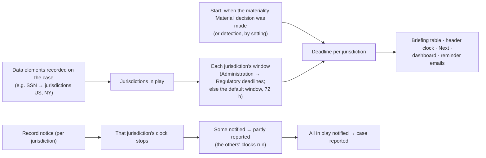

# Governance workflows

Stage gates, materiality, regulatory notification deadlines, legal referral and hold, and need-to-know
restriction. These are the parts of a case that regulators and counsel care about most.

## Stage gates

A stage gate is an administrator-defined checklist that a transition must satisfy, or get through with a written
override. Gates **block or warn; they never move a case by themselves.**

| Trigger | When it runs |
|---|---|
| `PromoteToAdverseEvent` | Complex Event → Adverse Event |
| `EscalateToIncident` | → Incident (from Complex Event or Adverse Event) |
| `EscalateToBreach` | → Breach (from anything lower) |
| `CloseCase` | any phase → Closed |

**Every rung climbed passes its own gate**, so promoting a Complex Event straight to Breach passes the Adverse Event, Incident and Breach gates, one passage each. The dialog shows them as one checklist, with a check that recurs on several rungs listed once. **A case filed directly at a rung** (New case, or an import that creates one) passes the gates up to that rung the same way: the form shows the checklist, judged from what it holds (the summary, the indicators filed with it), and anything required that's unmet needs an override reason. Filing a Breach sends the same Legal email and SIEM event as escalating to one.
De-escalation and every other phase change are never gated.

### Requirements

Each requirement is either a **machine check** (a key into `Application/StageGates/GateCheckRegistry.cs`, with
an optional number) or an **attestation** (a statement the person ticks in the dialog), and is either
**blocking** or **advisory**. A gate can also require a minimum length for the transition's reason
(`CommentaryMinLength`).

| Machine check | Passes when |
|---|---|
| `SummaryPresent` | The case has a summary |
| `AffectedIndividualsCountSet` | The affected-individuals count is recorded |
| `DataElementsSet` | At least one data element is recorded |
| `AffectedStatesSet` | Affected jurisdictions are recorded |
| `DetectionCaseIdSet` | The SIEM case id is recorded |
| `AtLeastOneEntity` | At least N entities (default 1) |
| `AtLeastOneMaliciousEntity` | At least N entities with disposition **Malicious** (Compromised doesn't count) |
| `AtLeastOneEvidence` | At least N evidence files |
| `AtLeastOneReport` | At least N **case** reports (lessons-learned reports don't count) |
| `IncidentCommanderAssigned` | An incident commander is assigned |
| `MinAffectedIndividuals` | Affected individuals ≥ the threshold |
| `MaterialityDetermined` | Passes below Incident; otherwise needs Material or Not material |
| `LessonsCaptured` | Passes below Incident; otherwise the review has "what happened" and at least one improvement action, or "no actions identified" |
| `NoOpenTasks` | No open tasks |
| `NotificationsRecorded` | Passes unless the deadline clock is on, a deadline applies (a start time, and a jurisdiction in play with no notice, judged as the case page judges it: those kept when the case was reported plus those of elements added since) and no reported time is recorded |
| `EntitiesAssessed` | No entity is left with the verdict **Unknown** ("Assess" goes to the Entities tab with the Unknown ones ticked, ready for *Set verdict for N…*; the dialog shows how many are left) |

Rules:

- Checks look at the **saved** case, not unsaved edits in the dialog.
- Attestations count **only** when ticked in the dialog at the moment of the transition, never from stored data.
- An attestation shows the record's facts beside it, so it isn't ticked blind: one about evidence or custody shows
  "1 evidence file · custody log on it" or "No evidence files attached"; one about a post-incident review or lessons
  shows "Review recorded 3 Oct 2026 · 2 improvement actions" or "No post-incident review recorded". What was shown
  is kept in the gate passage's record ("shown: …"). Other attestations show nothing extra.
- An unknown check key never passes.
- One active gate per trigger.
- The dialog offers a "Fix" jump next to each unmet check (to the right tab, the assign dialog, the materiality
  dialog).

### Passing and overriding

On Apply, `CaseService.ApplyGateAsync`:

1. If required items are unmet and there's no override justification: "Stage gate '…' is not satisfied: N
   required items outstanding. Complete them or override with a recorded justification."
2. Enforces the minimum length on the reason, and on the override justification when overriding.
3. Records a **`GatePassage`** in the same save as the transition: who, when, overridden or not, the
   justification, the reason, and every requirement's outcome (`[MET]`, `[UNMET(OVERRIDDEN)]`,
   `[UNMET(advisory)]`).

The timeline shows "<Gate> gate passed" or "**overridden**" (flagged, with the justification). If no active gate
exists for a trigger, nothing is recorded. Gates passed when a case is filed show on its "Case opened as …" milestone
("Promotion and Incident escalation gates passed") rather than as rows of their own; one overridden, or with commentary
other than the filed summary, keeps its row.

### Default gates

Seeded on first start in every environment:

| Gate | Requirements |
|---|---|
| Promotion readiness | Summary present |
| Incident readiness | Summary present; at least one entity; IC assigned (advisory) |
| Breach readiness | Summary present; affected individuals count; data elements; affected jurisdictions; at least one malicious entity (advisory); attestation "Impact assessment reviewed with leadership / Legal" |
| Closure readiness | Summary present; a report generated (advisory); required regulatory notifications recorded; post-incident review recorded (Incidents & Breaches); every entity has a verdict (advisory); attestation "Evidence preserved and chain of custody complete" |

Configure them in Administration → Stage gates.

## Materiality

| | |
|---|---|
| **Trigger** | Actions → *Record materiality determination…* (shown on Incidents and Breaches only) |
| **Fields** | Status (Under review, Material, Not material); for a final status: **decision maker**, **when it was decided** (date and time, in your zone) and **rationale** (all required) |
| **Behind the scenes** | `CaseService.RecordMaterialityAsync` → `Case.RecordMateriality`. A status change also writes a `MaterialityChange`. |
| **Permission** | `EditCases` |
| **Errors** | "A final determination must record who made the decision." and similar for date and rationale; the date can't be in the future; only on an Incident or Breach |
| **Effect** | Milestone "Materiality X → Y — Decided by … on …". With the deadline clock's start basis set to Determination, a *Material* decision starts the notification clocks. The decision maker (often a committee) is kept separate from the person who recorded it. CaseBook records the determination; it doesn't make it. |

## Regulatory notification deadlines

The feature is **off** by default (`Compliance:NotificationDeadlines:Enabled`).



- **Which deadlines apply**: the union of notification jurisdictions on the data elements recorded in the case's
  impact assessment. Each jurisdiction's window comes from its notification rule (NY and US, 72 hours, are
  seeded) or the default window.
- **When the clock starts**: the moment the materiality decision was made (`Determination`, the default) or detection
  (`Detection`, for Breach cases).
- **Recording notices**: each regulator's notice is recorded on its own row of the Briefing table (*Record notice*,
  with the time it was done: can be backdated, not future, not before detection), and **stops only that
  jurisdiction's clock** (`CaseService.RecordNoticeAsync`, a `JurisdictionNotice` row): a notice to NY never stops
  CA's. *Record notice to all regulators* (*Record notice to the remaining regulators* once one is notified; Next →
  *Mark reported…* too) records a notice at the time given for every jurisdiction in play not yet notified, so each
  clock still has its own stop and one already notified keeps its time; with no jurisdiction in play (and no notice) it
  records the case's reported time alone, since no clock runs. The form names the regulators it will record ("Records a
  notice to CA, TX."), and the save carries that set: if it changed since the form opened (a colleague added an element
  that brings TX into play, or removed NY's notice) it's refused ("The regulators still owed a notice changed while you
  were looking; now CA, TX. …"), the time typed stays, the form shows who is owed now, and Save again records those, so
  no regulator gets a notice nobody saw. Until every jurisdiction in play has a notice the case
  is **partly reported**: the Notification section, the Briefing's obligations and the report say "Partly reported:
  NY notified 2026-10-18 10:00, CA due 2026-10-19 00:00.", never a bare "Reported". It counts as **reported**
  (`ReportedAtUtc`) once every jurisdiction in play has a notice, at the latest notice's time ("Reported to every
  regulator in play: …"). Every view reads that through one function (CAP-38: `NoticeStanding`, via
  `NotificationDeadlineService.Standing`), not the stored time: the case page, Briefing and Next, the report (its
  standing line, its "Reported to regulators" stamp, `case.reported` and its timeline), the timeline's reported
  milestone, the brief's and handoff's "since", the review's narrative draft, the Cases list CSV's `reported_utc`, the
  close gate, the archive check, the reminder scan, the dashboard and Desk, the legal register and the retention review,
  so they can't disagree, even where a stored time was set over a clock still running (an older build, a restore, a
  hand edit). A data element that brings a new jurisdiction into play makes it partly reported again until
  that regulator is notified (a case reported as a whole with nothing in play goes back to unreported, BUG-555); one
  added that brings none in counts as one the case had, so a later admin change to it doesn't bring a regulator in.
  A case with so many elements that they can't be kept beside its regulators keeps just the regulators, and then every
  element counts as had, in the edit as in every view (BUG-618). A
  row's × removes a mis-entered notice and that clock runs again (the others keep theirs); *Clear all notices* removes
  them all. Milestones "Notified NY" (one per regulator, and for a single notice while the case is partly reported)
  and "Reported to every regulator in play". A case reported before notices were per jurisdiction (a reported time, no
  notice rows) counts every jurisdiction in play when it was reported as notified at that time: no overdue clock, no
  reminder, no rows written for it. A jurisdiction that comes into play later turns those into notices at that time and
  runs its own clock (BUG-104).
- **How a regulator was notified** (CAP-07): the *Record notice* form also takes, all optional, the method (Portal,
  Letter, Email, Phone or Other), the regulator's reference or confirmation number, who gave the notice (free text: a
  person, or counsel) and the evidence file holding it (only a file on this case; a file from another case, or one no
  longer there, is refused). On a recorded notice, *Add how notified* / *Edit how notified* changes them without moving
  the notice's time (`CaseService.UpdateNoticeDetailsAsync`, audited like the notice, `EditCases`). A form opened before
  a colleague changed them is refused ("Someone else changed how this regulator was notified while you were editing…"),
  keeps what was typed, and a second Save overwrites. They show under the notice on the Briefing table and in the
  Briefing's obligations, in the milestone's detail ("By portal, reference NYDFS-2026-114, notified by Pat Lee, notice
  file ack.pdf"; on the "Reported to regulators" milestone when there's one notice), in the report's notification
  summary and `notice.*` template fields ([reporting](reporting.md#the-case-report)), and the reference in the legal register's
  `notice_references` column. Editing them sends no SIEM event: recording the notice already sent 5513, and they move
  no clock. A legacy notice coded `NY;CA` shows its details under each code but isn't edited here.
- **Reminders**: when `Notifications:DeadlineScan` is on, the incident commander and assignees are emailed once
  as a deadline becomes at-risk and once when it passes, for each jurisdiction (regulators on the same deadline share
  one email; one that joins a deadline already reminded is reminded too). A notice stops only its own regulator's
  reminders: after NY is notified, CA is still reminded until its notice is recorded.
- **SIEM** (5513): each notice sends `RegulatorNoticeRecorded` (`jurisdiction=NY`), and whatever leaves the case fully
  reported where it wasn't also sends `CaseReported` (no detail), once: the last notice, *Mark reported*, removing the
  element that brought in the one regulator still owed, or an administrator's change to a data element's jurisdictions
  (the Data elements page or a configuration import). A partly reported case has only the regulators' own events.
  *Mark reported* sends one `RegulatorNoticeRecorded` per notice it records, then `CaseReported`; when every regulator
  was already notified it records nothing and sends nothing.
  Removing a notice sends `RegulatorNoticeRemoved` (Warning); *Clear all notices* sends `ReportedCleared`.
- **Closing doesn't stop the clock.** Closed cases with an unrecorded notification keep appearing as "awaiting
  report" until it's recorded. The `NotificationsRecorded` check on the close gate makes recording it a
  requirement for closing.

## Legal referral

Actions → *Refer to Legal / Privacy…*: contact and a note on regulatory relevance. `CaseService.ReferToLegalAsync`
(needs `ManageLegal`). Records that the case was referred, when and by whom; deadlines remain Legal's
responsibility. The case list's "Referred" filter is the SOC's roll-up. A referral can't be withdrawn.

## Legal hold

```mermaid
stateDiagram-v2
    state "No hold" as NH
    state "Held" as H
    state "Held, release requested" as HP
    [*] --> NH
    NH --> H: Place legal hold
    H --> NH: Release (reason required; not allowed in two-person mode)
    H --> HP: Request release (reason)
    HP --> H: Withdraw request
    HP --> NH: Approve release (a different ManageLegal user)
```

- **Place**: Actions → *Place legal hold* (reason optional). SIEM 5501.
- **Release**: a reason is required ("Say why the legal hold is being released."). With
  `Governance:LegalHoldRelease:RequireSecondApprover` on, a direct release is refused; the user requests release,
  and **someone else** with `ManageLegal` approves it ("Two-person control: someone other than the requester must
  approve the release."). SIEM 5502.
- **Effect**: a case under legal hold **can't be archived**. Nothing else is blocked.
- All need `ManageLegal` (Legal/Privacy and SysAdmin by default).

## Restriction (need-to-know)

| | |
|---|---|
| **Restrict** | Actions → *Restrict to need-to-know…* (reason optional). Anyone with `EditCases`. If you'd lose access, you're added as an Analyst. |
| **Lift** | Actions → *Lift restriction…* (reason required). Only the incident commander, or someone with `ViewAllCases` or `ViewRestricted`. |
| **Effect** | The case disappears for everyone except its team and cleared roles: lists, search, the Desk, dashboards, indicators, ATT&CK coverage, campaigns, exports, mentions and handoff pickers. A hidden case and a missing one look the same. Opening a restricted case is a higher-severity SIEM event (5305). The reason goes on the audit entry. SIEM 5504 / 5505. |

See [architecture/security.md](../architecture/security.md#need-to-know) for the exact rule and its known gaps.
