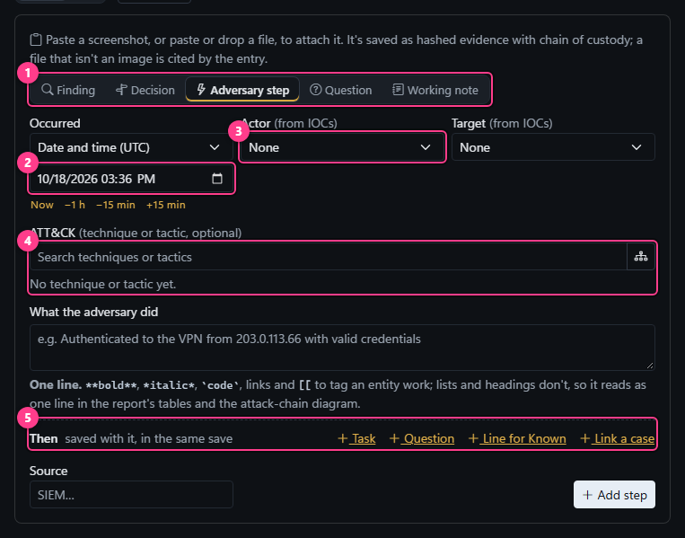
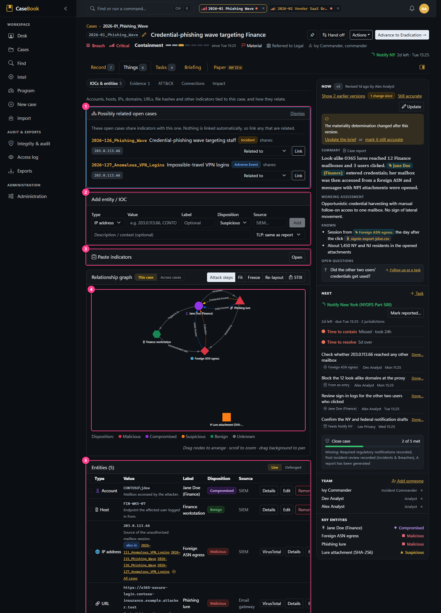
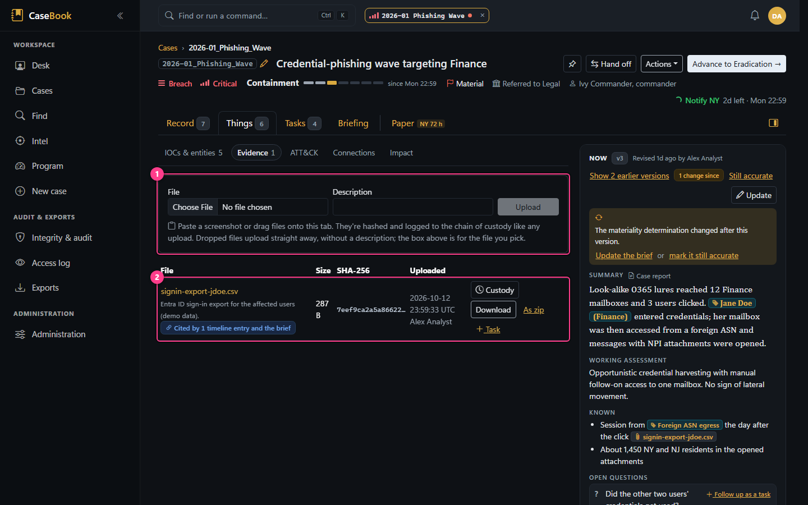
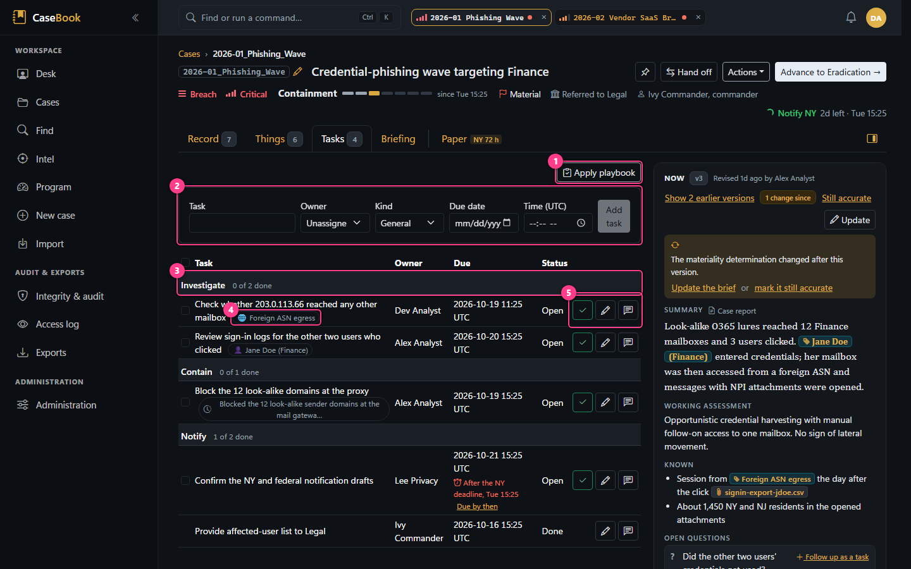
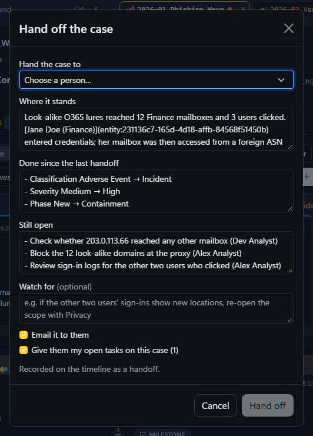

# Investigation workflows

Recording the work: the brief, the timeline, entities and IOCs, evidence, notes, tasks, the team and handoffs,
case links and campaigns. All of these need `EditCases` unless noted, and all go through the shared
[write path](../architecture/backend.md#the-write-path). Nothing on this page can be deleted except entities,
relationships, case links, ATT&CK tags and assignments.

## The brief ("Where it stands")

| | |
|---|---|
| **Where** | *Now*, in the Now/Next pane (from 1200 px wide); on the Briefing, *Open the brief* |
| **What it holds** | **Summary** (what the case report prints), **Working assessment**, **Known**, **Open questions**, **Next steps** (not typed: the live list of open tasks, snapshotted into each saved version) |
| **Saving** | *Revise* → `CaseService.ReviseBriefAsync` → `Case.ReviseBrief` creates a new version and marks the old one superseded. Saving with no written part changed makes no version ("No changes; the brief is unchanged."; the next-steps snapshot doesn't count). When things have been recorded since, **Still accurate** (beside "N changes since", and in the update nudge) records who confirmed the current version and when, without a new one (`ConfirmBriefAsync`; the header then reads "confirmed … by …"), and "changes since" counts from the confirmation. "Show N earlier versions" shows history. At least one part must be filled ("Write at least one part of the brief."); each part up to 8000 characters. The parts are plain text boxes: entity tags and evidence citations show as `[[name]]` and are saved back as links; typing `[[label or value]]` of one of the case's entities tags it (the close dialog's *What happened* and *Conclusion* work the same way). |
| **Concurrency** | If someone saved a newer version while you edited: "Someone else saved a newer version of the brief while you were editing. Your text is still here; review theirs, then save again to replace it." |
| **Open question → task** | Each line of a list in *Open questions* can be followed up as a task ("Raised from an open question in the brief (vN)"). Refused if an open task already follows that question. Once the task is done, its answer shows under the question (or "Marked done without an answer." for tasks completed before answers were required). |
| **Freshness** | After a decision, handoff, phase, classification or materiality change, the brief says it may be out of date ("1 change since", "Update the brief"). |
| **Rules** | `Cases.Summary` always equals the current brief's summary; editing the summary in *Edit details* also creates a version. The other parts are not in the case report unless a report layout turns the brief section on. |

## The timeline

How the timeline works internally is in [architecture/timeline.md](../architecture/timeline.md). The workflows:

### Adding an investigation entry or decision

| | |
|---|---|
| **Trigger** | Timeline tab → **Add** (or `l`), mode *Finding* or *Decision* |
| **Fields** | Type (Detection, Analysis, Containment, Eradication, Recovery, Communication, Evidence, Escalation, Note, Other, **Decision**), when it occurred (with nudges), Markdown text (with `[[` entity tags), source, an optional pasted screenshot or a pasted or dropped file (CAP-26). A Decision adds **why** (required), options considered and decided by (suggests the case team, then everyone; free text such as "IC with Legal" still works). |
| **Behind the scenes** | `CaseService.AddTimelineEntryAsync`. A pasted screenshot is uploaded as evidence first ("Pasted into the timeline", up to 15 MB) and linked. |
| **Attaching a file** (CAP-26) | Paste a file, or drop one on the composer (one per entry; the first of several, however many are dropped, and a note says the others go through the Evidence tab). While an entry is being edited, a paste or drop is refused with a note: an edit takes no file. A file that isn't a PNG, JPEG, GIF or WebP image by its bytes (the images the inline preview shows; an SVG, HEIC or TIFF is a file) is stored as evidence ("Attached from the timeline") in the entry's save (`AddTimelineEntryAsync` / `AddEventStepAsync`, its `screenshot`), and the entry cites it as *Cite evidence* would, so it reads "Evidence: file.csv"; such an image still becomes the entry's screenshot. Up to 50 MB, or the evidence limit if that's lower (it's held in memory until *Add*; larger files go through the Evidence tab). Checked before a byte is stored (WF-31): the size and name length when it's staged; then, at the save, the entry itself, the same file already on the case (PROD-59: "This file is already evidence in this case, as … It wasn't stored again. Remove it here, save the entry, then cite that copy with Cite evidence."; a withdrawn copy doesn't count) and the room and quota (PROD-55). A file that can run is kept like any other; the composer marks it *Can run: downloads zipped* and its download is zipped (PROD-58). It carries no collection details; record them later from its evidence panel (CAP-08). |
| **Errors** | "A decision on the timeline needs its why." |
| **Afterwards** | Shows "recorded …" if more than an hour after it occurred. Prints in the report's investigation timeline. A decision prompts a brief update. |
| **Follow-ups** | *Then* adds, in the same save: tasks about the entry (title, owner, kind, due), a question for the brief (optionally with a task to answer it), a line for the brief's Known, and a link to another case. `EntryFollowUps` on `AddTimelineEntryAsync` / `AddEventStepAsync`: everything is validated first and lands in one `SaveChanges`; the brief changes make one new version; the link follows `LinkCaseAsync`'s rules (visible, not self, one per pair, an existing link is left as it is). |
| **Answering a question** | In *Finding* mode, *Then* → **Answers an open question** picks one of the brief's open questions not yet answered (`OpenQuestionAnswers.Answerable`: the listed questions whose task, paired as the brief pairs them, isn't done). Saving completes the question's open task with the finding's text as its result ("Result: …", done by you, when the finding occurred, or now if that's in the future), or, when no task followed it up, raises one ("Raised from an open question in the brief") and completes it, and links the entry to the task (`TimelineEntry.ActionItemId`, as a result logged from *Mark done* is), all in the entry's save. The task is found by the id the picker had, never by its title. The brief, Now and the Briefing then show the answer under the question as they do for *Mark done*. Refused, with nothing saved and your text kept, when the question was answered ("… answered that question while you were writing"), followed up with a task ("Someone followed that question up with a task while you were writing"), canceled, or taken out of the brief since the picker showed it; the pick is let go, and a reload that changes it says so. Only a finding can answer (not a decision or an event step); the finding is held to a result's 7,992 characters and, like *Mark done*, can't be dated before detection. |

### Adding a question

Composer → *Question*: one line for the brief's open questions, and "Follow it up as a task" (on by default).
`CaseService.AddOpenQuestionAsync` writes a new brief version with the question on its own list line and, if
asked, the task that follows it up, in one save. Errors: "Write the question." · "That question is already open in
the brief."

**Questions and event steps are one line of inline Markdown.** Bold, italics, `code`, links and `[[` entity tags
work; lists, headings and line breaks don't (line breaks become spaces, `- x` stays literal). The box says so
under it. A question has to stay one line because the brief keeps one question per line and pairs each with its
task by the question's plain text, which is also the task's title. A step has to stay one line because it's a cell
in the report's tables and a node in the attack-chain diagram. `IMarkdownService.ToInlineHtml` renders them;
`MarkdownService.OneLine` stores them; the report and task titles use `MarkdownService.PlainLine`.

### Adding an event step (the attack chain)

Same composer, *Adversary step*: when, one or more ATT&CK tactics and an optional technique, **actor → target**
(entities on this case; *New IOC…* creates one in a dialog without leaving), what the adversary did, source,
optional screenshot. `CaseService.AddEventStepAsync` → `Case.AddEventStep`. Errors: "The actor is not an entity
on this case." (and the same for the target), technique ids must look like `T1566` or `T1566.001`.

On **third-party** cases the lens and lane are *Attack & disclosure*, and the composer has two modes instead of
*Adversary step*:

- **Attack step**, with *Where did it happen?*: **the vendor's environment** (what the attacker did there, as the
  vendor reported it) or **our environment** (what they did in our network after pivoting from the vendor; the first
  such step is the pivot, and its actor can be the vendor-side host and its target ours). The same fields as an
  adversary step, and it counts like one: in the case's techniques, the report's attack chain and diagram, the lessons
  narrative and ATT&CK coverage. Steps at the vendor are marked *At a vendor* in coverage; steps in our environment
  count as ours. The Record labels each "Attack at the vendor" / "Attack in our environment", the chain strip reads
  "Attack chain: the vendor, then our network" once there's a pivot, and the expanded chain marks *Pivot into our
  network*. The report's attack chain gets a *Where* column (template field `step.where`), its diagram tints the
  steps in our network and draws a dashed *pivot* line, and the narrative becomes one "Attack sequence (at the vendor,
  then in our environment)". Stored as `TimelineEntry.Environment` (null on an internal case, and on older vendor
  steps, which read as the vendor's).
- **Disclosure milestone**: when the vendor told us something or we confirmed something, typed by stage (Notified,
  Scope confirmed, Data confirmed, Remediation, Regulatory notification, Communication, Evidence, Other), without
  ATT&CK. The report prints these as *Disclosure milestones* (template collection `milestone`).

### When the time isn't known (ST-01, ST-02)

A vendor's report, or logs past retention, often give the steps without every time. *Occurred* on an attack or
adversary step offers **Date and time** (the default), **Date only**, **Between two dates**, **On or before a date**
and **Not stated**. Don't invent a time: pick what was stated. A date is a calendar date (no zone); a step with no
stated time asks what it **comes after** (or *First in the attack chain*), and a run of them is entered in order, each
defaulting to after the last. The Record, the attack-chain strip, the briefing, the report and the narrative print the
time as stated ("Between 2026-09-02 and 2026-09-05", "Time not stated"), in italics, with no T+, no "ago" and no gap
marker measured from it. Where the times don't settle the order (same date, or no time), the **↑ / ↓** arrows on a
step move it; they refuse to move a step past one whose stated time puts it elsewhere ("correct the step's time").
When the vendor later gives the exact time, edit the step: the change and its reason are in the audit trail.
Disclosure milestones and investigation entries keep exact times. When the case's *activity began* falls on the first
attack step's approximate dates (or the first step has no time), the Record's milestone, the Overview, the briefing,
the narrative and the report say "approximately" and why, and no "N before detection" is measured from it (ST-04).

`EventSteps.IsAttack` / `IsDisclosure` decide which a step is: on a third-party case, a step with ATT&CK content
(tactics, a technique, an actor or target) or a stated environment is an attack step; on an internal case every step
is. `EventSteps.Where` says where an attack step happened.

### Editing

- **Investigation entry** → *Edit* saves a **new version** (optional reason on the audit entry); citations move
  with it.
- **Event step** → corrected **in place** (the audit trail keeps the old values).
- **Milestones** can't be edited; for transitions use *Correct time*
  ([case-lifecycle.md](case-lifecycle.md#6-correcting-when-a-transition-happened)).

### Citing evidence

*Cite evidence* on a current entry → pick files → `CaseService.CiteEvidenceAsync` → `Case.SetCitations` (only
real additions and removals are audited). Superseded entries can't be cited. Cited files print with the entry in
the report.

### Putting a note or task comment on the record

*Put on the record* on a working note, or *Add to timeline* on a task comment: pick a type (not Decision: "Record a
decision as a Decision entry on the timeline, with why it was made."), a time (not in the future), and edit the
text if needed. Creates an investigation entry that remembers where it came from; the original is unchanged, and
the note is marked "On the record".

## Entities and IOCs

| Action | How | Rules |
|---|---|---|
| Add one | *Add entity / IOC*: type, value, label, disposition, source, TLP, description → `AddEntityAsync` → `Case.AddEntity` | Network types are refanged (`hxxp`, `[.]`); hashes, file names and accounts are kept exactly. **Adding an existing (type, value) never overwrites it**: an Unknown disposition takes the new one, blank details are filled, and anything already recorded is kept ("…is already on this case as Malicious. Its verdict wasn't changed; use Edit to change it."). |
| Paste many | *Paste indicators*: one per line, comma, semicolon or tab | Types are detected; duplicates merged. An indicator already on the case keeps its verdict, except that an Unknown one takes the pasted verdict (reason "Set by paste"); the confirmation says how many were kept and how many changed. |
| Edit | *Edit* (optional reason) | Can't collide with another entity of the same type and value. |
| Disposition | Unknown, Benign, Suspicious, Malicious, **Compromised** (a legitimate asset taken over). Changing it on an existing entity is recorded with its reason and shown as a **verdict** milestone on the timeline, in the report and in the entity panel's verdict history; marking one Malicious or Compromised needs a reason ("Say why it's compromised: the reason is kept with the verdict.") | An Unknown entity referenced three or more times is suggested for review. |
| Set the verdict on several | Tick rows (or *Select Unknown*, or the header box for all), then *Set verdict for N…*: one verdict, one "when was it determined?" and one reason → `AssessEntitiesAsync` | The single verdict's rules for each one: a reason for Malicious or Compromised and for a time more than an hour back, and the time not before that entity's previous verdict. Each that changes gets its own verdict record and milestone; one already at the verdict is left alone. One save: if any is refused (gone from the case, a time it can't take, or a verdict a colleague changed since you ticked it), none are recorded. A colleague's change is checked against what each showed when you ticked it, even when the live refresh has shown it since; the dialog says so and keeps what you typed, and saving again records yours over theirs. Up to 2,000 at a time. The Closure gate's *Assess* opens the tab with the Unknown ones ticked. |
| Pin | From the entity panel | Pinned entities show first under Key entities in the Now/Next pane, followed by Malicious, Compromised and Suspicious ones. |
| TLP | Per indicator | Controls sharing in exports. |
| Relationships | *Add relationship*: source, type (14 kinds), target, description | Directed; no self-links; no duplicates; editable in place (type, description, swap direction). |
| Graph | Drag to arrange; *Re-layout*; *Fit*; *Freeze* | Positions are shared by everyone and not audited. Event steps are drawn as tactic-colored edges. |
| Remove | *Remove* | Also removes its relationships and graph position. Refused while an attack step names it as actor or target ("Change the step first, so the attack record keeps saying who did what to what."). A task about it stays, no longer pointing at it. |
| Cross-case | *also in* on a row (hover for the other case's title, phase, outcome and verdict there); the entity panel's **Seen before** (closed cases: outcome, closed date, the verdict there and the closing line) and open cases; *Possibly related open cases*; the Indicators page | Value matches ignoring case on cases you can see (excluding exercises). An **account and an email address** with the same value are one identity; other types match only their own type. Suggestions never link by themselves. |
| Possibly related (CAP-28) | The entity panel's **Possibly related**, and the New case form's check | Not the same value but, by fixed rules (`RelatedObservables`): the same **registrable domain** (a domain or a URL's host: itself, a parent, a child or a sibling), the same IPv4 **/24** or IPv6 **/48** (an address or a URL on one), or the same **email domain** (an email address, or an account written as one; exact domain). The registrable domain is a built-in approximation of the Public Suffix List (none is shipped or fetched): the last two labels, or three under a known two-label suffix, a two-letter country code with a generic second level (`co.uk`, `com.au`, `gov.in`) or a known shared host (`azurewebsites.net`, `github.io`, `s3.amazonaws.com`). A country's own second levels outside that rule, or a shared host it doesn't know, can suggest unrelated names. **Left out** (Administration › Integrations › Related indicators, read live): your organization's domains and every name under them (until they're saved, the domains found on the server's network: its AD domain, forest and trusts; none when it isn't on a domain), addresses in the excluded ranges (by default the private, loopback, link-local and unique local ranges: `10.0.0.0/8`, `172.16.0.0/12`, `192.168.0.0/16`, `127.0.0.0/8`, `169.254.0.0/16`, `::1/128`, `fe80::/10`, `fc00::/7`), including an IPv4-mapped address and an address in a URL, and, while the switch is on (the default), addresses at the big free mail providers. An indicator left out is never used to suggest relations and is never suggested; the panel says why ("contoso.com is one of your organization's domains, so it isn't used to suggest relations.") instead of that nothing was found, and the New case check lists those it left out. An organization domain under a suggested one (`corp.contoso.com` under `contoso.com`) is also left out of the 500 read, for bare domains. On cases you can see, exercises excluded; per check at most 50 shared parts, each reading the 500 newest candidate indicators (by a `LIKE` on the value, which can't be indexed on SQL Server, BUG-63; an IPv4 address anchored at its /24, with each part's leading zeros stripped on both sides so a zero-padded `010.0.0.9` is read for `10.0.0.5` and back, an IPv6 one at its /48's leading hextets; the rule itself is then checked in code), 20 suggestions per indicator. Copies of the value being checked are left out of those 500 (they're *Seen before*, not suggestions). When a shared part has 500 or more candidates, the panel says it checked the newest 500 rather than that nothing is related, and the New case check says the same. Suggestions only (A4): never a link, not in a gate or on the Desk, and no value goes in a URL (C7). |
| Tag in text | `[[` in any Markdown editor | Stored as a link to the entity id; renders as a chip that opens the entity panel; counts as a reference for the timeline's entity filter. |

## Evidence

| | |
|---|---|
| **Trigger** | Evidence tab: choose a file and a description, then *Upload*; or paste a screenshot or drag files onto the tab (uploaded immediately) |
| **Collection** (CAP-08) | Optional *Collected* (when), *Collected from* (host, mailbox, system or vendor) and *Collected by*, on the upload form. They go with a picked or pasted file, with a large one (kept with the upload's state, so a resume keeps them) and with each dropped file. Checked before any byte is stored: not in the future, not before the case's activity began (its detected time when that isn't recorded). Later, the evidence panel's *Record how it was collected* sets or corrects them (`CaseService.RecordEvidenceCollectionAsync`, `EditCases`): an audited change, refused if someone changed them since the edit opened, and not dated after the upload. The file itself never changes. |
| **Behind the scenes** | `EvidenceService.UploadAsync` checks `EditCases`, need-to-know and the room left (size, quota, free space) **before** storing; the evidence store writes the bytes under a random name outside the web root while computing SHA-256 (encrypted when evidence encryption is on); an `Evidence` row and an "Uploaded" custody event are saved. Files over 100 MB go up in 8 MB parts (`/evidence/uploads`), each checked again, and are read back before they're recorded. |
| **Limits** | `Evidence:MaxUploadMB` per file (500 MB by default, up to 64 GB), `Evidence:StorageQuotaGB` in all, and `Evidence:MinFreeSpaceGB` left free (Administration › Evidence storage); 15 MB for timeline screenshots |
| **Duplicates** | The same file (SHA-256) twice in one case is refused, naming the first copy; in another case it's stored and the uploader is told which other cases they can see hold it. |
| **Large uploads cut off** | Kept for a day under *Unfinished uploads* (state beside the parts in `<store>\.incoming`, surviving a restart); picking the same file again carries on from the next part. |
| **Hash as IOC** | Adds the file's SHA-256 as a FileHash indicator (verdict Unknown, labelled with the file name), or says it's already one. |
| **Download** | *Download* (the file, sent as plain bytes with a sandboxing CSP) or *As zip* (a zip with the password `infected`). A file that can run downloads first as the zip (*Download safely*), per `Evidence:SafeDownload`. The custody event says which. |
| **Custody** | *Custody* shows uploaded, viewed (preview; once per person per 10 minutes), downloaded (explicit download only), transferred (recorded by hand, or by an evidence package), withdrawn. **Record transfer** (recipient, method, purpose) attests a hand-off outside CaseBook; it's also written to the audit chain. Thumbnails don't count. |
| **Integrity** | The file's hash is part of the record. The optional re-hash job alarms if stored bytes change. |
| **Finding a file** (CAP-25) | A filter over name, description and the start of the SHA-256 (four characters or more), never put in the URL; chips for images, text, can run, cited and not cited (chips of one kind widen, the two kinds narrow), and Withdrawn, which adds the withdrawn files (hidden otherwise, CAP-21); File, Size, Collected and Uploaded sort both ways (newest upload first by default; files with no collection time last). The logic is `EvidenceListView`. |
| **Package for hand-over** (CAP-12) | *Package evidence…* (`EditCases`): pick the files (every one that stands, by default) and name the recipient, method and purpose once. `CaseService.StageEvidencePackageAsync` checks the permission, need-to-know, that each file is on the case and not withdrawn, and the size (at most 500 files, and no more than `Evidence:MaxUploadMB` in all), and returns a ticket. *Download the package* fetches `/evidence/package/{ticket}` once, within 10 minutes, by the person who prepared it (checked again: the permission, the case, a file withdrawn since, the size): one zip, password `infected` (ZipCrypto, deflated, streamed straight from the store and decrypted as it's read), each file under its base name (a clash becomes "name (2).ext"), and a `MANIFEST.txt` last (the case, the hand-over, each file's name, SHA-256, size, collection, upload and custody so far). Each file is read and checked against its SHA-256 before any of it is sent, then hashed again as it goes. A zip like this can be read file by file without its directory, so a package that stops part-way has still handed over what went out; it's recorded in steps, each step's custody and audit entry in one transaction (`IAppDbContext.PendingAuditNotes`): **begun**, before the first byte (`EvidenceService.RecordPackageBegunAsync`: "Transfer begun" on each file, an audit entry with the package id, the hand-over and each file's SHA-256, the access log and SIEM 5308; if it can't be written, nothing is sent); then **sent in full** (`RecordPackageSentAsync`: "Transferred" on each file and an entry with the SHA-256 of the zip as sent and of its manifest, before the zip's directory goes out) or **stopped** (`RecordPackageStoppedAsync`: "Transferred", "Partly transferred" or "Not transferred" on each file, and an entry "stopped after N of M files" naming which and why). A file that doesn't match is never sent. A begun record with nothing after it (the server stopped) is read as partial. |
| **Withdraw** (CAP-21) | The evidence panel's *Withdraw…* (`EditCases`, need-to-know), with a required reason: `CaseService.WithdrawEvidenceAsync` → `Evidence.Withdraw`. For a file filed on the wrong case. Nothing is removed: the bytes, hash and custody stay, it can still be downloaded (logged as before), and a "Withdrawn" custody event (with the reason), an audited update (the reason on its audit entry, the withdrawal in the row hash) and SIEM 5516 record it. It leaves the report (evidence index, citations, milestones), the gates' evidence count, the tab's count, citing, notice files, packages, tasks about it and recorded transfers (the panel offers neither; the server refuses both), and "also evidence in" on other cases; Find still finds it, with a *Withdrawn* chip (it's still held, and a file re-uploaded to the right case shouldn't be taken for evidence on the wrong one). Its milestone becomes "Evidence withdrawn: *file* (*reason*)". Refused while a regulator's notice names the file (change the notice first) or a current timeline entry shows it as its screenshot (retract the entry first), and when the record changed since the dialog opened. The withdrawal loads the case tracked, so it checks and renews the case's edit version (BUG-113): a notice, an entry or a second withdrawal saved between its checks and its save makes it fail with "Someone changed this case…", and the other way round. |
| **Reinstate** | A withdrawn file's panel offers *Reinstate…* (`EditCases`) for `Evidence:ReinstateWithinDays` after its withdrawal (30; 0 turns it off): `CaseService.ReinstateEvidenceAsync` → `Evidence.Reinstate`, with a required reason. The withdrawal is cleared on the file; both it and a "Reinstated" custody event stay, with an audited update and SIEM 5517. Refused after the period, for a file moved or purged, and when the case holds the same file again (a re-upload stands in for it). |
| **Move to the right case** | In *Withdraw…*, *Move it to the case it belongs on* with the case number (`EditCases`, need-to-know on both): `CaseService.MoveEvidenceAsync` copies the bytes into that case's folder and checks them against the SHA-256, records the copy there with its description and collection details and a "MovedIn" custody event (where it came from, who first uploaded it, why), and withdraws it here with "Moved to <case>: <reason>" and a "MovedOut" event, in one save (the copy is discarded if it fails). SIEM 5518. Refused as a withdrawal is, between an exercise and a live case, and when the other case holds the file already. A moved file can't be reinstated here. |
| **Purge** | Administration › Diagnostics › *Withdrawn evidence* (`Administer`) lists every withdrawn file with until when it can be reinstated, and offers *Purge…* (a required reason) once it can't be: `CaseService.PurgeEvidenceAsync` → `Evidence.Purge` records who, when and why and a "Purged" custody event, then deletes the bytes from the store (`IEvidenceStore.PurgeAsync`). The record, SHA-256 and custody stay; downloads say it was purged; the evidence re-check, encryption conversion, `casebook-keytool export` and `verify-restore` skip it; the storage total leaves it out; the backup script removes it from its evidence mirror. SIEM 5519 (High). Never under a legal hold. |
| **Removal** | Not possible: evidence is never deleted (R3). A withdrawal is final, as a retraction is; a file withdrawn by mistake is uploaded again as a new record (a withdrawn copy doesn't count as a duplicate). |

## Notes

| | |
|---|---|
| **Trigger** | Composer → *Working note* (or `n`); the notes are listed in the Timeline's *Working notes* lens |
| **Fields** | Markdown body; `@` to mention someone who can see the case; `[[` to tag an entity |
| **Behind the scenes** | `CaseService.AddNoteAsync`; mentions are de-duplicated, the author dropped, and anyone who can't see the case dropped. After saving, each person mentioned is emailed a link to the note. |
| **Editing** | Saves a new version; only people **newly** mentioned are emailed. |
| **Report** | Notes are working reasoning and are **not** in the case report unless a report layout includes the Analyst Notes section. |
| **Search** | The case-list search matches current note text, as well as the number, title, summary, entities, current timeline entries and decisions (with their why), the current brief, task titles, task comments and results, phase-change reasons and the post-incident review. When the match isn't the number, title or summary, the row says where: "decision, 1 Oct 2026: …MFA fatigue on a payment account…". CAP-22: on SQL Server with Full-Text Search, the title, summary, notes, entries, brief, task titles and task comments match by word prefix (`mfa fat` finds "MFA fatigue"; `atigue` doesn't), as in [Find](find.md#how-find-reads-the-query); the number, entities, phase reasons and the review, and any search shaped like an indicator or a case number, match anywhere in the text, as everything does without the feature. |
| **Removal** | Not possible. |

## Tasks

| Action | How | Rules |
|---|---|---|
| Add | Title, owner (a person or a typed external name), kind, due date and time (a time is in your zone; a date alone means the end of that day on the organization's calendar, so every reader and report sees the same day) → `AddActionItemAsync` | "Say what needs doing." Title up to 400 characters. |
| Raise from something | *Task* on a timeline entry, entity, evidence file or note; *Follow up as a task* on a brief question; quick add on the Desk | The task remembers what it's about. For a timeline entry or a note it points at the first version, so the link survives edits. *Task* on a Decision starts with the decision's text as the title, to trim into the action. |
| Apply a playbook | *Apply playbook*: choose a template, steps and a default owner → `ApplyTemplateAsync` | Owner = the step's hint, else the incident commander, else the default owner. Due = now + the step's offset, so a playbook applied mid-case isn't instantly overdue. After an escalation, a notice can open this card on the rung's playbook with only the steps not yet on the case ticked ([case lifecycle §3](case-lifecycle.md), *Playbook offer*). |
| Complete | ✓ → result text, **done by** (you, another person, or a typed name), completion time (can be backdated; not in the future or before detection), optionally "add to the timeline as …" (ticked by default; untick it to keep the result off the timeline, or pick another type; only a written result is ever added, and the form says so while there's none) → `CompleteActionItemAsync` | The result is saved as a "Result: …" comment, and optionally an investigation entry, in one save. It shows under the task's title, on the task chip of the timeline entry it's about, and in the report's Response Tasks. **A task raised from a brief question needs an answer** ("This task follows up a question in the brief. Say what was found to mark it done."), and the answer shows under the question in the brief. The timeline type defaults to the task's kind: Contain → Containment, Eradicate → Eradication, Recover → Recovery, Investigate (or a question's task) → Analysis, Notify → Communication, General → Other. **Finishing Contain, Eradicate or Recover work while the case is in an earlier phase** offers "Move the case to <phase>…": it opens the usual phase dialog with the result as what was achieved and the completion time as when, and the analyst reviews and applies it (nothing moves on its own). |
| Move to lessons learned | Edit → **Move to lessons learned** (an open task; `EditCases`) → `LessonsService.MoveTaskToActionAsync` | For work that turned out to be a program change rather than this case's follow-up: in one audited save it becomes an improvement action (its title, its description as details, its owner, its due date as the target date) and the task is cancelled with "Cancelled: moved to lessons learned as an improvement action." Clears the review's "no actions identified". |
| Change status | Edit, or bulk "mark done" | Any status to any status (Open, In progress, Blocked, Done, Cancelled), except a cancelled task to Done: reopen it first. Cancelling in Edit asks "Why cancel it?" (optional); the answer is kept as a "Cancelled: …" comment and shown under the task. Leaving Done clears the completion time and "done by". A question's task can be set to Done this way only if it was answered before (it was reopened since). |
| Comment | 💬 → append-only comment | Needs only **`ViewCases`**, so view-only roles can comment. Can be put on the timeline. |
| Reminders | Background jobs, when enabled | Overdue and due-soon emails to the owner (else the IC), escalating to the IC then managers. Off by default. |
| Phase link | Kinds Investigate, Contain, Eradicate and Recover map to Triage, Containment, Eradication and Recovery | Open tasks of a phase being left are listed as a warning when changing phase; the `NoOpenTasks` gate check can require none. |
| Notification timing | An open **Notify** task due after the running notification deadline (the most urgent one not yet reported), or with no due date | Flagged under its due date ("After the NY deadline, Tue 15:02") with **Due by then**, which sets its due date to the deadline and changes nothing else (`UpdateActionItemAsync`). The Briefing marks it too. |

Tasks are never deleted; cancel them instead.

## Team, incident commander and handoff

| Action | How | Effect |
|---|---|---|
| Assign | Now/Next pane → Team → *Assign*: person and role (Incident commander, Analyst, Observer); or Actions → *Assign to me* | `Case.Assign`. Re-assigning changes the role. A new incident commander demotes the previous one to Analyst. The assignee is emailed (not when assigning yourself) if assignment emails are on. On a restricted case, assigning someone gives them access. |
| Unassign | × beside a team member | Recorded as "no longer on the case". |
| Hand off | *Hand off* in the case header: recipient (only people who can see the case), where it stands (required), done since the last handoff, still open, watch for; options to email it and to give them your open tasks | `CaseService.HandOffAsync` adds a **Handoff** timeline entry and can move your open tasks. It doesn't change the incident commander; that's a separate assignment. "Choose someone other than yourself." |
| Watch for, on Now | Automatic, from the latest handoff | When the latest handoff (by when it was first recorded) has a *Watch for* part, Now shows it above the brief: "Handed to you by X on …" for the recipient, "Handed to Y by X on …" for everyone else on the case. It goes once the recipient revises the brief or marks it *Still accurate* after the handoff; a version CaseBook appends (a composer question or Known line) doesn't count, nor does anyone else's revision. The text is read back from the entry's headings (`HandoffNote.Parse`), leniently enough for an edited entry (bold, `##` or plain headings, a trailing colon, the text on the heading's line); an entry with no *Watch for* heading shows nothing. The recipient is matched by the user id the handoff recorded (CAP-20 review), so a rename or a colleague with the same display name doesn't change who it is; a handoff recorded before the id was kept is matched by the display name the entry gives ("**Handed to …**"), and when an edit removed that line, the first revision or confirmation by anyone other than the person who handed off counts. A later handoff with no *Watch for* replaces the card rather than bringing back an older one. Read-only: nothing is stored for the card. |

Team changes appear on the timeline ("X is incident commander, taking over from Y"). They can't be backdated.

### The owning team (CAP-36)

Besides the people on it, a case can belong to a **team** (Administration › Teams). It's chosen on the New case form
(or by an import), and on the case record (Briefing, *Case record* → *Team* → *Change*, with `EditCases`): pick an active
team or *No team*, then *Save*. A team **routes and filters only**: its chat channel gets the case's posts, its
detection source label and link are the ones the case shows, and lists and figures can be cut to it. It never changes
who can see the case; restriction and need-to-know decide that, as before. A change is audited and in the case's row
hash; one saved after a colleague changed the team is refused (*Save* again overwrites). A retired team stays on the
cases that have it, but isn't offered for others.

## ATT&CK

- **Case techniques**: Things › ATT&CK → matrix picker. Added and removed one by one (a partial failure leaves
  what was already saved).
- **Event steps** carry tactics and a technique.
- Things › ATT&CK and the report's ATT&CK appendix show **both**: the tags, plus each technique recorded on an
  attack-chain step (one per technique and tactic, named from the catalog). A technique only on the chain has a
  dashed chip with a link mark and no ×; remove it by editing its step. The report's table has a Source column
  ("Tagged", "Attack chain (2 steps)" or both; template field `technique.source`). On a third-party case the attack
  steps at the vendor count; disclosure milestones add nothing.
- Intel › ATT&CK coverage (`/intel/attack`) combines both across cases you can see.

## Case links and campaigns

| Action | How | Rules |
|---|---|---|
| Link | Things › Connections → *Link a case*; *Then* in the composer; from the new-case duplicate check; from *Possibly related open cases*; from Supersede | Types: Related to, Duplicate of (directional), Part of campaign. **One link per pair of cases.** No self-links ("A case can't be linked to itself."). You must be able to see both. |
| Remove | × on the link | |
| Campaign | Any connected group of "Part of campaign" links | Not a record. Intel › Campaigns (`/intel/campaigns/{id}`) rolls up members, shared indicators (strongest verdict wins), combined ATT&CK, merged event timeline and overall posture. Only links where you can see both cases are followed, so a restricted case can't connect two groups for you. JSON export at `/campaigns/{id}/rollup.json`. |

Links to cases you can't see are hidden.

## Outside parties

Things › Connections → **Outside parties** (CAP-34) records who outside the organization is on the matter: outside
counsel, a forensics firm, the insurer, law enforcement, a regulator's contact, or another party.

| Action | How | Rules |
|---|---|---|
| Add | *Add a party* | Role (from the list) and name are required; contact, reference (a claim, police report or matter number), when they were engaged and notes are optional. Facts only (decision 0012): the form asks who, how to reach them, their reference and when, never how they did. Engaged can't be in the future. `EditCases`. |
| Edit | *Edit* on the party | One party form at a time; a second *Edit* while one is open is refused, so what's typed is kept. A save after a colleague changed or removed the party is refused with what's there now; *Save* again overwrites deliberately. |
| Remove | × on the party, confirmed | For a mis-entry. The audit trail keeps what it said. A page opened before a colleague's change refuses it. |

Who can see the case sees its parties. Each change is audited and the row is hashed. They print in the case report with
the legal lines, as `party.*` template fields, and in the legal register ([reporting](reporting.md)).

## Desk, Due work and Team

| Page | Shows | Who |
|---|---|---|
| **Desk** (`/desk`) | Since you last looked: how many changes others made to your cases, and who. **Needs you**, most consequential first: a running notification deadline, your overdue tasks, notes mentioning you, being added to a case, API imports waiting for your review (with `EditCases`, those you'd see in the import queue, with when the oldest arrived; CAP-01), tasks due within a day. **Your cases**: state, phase and how long, your part, the next thing for you, changes since you looked. **Your next**: your tasks by when (overdue, today, tomorrow, this week, later, no date), each with why it exists; quick-add and *Done*. Beside them: the clocks running on your cases, quiet changes by others, pinned cases and recent escalations. "Since you looked" counts audit entries by others after you last opened the case (or the last 14 days). | everyone |
| **Program › Due work** (`/program/due`) | Open tasks across the cases you can see, bucketed Overdue / Today / This week / Later / Undated, filterable by owner | `ViewAllCases` |
| **Program › Team** (`/program/team`) | Open cases per person by severity, SLA and stale pressure, and the unassigned queue. A team picker (CAP-36, `?team=`) cuts it to one team's open cases, or those with no team; its links and the reassign list keep the cut | `ViewAllCases` |
| **Calendar** (Notification settings) | Your personal calendar feed URL (needs `Agenda:FeedKey`) and a one-time `.ics` of your due tasks | everyone |

Exercise cases are excluded from all three.

## Saved views and pinned cases

- **Saved views**: the current case-list filters saved under a name, personal or shared; one can be your
  default landing view. Only the owner can delete one. CAP-36: a view can be shared with everyone or with one of the
  teams you're in (an active one), and then only that team's members see it. A view holds filters, never cases: whoever
  applies it sees only what need-to-know lets them see.
- **Pinned cases**: the pin button in the case header; pinned and recent cases appear in the command palette.
  Both are re-checked against need-to-know when shown.
